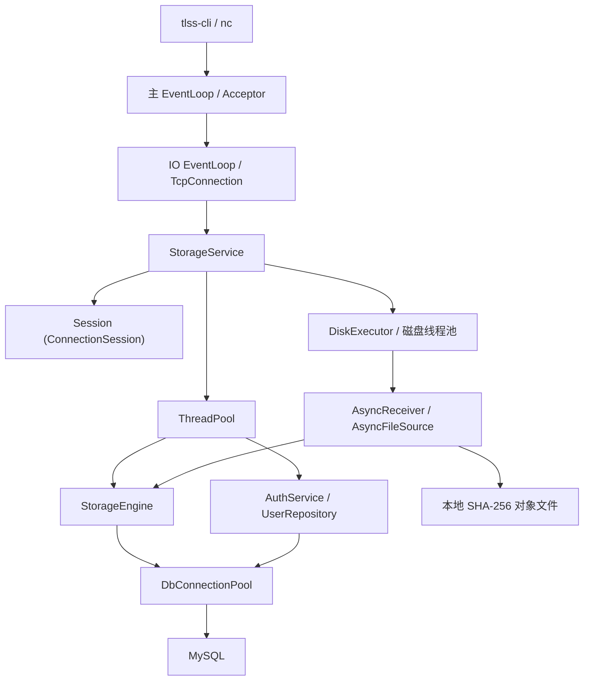

<p align="right">潮水成诗，破碎生长</p>


# TLSS — Toy-Level File Storage Service

**简体中文** | [English](README.md)

**一个基于 C++17/Linux、从底层逐步构建的玩具级文件存储服务**

TLSS（Toy-Level File Storage Service）是我用于探索 Linux 系统编程、网络通信、并发模型与存储系统设计的长期个人开源项目。

项目基于自研的 epoll Reactor 网络框架构建，并逐步实现了线程池、MySQL 连接池、用户认证、虚拟文件系统、基于 SHA-256 的内容寻址存储，以及异步文件上传与下载。

与直接组合成熟框架的方式不同，TLSS 尝试从基础组件出发，理解一个存储服务如何建立、运行、处理错误，并在持续迭代中改善其可靠性。

目前，TLSS 已具备基本的单机文件存储能力，实现了异步磁盘读写与初步流量背压机制。项目正在持续完善资源生命周期管理、测试验证、崩溃恢复与文件生命周期管理。

**已实现功能：** epoll Reactor、异步 TCP 客户端 (`tlss-cli`)、有界线程池、MySQL 连接池、基于 PBKDF2 的密码哈希、用户注册/登录、虚拟目录操作（`mkdir`、`cd`、`ls`、`pwd`）、文件上传/下载、SHA-256 内容寻址对象存储、异步磁盘读写以及优雅停机（graceful shutdown）。

**独立子系统：** 监控与可靠告警机制、基于 AVX2/REP MOVSB 指令优化的内存拷贝功能。

**后续方向：** 对象与元数据一致性恢复、对象回收、主服务监控接入、gRPC 接口以及分布式存储。

### 快速入门

完成下方的依赖安装、数据库初始化和项目构建后，分别在两个终端启动服务端与客户端：

```bash
./bin/storage-service
./bin/tlss-cli 127.0.0.1 9000
```

### 项目定位

TLSS 目前是一个持续开发中的单节点存储系统原型，面向技术学习、架构探索与开源交流。

现阶段尚不适合作为生产级存储服务，也不建议用于保存重要数据。项目会持续完善可靠性、可测试性与文件生命周期管理。

请参阅下方的构建说明、架构设计及实现笔记。

## 导航

- [功能与实现状态](#功能与实现状态)
- [当前交互](#当前交互)
- [架构与执行模型](#架构与执行模型)
- [模块实现](#模块实现)
- [文件传输与异步磁盘任务](#文件传输与异步磁盘任务)
- [网络服务生命周期与线程约束](#网络服务生命周期与线程约束)
- [代码结构](#代码结构)
- [构建与运行](#构建与运行)
- [测试与开发入口](#测试与开发入口)
- [当前限制与待收尾事项](#当前限制与待收尾事项)
- [演进路线与接入时机](#演进路线与接入时机)
- [为什么叫Toy-Level?](#关于TLSS)

## 功能与实现状态

- **epoll Reactor networking** — 自行实现事件循环、连接管理与读写缓冲。
- **one-loop-per-thread** — 每个 IO 线程运行独立的 EventLoop，连接按轮询分配。
- **bounded worker pool** — 有界任务队列、非阻塞提交与异步排队超时。
- **MySQL connection pool** — 连接复用、预处理语句与 RAII 事务。
- **virtual filesystem namespace** — 用户根目录与 `mkdir / cd / ls / pwd` 命令。
- **content-addressed object storage** — 以 SHA-256 标识本地对象，通过 `object_hash` 关联用户虚拟文件；同内容对象复用。
- **asynchronous file transfer** — 上传/下载使用独立磁盘线程池、分块读写、临时文件、持久化和传输确认。
- **graceful shutdown** — 响应 `SIGINT / SIGTERM`，排空任务并回收连接与线程。
- **monitoring subsystem** — 独立的指标存储、策略、CLI、UDP 指标与可靠 TCP 告警。
- **interactive client** — `tlss-cli`，支持异步连接、终端输入和有序退出。
- **memory copy library** — AVX2、REP MOVSB、非临时写入（NT）与运行时并行拷贝选择。

| 部分 | 当前能力 | 主服务集成状态 |
| --- | --- | --- |
| 网络库 | epoll Reactor、连接缓冲、IO 线程池、异步 TCP 客户端 | 已使用 |
| 业务线程池 | 有界执行队列、非阻塞提交、异步排队超时 | 已使用 |
| MySQL | 连接池、预处理语句、RAII 事务 | 已使用 |
| 认证 | 注册、密码校验、用户与根目录事务创建 | 已使用 |
| 虚拟目录 | `mkdir / cd / ls / pwd` | 已使用 |
| 客户端 | `tlss-cli <IPv4> <port>`，支持交互命令和文件上传/下载 | 独立可执行程序 |
| 监控 | 指标、策略、CLI、UDP、可靠 TCP 告警 | 库已链接，通过独立 demo 运行；主入口未启动 |
| 内存拷贝 | `TLSS::MEMORY::memcpy` 动态库 | 已被网络 `Buffer::append()` 调用，使用 Default 提示 |
| 文件内容 | SHA-256 对象、上传/下载、临时文件发布、异步磁盘读写 | 已接入；尚无对象回收和崩溃一致性修复 |
| RPC、网关 | 构建目标和代码骨架 | 无业务服务实现，四份 `.proto` 为空 |
| Kafka | 事件与消费者方案 | 规划中，尚无生产者、消费者或部署配置 |

## 当前交互

先按[构建与运行](#构建与运行)准备数据库并启动服务，再在另一个交互终端中执行 `./bin/tlss-cli 127.0.0.1 9000`。下面展示已注册用户的目录操作，省略连接提示；`documents` 假定尚不存在，`<password>` 代表实际密码。

```text
$ ./bin/tlss-cli 127.0.0.1 9000
Welcome to TLSS.
Please enter login or signup:
tlss>login
Username:alice
Password:<password>
Login successful.
tlss@alice:/>mkdir documents
tlss@alice:/>cd documents
tlss@alice:/documents>pwd
/documents
tlss@alice:/documents>cd ..
tlss@alice:/>quit
```

首次使用时选择 `signup`，依次输入用户名、密码和确认密码；注册成功后重新选择 `login`。客户端当前没有密码输入隐藏功能，服务连接也尚未接入 TLS。

登录后可在 `tlss-cli` 中传输文件，以下参数为客户端交互命令，不是 shell 命令：

```text
upload <本地文件路径> [远端文件名]
download <远端文件名> [本地目标路径]
```

例如，从仓库根目录启动客户端，进入远端 `documents` 目录后，依次输入以下命令，并等待每次操作完成：

```text
upload "./README.md" "readme-copy.md"
download "readme-copy.md" "./readme-downloaded.md"
```

上传省略远端名称时使用本地文件名；下载省略目标路径时写入客户端当前工作目录。含空格的参数使用双引号。远端文件名限定为当前虚拟目录中的单个名称；上传不覆盖同名节点，下载不覆盖已有本地文件，且本地父目录必须存在。每个连接一次只允许一个传输；传输期间输入 `exit / q / quit` 会取消传输并断开连接。

## 架构与执行模型



图中为当前实现。`StorageEngine` 通过 `DbConnectionPool` 直接读写 MySQL 中的目录和文件元数据；`AsyncReceiver / AsyncFileSource` 在 `DiskExecutor` 中处理本地文件。`MetadataStore / ObjectStore` 仍是后续可提取的抽象，当前没有对应实现类。

网络层负责连接与消息回调，`StorageService` 解析命令并维护会话。每个连接的 `ConnectionSession` 保存认证状态、用户身份、当前目录和传输状态，由所属 IO 线程读写。认证、目录操作和上传前置检查派发到业务线程池；文件读写、下载查询及上传最终登记由磁盘任务执行。认证结果、目录切换结果和传输结果通过 `queue_in_loop` 返回连接所属的 EventLoop。

服务端默认配置为 4 个 IO 线程、8 个业务线程、256 个业务执行队列槽位和 128 个异步等待队列槽位；独立磁盘线程池默认使用 2 个线程。目录操作通过 `try_run` 提交，队列已满时返回忙碌提示；登录与注册通过 `submit_async` 提交，排队等待期限为 2 秒。

主线程之外还存在信号控制线程、业务池的超时管理线程，以及数据库连接生产与空闲扫描线程。2 秒只限制认证任务等待进入执行队列的时间，不中断已开始执行的 SQL 或密码计算。

停机时先停止接受连接并暂停读取，再排空业务任务、取消并等待磁盘任务收尾，半关闭现有连接；连接等待超时后强制清理。随后回收 IO 线程和数据库连接池，退出主事件循环，最后关闭日志系统。

## 模块实现

### 网络库与命令协议

实现位于 [common/net](src/common/net/)，头文件位于 [inc/common/net](inc/common/net/)。

| 类型 | 职责 |
| --- | --- |
| `EventLoop` | 等待 IO 事件、分发 Channel、执行待处理回调 |
| `Poller / EPollPoller` | epoll 事件等待与注册管理 |
| `Channel` | fd 关注事件、回调及生命周期关联 |
| `Acceptor / TcpServer` | 接受连接、维护连接表、轮询分配 IO loop |
| `TcpConnection` | 连接状态、输入输出缓冲、背压、半关闭和强制关闭 |
| `EventLoopThreadPool` | one-loop-per-thread 的 IO 线程管理 |
| `Connector / TcpClient` | 非阻塞建连、失败重试与客户端连接管理 |

跨线程调用通过 `queue_in_loop()` 入队，并用 `eventfd` 唤醒目标 loop；`run_in_loop()` 在所属线程直接执行，否则排队。跨线程发送持有消息内容和连接引用，避免回调执行前数据失效；`Channel::tie()` 与延迟清理用于协调事件分发和对象销毁。

`Buffer::read_fd()` 使用 `readv`，组合内部可写区和 64 KiB 栈缓冲。服务为连接设置 256 KiB 输出高水位，达到水位后暂停读取，写缓冲排空后恢复；连接待发送内存（含异步文件块预留）另有 1 MiB 上限，而不是将整个文件装入该缓冲。这些措施不能替代所有上游任务队列的容量控制。

[StorageService::on_message()](src/ftp/server.cpp) 在控制阶段按 `\n` 拆行，兼容 `\r\n`，保留未收齐的命令并循环处理完整命令；单条控制命令最多 4096 字节，超过限制关闭连接。上传正文按声明长度消费，不按换行拆分。`ftp/` 实现的是自定义 TCP 存储协议，不兼容标准 FTP。

### 会话、注册与登录

[ConnectionSession](inc/ftp/context.h) 保存登录状态、交互中的用户名和密码、认证尝试编号、已认证身份、当前目录、目录切换标志、传输阶段及传输代次。会话内容只由所属 IO 线程读写；会话索引表另由互斥锁保护。

```text
登录：
login → 用户名 → 密码 → verifying
      → 业务线程查询有效用户并校验密码
      → IO loop 检查连接、原会话、auth_attempt
      → 写入身份，当前目录设为 /

注册：
signup → 用户名 → 密码 → 确认密码 → registering
       → 业务线程先计算密码哈希
       → 同一数据库事务插入用户和根目录
       → 返回结果，要求重新登录
```

[AuthService](src/auth/auth_service.cpp) 负责输入校验、用户名规范化和结果映射，[MySqlUserRepository](src/auth/user_repository.cpp) 负责用户数据访问。注册用户名为 3–64 个 ASCII 字母、数字或下划线，存储前转换为小写；密码为 8–128 字节，不裁剪空格，拒绝控制字符。

[PasswordHasher](src/auth/password_hasher.cpp) 使用 16 字节随机盐、600000 次 PBKDF2-HMAC-SHA256 迭代、32 字节派生结果，以及带版本和迭代次数的编码格式；校验通过 `CRYPTO_memcmp` 比较。哈希计算先于注册事务借用数据库连接，减少连接占用时间。

并发注册由数据库用户名唯一索引裁决。提交确认丢失时返回“结果未知”，提示先尝试登录；不自动重试注册。认证完成回调使用弱引用、会话匹配和 `auth_attempt` 检查，避免过期结果覆盖当前状态。

### 虚拟目录与存储边界

[建表脚本](sql/init_tlss_db.sql) 定义 `users` 和 `virtual_files`。后者通过 `username` 区分用户，使用 `parent_id` 表示父子关系，并保存 `path`、`file_type`、`object_hash` 和时间戳。根目录为 `parent_id = -1`、`file_name = '/'`、`path = '/'`；唯一索引限制同一用户、同一父目录下的重名节点。

| 命令 | 当前执行方式 |
| --- | --- |
| `pwd` | 直接读取会话中的当前目录 |
| `ls` | 查询当前目录 ID，再列出子节点的名称、类型和创建/更新时间 |
| `cd <子目录>` | 父子节点 JOIN，限定用户、父路径和目录类型 |
| `cd ..` | 查询父目录；根目录保持 `/` |
| `mkdir <名称>` | 查询父节点、拼接路径并插入目录记录 |
| `upload / download` | 上传前检查目录和重名节点，发布对象后插入文件记录；下载按用户、当前目录和文件名查询对象哈希 |

[StorageEngine](src/ftp/service_engine.cpp) 当前直接执行预处理 SQL。`cd` 支持直接子目录与父目录，尚未实现通用绝对/相对路径解析。目录切换期间 `directory_change_pending` 阻止后续目录命令继续执行；其他异步命令没有完整的逐连接串行执行队列，不能假定所有响应严格按输入顺序返回。

目录记录的 `object_hash` 为 SQL `NULL`，文件记录保存 SHA-256 哈希。对象文件独立于用户目录树，相同内容可被多条虚拟文件记录引用。后续可将元数据访问抽取为 `MetadataStore`，将内容落盘封装为 `ObjectStore`。

### 文件传输与异步磁盘任务

[传输工具](inc/ftp/file_transfer.h) 提供文件句柄、临时文件和 SHA-256；[AsyncReceiver](src/ftp/async_file_receiver.cpp) 负责异步接收与发布，[AsyncFileSource](src/ftp/async_file_source.cpp) 负责异步打开和读取。服务端与客户端各自持有独立的 `DiskExecutor`，默认 2 个线程，每个执行器最多挂接 64 个活动文件源/接收器。

```text
上传：
客户端 → @TLSS UPLOAD <size> "<name>"
服务端 → 检查目录和同名节点 → 初始化临时文件 → UREADY
客户端 → 精确 size 字节正文
服务端 → 写入并计算 SHA-256 → 同步并发布对象 → 登记元数据 → UOK <hash>

下载：
客户端 → @TLSS DOWNLOAD "<name>"
服务端 → 查询对象、打开文件 → DATA <size> <hash> → 正文 → DONE
客户端 → 写入临时文件 → 校验 SHA-256 → 同步并发布本地文件 → @TLSS ACK
服务端 → OK
```

服务端控制响应带 `\n@TLSS ` 前缀，客户端自动解析并显示传输结果。上传完成以 `UOK` 为准；下载只有在本地文件完整写入、哈希校验、同步和发布后才发送 `ACK`，收到 `OK` 后显示完成。底层发送回调只表示字节交给 socket，不等于对端持久化确认。

接收端每次最多交出 64 KiB 数据，等待磁盘结果期间使用独立 token 暂停读取，完成后在所属 IO loop 恢复。发送端使用 `send_file_async()`，按最多 64 KiB 异步 `pread`，与控制文本共用 FIFO 发送队列；等待磁盘时关闭 `EPOLLOUT`，避免空转。文件打开、读写、校验、同步和关闭在磁盘线程执行，结果通过 `queue_in_loop()` 返回。底层仍保留直接 `sendfile` 接口，但当前业务文件传输使用异步分块路径。

上传先写 `.tlss-part-*` 临时文件，再同步文件，通过同文件系统硬链接发布为哈希对象，移除临时路径并同步目录。已有对象只有在大小及哈希一致时才复用。发布后再登记 MySQL 元数据，最后返回 `UOK`；数据库登记失败时保留对象，避免删除其他文件可能共享的内容。因此本地文件系统与 MySQL 还不是一个原子事务，孤儿对象回收和进程崩溃后的修复仍待实现。

断连会取消文件任务并让磁盘线程收尾；弱引用、传输代次和异步读取序号用于过滤过期结果。中途正文读写失败可能直接关闭连接，不能假定收到错误后总能继续同一会话。

### 业务线程池与数据库资源

[ThreadPool](inc/common/base/tlss_thread_pool.h) 提供三种任务提交方式：

| 接口 | 队列满时 | 当前使用 |
| --- | --- | --- |
| `run()` | 外部调用者等待空位；池内嵌套提交满队列时拒绝以避免死锁 | 通用阻塞提交 |
| `try_run()` | 立即失败 | 目录操作、上传准备及磁盘任务执行器 |
| `submit_async()` | 进入有界等待队列，等待入执行队列或触发超时回调 | 登录、注册 |

停止时拒绝新任务、取消等待队列、排空执行队列并 join 工作线程。线程池只能启动一次；零工作线程模式由调用者执行 `run / try_run` 任务，`submit_async` 不支持此模式。业务工作线程未捕获的任务异常会导致进程终止，目前没有逐任务异常隔离。

[DbConnectionPool](src/common/base/mysql_connection_pool.cpp) 包含初始连接、容量上限、后台生产、空闲扫描、借用等待期限、借出前 `ping` 和停机协调。RAII 句柄归还连接；失效或事务未结束的连接不会重新进入空闲队列。借用期限约束条件变量等待，不能中断后续 MySQL 网络调用。

[DbConnection / DbTransaction](inc/common/base/mysql_connection.h) 封装参数绑定、查询结果、事务提交与析构回滚。提交失败区分为结果未知，并使连接失效；注册通过同一事务创建用户和根目录。

### 交互客户端与日志

[client_main.cpp](src/client_main.cpp) 构建 `tlss-cli`，[Client](src/ftp/client.cpp) 将终端输入、`signalfd` 和退出超时的 `timerfd` 注册到 EventLoop。客户端显示交互响应并解析传输控制帧，支持本地文件上传和下载；输入 `exit / q / quit`、终端 EOF 或退出信号时发起关闭，连接关闭等待期限为 2 秒。

底层 [Connector](inc/common/net/connector.h) 的重试间隔从 500 毫秒指数增加到最多 30 秒。CLI 初始建连可以重试；已建立会话后断线则退出，避免自动建立缺少原认证上下文的新会话。

[Logger](src/logger/logger.cpp) 封装 spdlog 的控制台、文件、滚动文件和双 sink 输出。主程序初始化 `net`、`storage_service`、`mysql` 日志，在服务对象和后台线程清理后关闭日志系统。

### 独立监控与可靠告警

监控使用 `TLSSMON` 命名空间。其 [Engine](src/monitor/engine.cpp) 基于 **select + 唤醒管道**，独立于业务网络层的 epoll EventLoop；生命周期为 `CREATED → INITIALIZING → READY → RUNNING → STOPPING → STOPPED`，停止后不能重新运行。

| 组件 | 当前实现 |
| --- | --- |
| `AioManager / TimerManager` | fd 就绪回调、延迟移除、按期限排序的单次/周期定时器 |
| `CallbackRegistry` | 回调注册、异步 worker、调用次数及耗时统计 |
| `MonitorModuleRegistry` | 模块与错误元数据，运行前完成注册 |
| `MonitorStore` | 按完整主键保存当前记录，互斥保护，查询返回副本 |
| `MonitorReporter` | 补齐元数据、按值变化发布、选择普通指标或可靠告警通道 |
| `MonitorPolicy` | 连续超阈值、滚动窗口事件次数、滑动平均与异常样本过滤 |
| `CliServer / CliRegistry` | 命令注册、会话上下文、模块选择与数据查询 |
| `MonitorWire / UDP` | V1/V2 自定义二进制协议、指标发送和接收 |
| `ReliableAlarmPublisher / Collector / AlarmSpool` | 本地持久化、TCP 发送、ACK、重试、去重和恢复 |

指标主键为 `(mid, level, fid, eid)`，值为数值或字符串。Store 保存每个 key 的当前记录和变化时间，不是历史时序数据库。普通首次零值可被忽略，值不变时通常不发布；`report_count()` 提交调用方提供的值，不自动累加。V2 包含描述和生产端变化时间，V1 接收时使用 Collector 时间。

```text
普通指标：
采样 → 策略 → Reporter → Store 更新 → UDP 发布
     → Collector 解码 → 接收端 Engine / Store

可靠告警：
report_error → outbox 持久化 → 本地 Store 提交
             → 后台 TCP 发送 / 重试
             → Collector 校验 → inbox 持久化 → 接收端 Store 更新
             → ACK → 发送端删除已确认文件
```

可靠通道持久化失败时不提交本地 Store 新值，允许后续相同值重试。普通发布回调在 Store 解锁后执行；可靠告警的提交前持久化在 Store 锁内执行，只允许有界的本地持久化操作，不能网络等待或重入 Store。

告警实现包含 CRC 校验、流式解码、消息身份去重、短写处理、退避重试、损坏文件隔离、重启恢复，以及文件和目录同步。这是持久化重试与接收端去重机制，不代表任意外部业务副作用均具备端到端 exactly-once 保证。

CLI 支持 `help`、`modules`、`use`、`db_dump`、`alarm_status`；这里的 `db_dump` 查询监控 Store。`demo-m9-node` 与 `demo-m9-collector` 展示采样到查询的双进程链路，目前主服务没有自动启动或上报这些指标。

### 内存拷贝库

[公共 API](inc/common/memory/tlss_memcpy.h) 提供 `TLSS::MEMORY::memcpy`，支持 `Auto / Avx2 / RepMovsb / NonTemporal` 后端及 `Default / Streaming` 提示。共享库输出到 `lib/libtlss_memory.so`。

自动选择流程为：CPU 能力检测 → 按大小与 Hint 生成 CopyPlan → 能力适配 → 执行或回退。[当前策略](src/common/memory/internal/copy_policy.cpp) 如下：

| Hint | 大小 `n` | 初始策略 |
| --- | --- | --- |
| Default | `n ≤ 2 KiB` | AVX2 cached |
| Default | `n > 2 KiB` | REP MOVSB |
| Streaming | `n ≤ 2 KiB` | AVX2 cached |
| Streaming | `2 KiB < n < 3 KiB` | libc memcpy |
| Streaming | `3 KiB ≤ n < 8 KiB` | AVX2 cached |
| Streaming | `8 KiB ≤ n < 64 KiB` | 单线程 NT |
| Streaming | `64 KiB ≤ n < 128 KiB` | 请求 4 worker 并行 NT |
| Streaming | `n ≥ 128 KiB` | 请求 8 worker 并行 NT |

实际后端受 CPU 能力、可用拓扑与 worker 数影响。实现包含 CPU 亲和性、持久 worker 池、预计算 worker 选择、懒初始化、并行池忙碌时回退，以及不支持 AVX2 时的自动路径回退。强制指定不支持的后端会报错；该接口沿用 memcpy 的非重叠内存前提。

网络 `Buffer::append()` 已调用 `TLSS::MEMORY::memcpy`，使用 `Auto / Default`，默认不会启用 Streaming 并行 NT 策略。该库的独立基准结果仍不能直接视为主服务吞吐收益。实现与测量说明见 [V1 设计与验证报告](doc/TLSS_Memory_Copy_Subsystem_V1_Design_Validation_Report_Final.md) 和 [内存拷贝导读](doc/tlss_memcpy_tutorial.md)。

## 网络服务生命周期与线程约束

本节描述当前 `TcpServer` / `StorageService` 的使用契约。安全运行需要同时满足**调用顺序、线程归属和对象生命周期**；接口使用了原子变量或把任务放入队列，并不代表允许任意并发调用。以下流程适用于已成功启动的服务，直接使用 `TcpServer` 时也须由上层执行对应的停机步骤。

### 完整启动与运行路径

当前入口见 [main.cpp](src/main.cpp)，服务编排见 [StorageService](src/ftp/server.cpp)。

1. **主线程**在创建工作线程前，通过 `pthread_sigmask` 阻塞 `SIGINT` / `SIGTERM`，然后初始化日志。退出信号由后续控制线程通过 `sigwait` 同步接收。
2. **主线程**先构造 `EventLoop`，再构造引用它的 `StorageService`。服务构造期间创建 `TcpServer`、获取数据库连接池，并设置连接/消息回调、IO 线程数及业务队列容量。
3. **主线程**调用 `StorageService::start()`：先启动业务线程池和磁盘执行器，再调用 `TcpServer::start()` 启动 IO 线程池并开放监听。配置必须先于启动完成；启动不能与停机或析构并发。
4. 启动完成后创建**独立控制线程**，让它等待退出信号；主线程进入 `EventLoop::loop()`。控制线程可以提交停机请求并等待，但主 loop 必须继续运行以处理这些请求。
5. 正常运行时，**主 loop**接受连接、分配 IO loop、维护 `_connections`；连接所属的 **IO loop**处理读写、连接状态和业务回调；**业务线程池**执行认证和目录等操作，**磁盘线程池**执行文件操作及相关元数据回调；结果通过事件循环任务返回 IO loop。

IO 线程数为 `0` 时，连接也由主 loop 管理，没有独立的 IO 工作线程。业务回调不能假定自己一定在单独的 IO 线程中。

### 完整停机与析构路径

当前主程序的调用链是：

```text
控制线程 sigwait() 收到 SIGINT / SIGTERM
  → StorageService::stop(grace_period)
  → 标记业务停机，串行化停机请求
  → TcpServer::stop_accepting(done)
  → 等待 done：监听关闭、已有连接暂停读取
  → 业务线程池 stop()，等待已进入执行队列的任务结束
  → DiskExecutor::stop()，取消传输并等待磁盘任务和文件资源收尾
  → TcpServer::shutdown_connections(done)
  → 等待连接关闭；超过宽限期则 force_close_connections()
  → 继续等待同一个 done：连接表清空、相关 IO 清理已越过屏障
  → TcpServer::stop_io_threads()，退出并 join IO 线程
  → 数据库连接池 shutdown()
  → 主 EventLoop::quit()
  → 发布 StorageService 停机结果，控制线程结束

主线程 EventLoop::loop() 返回
  → join 控制线程
  → 析构 StorageService / TcpServer
  → 析构主 EventLoop
  → Logger::shutdown()
```

每一步都必须满足完成条件，才能进入下一阶段：

| 阶段 | 执行线程与实际操作 | 进入下一阶段的条件 |
| --- | --- | --- |
| 标记停机 | 控制线程设置 `StorageService::_stopping`；停止接受新的业务提交 | 上层不再产生新的业务任务；启动已经完成 |
| 停止接收 | 控制线程调用 `stop_accepting()`；主 loop 释放 Acceptor，各 IO loop 执行 `pause_read_for_shutdown()` | `done` 在主 loop 被调用，控制线程通过 future 等机制收到通知 |
| 结束业务任务 | 控制线程调用业务线程池 `stop()`；拒绝新提交、取消异步等待队列中尚未进入执行队列的任务，执行完已入队任务并 join 工作线程 | 业务线程池 `stop()` 返回；此时 IO loop 和数据库仍可用 |
| 结束磁盘任务 | 控制线程调用 `DiskExecutor::stop()`，取消活动文件源/接收器，等待文件资源释放并回收磁盘线程 | 磁盘执行器已停止；整个阶段 IO loop 和数据库仍须存活 |
| 排空连接 | 控制线程调用 `shutdown_connections()`；各 IO loop 排空发送缓冲后半关闭写端，并继续读取以等待对端 FIN | 等待连接清理完成；若超过 `grace_period`，提交强制关闭请求 |
| 强制关闭（按需） | 控制线程调用 `force_close_connections()`，各 IO loop 执行关闭 | 仍须等待此前 `shutdown_connections()` 的 `done`，不能因强制关闭接口返回就继续回收线程 |
| 确认 IO 清理 | 主 loop 从连接表移除连接，IO loop 执行 `connect_destroyed()`，随后通过 `when_io_idle()` 屏障通知主 loop | 连接表已空，相关清理任务越过屏障；`done` 已通知控制线程 |
| 回收资源 | 独立控制线程调用 `stop_io_threads()`，再关闭数据库池，最后 `quit()` 主 loop | IO 线程已 join；控制线程完成停机并发布结果 |
| 析构 | 主线程退出 `loop()`，join 控制线程，依次销毁服务与主 loop，最后关闭日志 | 没有仍会访问服务对象或已销毁 loop 的任务、回调及外部调用 |

`StorageService::stop()` 默认的连接宽限期为 5 秒，可传入非负时长。它只限制等待连接自然关闭的阶段，不是整个停机过程的超时：业务及磁盘任务结束、强制关闭后的清理和其他阶段仍可能等待。返回值表示数据库连接池是否按其关闭策略成功结束，不应解释为整个停机过程一定在 `grace_period` 内完成。

### 直接使用 TcpServer 时如何等待完成

使用 `StorageService` 时，应由独立控制线程调用其 `stop()`，不要同时绕过它操作内部 `TcpServer`。若直接组合 `TcpServer`、业务线程池和数据库连接池，下面展示控制线程中的停机顺序；各对象已完成启动，主 loop 仍在运行，调用方在整个流程中保持它们存活。

```cpp
// 此代码运行在独立控制线程中；不能放进主 loop、IO 回调或业务线程池任务。
// 先由上层关闭业务入口，停止产生新任务。
auto paused = std::make_shared<std::promise<void>>();
auto paused_future = paused->get_future();
tcp_server.stop_accepting([paused] { paused->set_value(); });
paused_future.wait();

worker_pool.stop();  // IO loop 和数据库此时仍须存活，供已有任务完成。

auto drained = std::make_shared<std::promise<void>>();
auto drained_future = drained->get_future();
tcp_server.shutdown_connections([drained] { drained->set_value(); });
if (drained_future.wait_for(std::chrono::seconds(5)) == std::future_status::timeout) {
    tcp_server.force_close_connections();
}
drained_future.wait();  // 强制关闭也只是提交请求，完成通知仍来自同一个 done。

tcp_server.stop_io_threads();
const bool db_stopped = db_pool.shutdown();  // 按实际持有方式调用，并记录停机结果。
(void)db_stopped;
base_loop.quit();
// 主线程在 loop() 返回后 join 此控制线程，再析构服务和 base_loop。
```

若上层还持有磁盘执行器，应在 `worker_pool.stop()` 之后、`shutdown_connections()` 之前取消并等待其收尾，与 `StorageService::stop()` 一致。示例中的 `worker_pool`、`db_pool` 和 `base_loop` 代表调用方持有的对应对象，需包含 `<future>`、`<memory>` 和 `<chrono>`。不要用 `sleep()` 猜测异步操作是否完成，也不要在控制线程等待之前先停止 EventLoop，否则完成回调无法执行。

### 必须遵守的线程与生命周期约束

| 对象或操作 | 当前实现要求 | 违反约束的风险 |
| --- | --- | --- |
| `TcpServer` 构造、配置、启动 | 按当前入口在主 loop 所属线程执行；所有 setter 在启动前配置完毕，启动后不再并发修改 | 回调 `std::function`、线程数或线程池容器发生并发读写 |
| `start()` 与停机 | 启动完成后才允许发起停机；停机开始后不能再次启动 | `_stopping` 的检查与资源访问不是整体原子操作，Acceptor 可能已被释放 |
| `_connections`、连接编号 | 由主 loop 维护；析构前先完成停机，避免其他线程与主 loop 同时访问连接表 | 容器数据竞争、迭代器失效 |
| TcpConnection / Channel | 对读写状态、缓冲和 Channel 的直接操作归所属 IO loop；跨线程使用提供了调度的接口 | 与事件分发、Channel 注销产生竞态；`shared_ptr` 只保活，不自动同步成员访问 |
| 停机回调 `done` | 在主 loop 执行；只做通知或轻量操作，不阻塞等待同一 loop 的任务 | 主 loop 无法推进，停机等待无法结束 |
| `StorageService::stop()`、`stop_io_threads()` | 由主 loop、IO 线程池、业务线程池和磁盘线程池之外的独立控制线程执行 | 阻塞等待自身处理屏障，或 join 当前线程；当前代码的线程检查未覆盖所有误用 |
| 文件异步任务 | 保持磁盘执行器、所属 IO loop 和数据库存活到取消及工作线程收尾完成；会话与接收器接口由 IO loop 操作 | 磁盘任务或结果回调访问已销毁资源 |
| 捕获裸 `this` 的任务 | TcpServer、StorageService 以及用户回调引用的对象必须活到相关任务和回调执行完 | 关闭回调、屏障或其他排队任务访问已析构对象 |
| loop 生命周期 | IO loop 清理完成后才能 join IO 线程；主 loop 活到停机通知完成及服务析构之后 | 停机任务无法执行，或连接/任务通过裸 loop 指针访问已销毁对象 |
| 外部持有的连接和任务 | 停机前协调所有外部生产者；IO 线程回收后不能再通过旧连接提交任务或使用其 loop | 持有 `TcpConnectionPtr` 并不会延长它所引用的 EventLoop 生命周期 |
| 多个停机调用者 | 使用 `StorageService::stop()` 的互斥与完成通知统一协调；直接使用 TcpServer 时由上层保证只有一个停机流程 | 重复 `shutdown_connections()` 可能覆盖完成回调；线程池回收可能与其他操作交错 |

`when_io_idle()` 在各 IO loop 中排入屏障，再回主 loop 汇总结果。它保证相关先前任务已执行到屏障位置，**不保证其他线程今后不会继续提交任务，也不自动递归等待这些任务派生的所有后续任务**。因此必须先停止任务生产，再依次等待业务结束和连接清理；不能把这个函数当成任意时刻都能安全销毁服务器的证明。

`TcpServer::~TcpServer()` 不会自动完成上述完整停机流程，也不会自动延长裸 `this` 回调引用的对象生命周期。已启动的 `StorageService` 必须显式完成 `stop()` 后再析构，否则其析构函数会终止进程。不要在业务回调里直接删除仍在运行的服务器，也不要把“已调用停止接口”等同于“已完成停止”。

实现入口：[TcpServer](src/common/net/tcp_server.cpp)、[EventLoop](src/common/net/event_loop.cpp)、[EventLoopThread](src/common/net/event_loop_thread.cpp)、[业务线程池](src/common/base/tlss_thread_pool.cpp)。现有[停机回归测试](tests/test_tcp_server_shutdown.cpp)覆盖等待对端 FIN、零 IO 工作线程下的强制关闭等路径；它不代表已经验证任意启动/停机/析构交错都安全。

## 代码结构

```text
cpp_TLFSS/
├── CMakeLists.txt / CMakePresets.json
├── inc/                          公共头文件，与 src 按模块对应
├── src/
│   ├── main.cpp                  storage-service 入口
│   ├── client_main.cpp           tlss-cli 入口
│   ├── common/
│   │   ├── base/                 线程、业务线程池、数据库封装
│   │   ├── net/                  Reactor、TCP 服务端与客户端
│   │   ├── memory/               内存拷贝运行时与汇编
│   │   └── benchmark/            内存拷贝实验与基准
│   ├── auth/                     认证服务、用户仓储、密码哈希
│   ├── ftp/                      会话、目录与文件传输、磁盘执行器、客户端
│   ├── logger/                   spdlog 封装
│   ├── monitor/                  独立监控系统，含 demo/ 与 test/
│   ├── rpc/                      RPC 占位
│   └── gateway/                  网关占位
├── tests/                        网络、线程池、传输、认证及数据库等测试
├── proto/                        空的协议占位
├── config/ / sql/                配置与数据库脚本
├── scripts/ / doc/               构建脚本与技术资料
├── docs/superpowers/             本地设计与实施计划（当前被 Git 忽略）
├── third/ / third_party/         第三方依赖
└── build/、bin/、lib/             默认构建产物
```

| 路径 | 用途 |
| --- | --- |
| `inc/`、`src/` | 按 `common`、`auth`、`ftp`、`gateway`、`logger`、`monitor`、`rpc` 分组的头文件与实现 |
| `proto/` | 存储、认证、监控、网关的协议占位文件；CMake 配置了向 `build/generated/` 生成代码的步骤 |
| `tests/`、`src/monitor/test/` | 主服务/基础模块测试，以及监控子系统测试 |
| `config/`、`sql/` | MySQL 连接配置和建表脚本；`config/config.yaml.example` 目前为空，主程序不读取 YAML |
| `scripts/build.sh` | 配置、编译、测试的封装脚本 |
| `third/`、`third_party/` | 仓库内依赖与上游子模块；不要提交其构建产物 |
| `doc/` | 网络和内存拷贝子系统的补充资料 |

顶层 CMake 组织 `common_lib`、`auth_lib`、`ftp_lib`、`logger_lib`、`monitor_lib`、`rpc_lib`、`gateway_lib`、`proto_lib` 和 `tlss_memory`。主服务链接多个库，但实际启用的运行组件由 `main.cpp` 决定。额外的基础模块示例与验证代码位于 `src/common/base/example/`，并非全部由顶层 CTest 自动运行。

## 构建与运行

### 环境要求

- Linux x86-64；C++17 编译器、CMake 3.21+、Make、NASM、pkg-config。当前构建包含 x86 汇编，不是通用跨架构构建。
- OpenSSL、Protobuf（含 `protoc`）、gRPC（含 `grpc_cpp_plugin`）、yaml-cpp、pthread；GoogleTest 用于部分可选测试。
- CMake 构建使用 `third/mysql/inc` 和 `third/mysql/lib/libmysqlclient.so` 中的 MySQL 客户端文件。运行主服务还需要可连接的 MySQL 8.0 实例（建库脚本使用 MySQL 8.0 排序规则）。

项目的 gRPC/Protobuf 上游仓库以 Git 子模块记录；按需使用 `git submodule update --init --recursive` 获取源码。CMake 当前优先查找已安装的 Protobuf 和 gRPC，而不是自动编译子模块。

虽然 RPC 业务尚未实现，顶层 CMake 当前仍要求 gRPC、Protobuf 及其代码生成工具。Python 3 用于可选的目录 SQL 测试；仓库另有未接入 CTest 的客户端交互脚本。Kafka 尚未接入，不是当前构建或运行依赖。

### 配置数据库

主程序构造 `StorageService` 时会初始化 MySQL 连接池，并连接固定的 `tlss_db` 数据库。先在本地 MySQL 中执行建库脚本，再按本机环境调整配置：

```bash
mysql -u root -p < sql/init_tlss_db.sql
```

连接池从**可执行文件所在目录的上一级**读取 `config/mysql.cnf`。按默认输出布局，即 `bin/storage-service` 对应仓库根目录的 `config/mysql.cnf`。配置采用无空格的 `key=value` 格式，主要字段是 `ip`、`port`、`username`、`password`、`initSize`、`maxSize`；不要将真实凭据提交到仓库。启动时无法读取配置或建立初始数据库连接会导致进程退出。

### 编译、测试、启动

```bash
cmake --preset debug
cmake --build --preset debug
ctest --preset debug
./bin/storage-service
```

建议从仓库根目录启动，日志会写到相对路径 `logs/`。主程序当前不解析命令行参数，监听端口固定为 `9000`；不要传入尚未实现的 `--config` 参数。另开交互终端启动客户端：

```bash
./bin/tlss-cli 127.0.0.1 9000
```

也可以使用 `nc 127.0.0.1 9000` 手动检查登录和目录行协议；文件传输请使用 `tlss-cli`，由它处理控制帧、二进制正文、校验和确认。`tlss-cli` 面向交互终端，尚无批量命令接口。

服务端默认将对象写入相对路径 `./data/objects`。需要指定存储位置时，在启动服务的同一 shell 中设置环境变量：

```bash
TLSS_STORAGE_ROOT=/absolute/path/to/tlss-objects ./bin/storage-service
```

对象目录会按需创建，进程需要相应写权限。该变量只配置服务端对象根目录；客户端的下载路径由交互命令指定，示例见[当前交互](#当前交互)。

首次使用时输入 `signup`，按提示创建用户名和密码；用户名为 3–64 个字母、数字或下划线，密码为 8–128 字节且不含控制字符。注册同时创建用户根目录，成功后再输入 `login` 登录。

下面假设 `alice` 已注册，`documents` 尚不存在。`<password>` 代指注册时设置的密码，`nc` 不会自动隐藏输入；`ls` 查询空目录时只返回提示符。

```text
$ nc 127.0.0.1 9000
Welcome to TLSS.
Please enter login or signup:
tlss>login
Username:alice
Password:<password>
Login successful.
tlss@alice:/>mkdir documents
tlss@alice:/>cd documents
tlss@alice:/documents>pwd
/documents
tlss@alice:/documents>ls
tlss@alice:/documents>cd ..
tlss@alice:/>quit
bye!
```

服务收到 `SIGINT` 或 `SIGTERM` 后会尝试有序停机。`scripts/build.sh -t Debug` 也可完成配置、构建和测试；`-n` 不构建或运行测试，`-c` 会清理 `build/`、`bin/`、`lib/`，使用前请确认这些目录中的本地文件可以删除。优化构建使用 `cmake --preset release && cmake --build --preset release`。两个 preset 共用 `build/`，切换构建类型时需要重新配置。

监控演示程序输出到 `bin/dome/`，例如 `./bin/dome/demo-m9-policy` 可单独演示三种监控策略。`demo-m9-collector` 和 `demo-m9-node` 是独立示例，前者默认监听本机 UDP `9300`（指标）、TCP `9400`（告警）和 TCP `9310`（CLI）；后者需要指定模块、源 ID、outbox 目录和 CLI 端口。详情见 `src/monitor/demo/`。

分别在三个终端运行以下命令。示例数据目录位于 `/tmp`，可保留用于进程重启恢复实验；它不是长期持久化目录。不同发送节点应使用不同源 ID、outbox 和 CLI 端口。

```bash
# 终端 1：接收指标与告警。
./bin/dome/demo-m9-collector /tmp/tlss-m9/collector-inbox

# 终端 2：disk 模块的采样节点。
./bin/dome/demo-m9-node disk 1 /tmp/tlss-m9/disk-outbox 9320

# 终端 3：连接 Collector 的管理 CLI。
nc 127.0.0.1 9310
```

在管理 CLI 中输入 `modules`、`db_dump`、`alarm_status` 查看结果；通过各 demo 的 CLI `stop` 命令请求停止。

### 可选内存拷贝基准

基准目标默认关闭，可单独启用和构建：

```bash
cmake --preset release -DTLSS_BUILD_MEMCPY_GLIBC_BENCHMARK=ON
cmake --build --preset release --target memcpy_glibc_benchmark
./bin/memcpy_glibc_benchmark streaming
```

该程序还支持 `hot / runtime` 模式；仅 `runtime` 接受可选的调用者 CPU 编号，未指定时默认 CPU 8，运行前应确认该 CPU 在允许的亲和性集合内。结果依赖 CPU、亲和性、内存布局、构建选项与负载；比较时应记录环境和测试方法。启用开关保存在共用的 CMake 缓存中，不再需要时可显式设为 `OFF`。

## 测试与开发入口

`ctest --preset debug` 只运行 CMake 注册的测试，不会自动发现所有测试源码。[tests/CMakeLists.txt](tests/CMakeLists.txt) 当前注册内存拷贝链接、TCP 停机、线程池异步提交、20 个文件传输场景，以及找到 Python 3 时的目录 SQL 测试。找到 GoogleTest 时另注册 `test_ftp_server` 和 `test_monitor_timer`；其中 FTP 服务测试仍为占位断言。[监控 CMake](src/monitor/CMakeLists.txt) 单独注册 `src/monitor/test/` 中的测试，不依赖 GoogleTest。

| 范围 | 验证内容与边界 |
| --- | --- |
| 网络 | CTest 注册服务端停机测试；`test_tcp_client.cpp` 中另有取消/重连、旧回调及生命周期检查，尚未接入 CMake |
| 业务线程池 | 异步等待、超时、容量与停机 |
| 目录查询 | Python 从生产代码提取 SQL，在内存 SQLite 中检查父子目录和用户隔离；不是完整 MySQL/TCP 集成测试 |
| 文件传输 | 实际服务端/客户端处理器、分块收发、哈希与发布、错误帧、背压、冷文件等待、取消、旧回调和停机；使用数据库/认证替代实现，不是真实 MySQL 端到端测试 |
| 交互客户端 | `test_ftp_client.py` 使用伪终端与测试服务端交互，目前未注册到 CTest |
| 认证和数据库 | 认证服务、仓储、注册、事务和预处理语句测试源码当前未注册到 CMake；部分要求显式配置真实测试数据库 |
| 监控 | Engine、Store、策略、协议、CLI、并发、可靠告警和 demo smoke |
| 内存拷贝 | CTest 中的链接/基础正确性；更深入的验证与基准分散在 benchmark 和专项脚本中 |

可按需运行已构建的传输回归组：

```bash
ctest --preset debug -R '^ftp_transfer_'
```

可使用 `ctest --preset debug -N` 查看当前构建目录登记的测试；它不会执行测试，也不能证明测试通过。数量取决于配置、依赖和是否重新运行 CMake，不在文档中固定为某个通过数量。

未注册的 MySQL 集成测试源码使用 `TLSS_TEST_MYSQL_HOST`、`TLSS_TEST_MYSQL_USER`、`TLSS_TEST_MYSQL_PASSWORD`、`TLSS_TEST_MYSQL_DATABASE`，以及可选的 `TLSS_TEST_MYSQL_PORT`。注册端到端测试另需 `TLSS_TEST_FTP_SIGNUP=1`，并使用服务连接池配置。请使用专门的测试数据库；未配置环境时部分用例会跳过，跳过不等于验证成功。当前仍有旧测试接口失配，见[待收尾事项](#当前限制与待收尾事项)。

建议按以下顺序阅读源码：

1. `src/main.cpp` → `src/ftp/server.cpp` → `inc/ftp/context.h`：了解服务入口、命令派发、会话状态与停机流程。
2. `src/common/net/event_loop.cpp` → `src/common/net/tcp_server.cpp` → `src/common/net/tcp_connection.cpp`：追踪连接与消息处理。
3. `src/common/base/tlss_thread_pool.cpp`、`src/common/base/mysql_connection_pool.cpp`：查看任务与数据库资源的生命周期。
4. `src/auth/auth_service.cpp` → `src/auth/user_repository.cpp` → `src/ftp/service_engine.cpp`：追踪注册、登录与虚拟目录的数据库操作。
5. `inc/ftp/file_transfer.h` → `src/ftp/async_file_receiver.cpp` → `src/ftp/async_file_source.cpp` → `src/common/net/tcp_connection.cpp`：追踪文件发布、异步磁盘处理、背压及有序发送。
6. `src/monitor/demo/demo-m9-node.cpp` → `src/monitor/engine.cpp` → `src/monitor/monitor_reporter.cpp` → `src/monitor/demo/demo-m9-collector.cpp`：追踪独立监控示例。
7. `src/client_main.cpp` → `src/ftp/client.cpp` → `src/common/net/tcp_client.cpp` → `src/common/net/connector.cpp`：追踪客户端连接、重试和退出。
8. `src/common/memory/memcpy_dispatch.cpp` → `internal/copy_policy.cpp` → `internal/copy_executor.cpp` → `internal/memory_runtime.cpp`（后三者相对 `src/common/memory/`）：理解内存拷贝策略和运行时。

## 当前限制与待收尾事项

- 已实现单机上传/下载和内容寻址落盘；尚无断点续传、覆盖更新、文件删除和对象垃圾回收。对象发布与 MySQL 登记之间的故障可能留下无引用对象，崩溃后的临时文件清理与一致性修复尚未实现。
- 监控库未在主服务中初始化；连接数、业务队列、数据库池等指标尚未自动接入。
- RPC/网关为占位，`.proto` 和 YAML 配置示例为空；端口、线程数量等尚无统一配置入口。
- TCP 业务连接未启用 TLS；密码哈希保护的是存储凭据，不能替代传输保护。客户端尚未关闭密码输入回显。
- [test_mysql_prepared.cpp](tests/test_mysql_prepared.cpp) 仍通过旧的连接提供器方式构造 `StorageEngine`，并调用已移除的 `find_user_by_name()` 和旧会话字段，与当前接口失配，目前未注册到 CMake；恢复测试目标前需要同步这些用例。[test_ftp_server.cpp](tests/test_ftp_server.cpp) 仍包含占位断言。
- 监控中部分异常已被隔离，但错误记录仍为 TODO；业务线程池未捕获的异常则可能终止进程，两者的异常策略不同。
- `scripts/build.sh` 末尾的运行提示仍含未实现的 `--config` 参数；实际启动方式以本文的 `./bin/storage-service` 为准。

## 演进路线与接入时机

以下是面向当前代码的建议路线，均不表示相关功能已经交付。推荐顺序为：**整理业务边界 → 接入小范围 gRPC → 完善存储一致性与恢复 → 接入 Kafka 异步事件 → 按实际需求拆分部署。**

| 阶段 | 建设内容 | 可验证的完成条件 |
| --- | --- | --- |
| 1. 稳定现有业务边界 | 提取协议无关业务接口、统一错误类型、修复并注册旧测试 | 业务用例不依赖 `TcpConnection` 即可测试；真实 MySQL 与客户端端到端链路有回归验证 |
| 2. gRPC 入口 | 认证、列目录、创建目录；与 TCP 共享业务实现 | 两种入口的权限与结果一致；验证 deadline、取消、重复写请求和有序退出 |
| 3. 存储一致性与恢复 | 在现有上传/下载上提取 MetadataStore、ObjectStore，补齐崩溃恢复、孤儿对象回收与重试语义 | 对象发布后元数据失败、进程退出、重复请求和中断传输都有可验证的修复或清理行为 |
| 4. Kafka 事件链路 | 事务 Outbox、发布器、一个审计或索引消费者 | broker 不可用时事件保留；恢复后可补发；重复消费不会重复产生业务效果 |
| 5. 运行与部署演进 | 接入主服务监控，根据独立扩容和故障隔离需求拆服务 | 积压、失败和资源占用可观测；部署和恢复流程可验证 |

监控接入可以随各阶段推进，尤其应覆盖 RPC 延迟、任务拒绝、数据库借用失败、outbox 积压和消费失败。阶段以能力和验证结果划分，不以固定开发天数划分。

### gRPC：业务接口稳定后即可接入

现有 `AuthService` 和 `StorageEngine` 已有可复用基础。下一步让协议解析、会话提示符和连接对象留在入口层，让业务接口接收身份上下文、目录 ID/路径及结构化请求，并返回结构化结果。

```text
TCP 命令入口 ─┐
             ├→ 统一业务接口 → 用户仓储 / MetadataStore / ObjectStore
gRPC 入口 ───┘
```

第一版可在同一进程、不同端口提供 TCP 与 gRPC：保留自研 Reactor 供现有客户端使用，gRPC 使用自身运行时。无需为接入 RPC 同时拆分认证、目录、存储等微服务，也不必将 gRPC 的 socket 纳入现有 epoll 管理。

优先定义 `Register`、`Login`、`ListDirectory`、`CreateDirectory`；`GetFileInfo` 在业务实现后加入。用普通 RPC 先验证接口，再根据文件业务设计客户端流上传和服务端流下载。gRPC 提供普通请求、客户端流、服务端流和双向流等形态，见 [gRPC 核心概念](https://grpc.io/docs/what-is-grpc/core-concepts/)。

| 设计点 | 建议契约 |
| --- | --- |
| 身份 | 每次调用携带可验证凭据，服务端生成身份上下文并检查资源权限；不能把客户端自报的 user ID 当作认证 |
| 当前目录 | 由客户端维护，RPC 显式携带目录 ID 或路径；`cd` 可作为客户端解析和更新上下文的行为 |
| 错误 | 统一业务错误，由 TCP 和 gRPC 分别映射；不得把 SQL 或凭据等内部信息直接返回 |
| deadline / 取消 | 客户端显式设置 deadline；服务端协作停止可取消工作，已提交的数据库写入不能据此认定失败 |
| 写入幂等 | 注册、建目录、上传完成等操作定义请求 ID、去重范围和结果查询，避免超时重试重复执行 |
| 执行与停机 | 明确 gRPC 处理线程和业务线程池的分工；使用异步 API 时不在回调中阻塞执行长 SQL/哈希；停机先停止请求再等待业务和运行时清理 |

gRPC 默认不设置 deadline；超时或取消也不意味着业务副作用已经回滚。实现应延续现有“提交结果未知”的表达，并验证重试行为，参考 [Deadlines](https://grpc.io/docs/guides/deadlines/) 与 [Cancellation](https://grpc.io/docs/guides/cancellation/)。

现有 TCP 上传/下载可继续保留。先接稳定的认证与目录 RPC，再抽取现有文件业务以供流式 RPC 复用，可以减少协议迁移时的重复实现。

### Kafka：有可靠业务事件和实际消费者时接入

Kafka 适合上传后异步处理、多个消费者订阅、积压恢复和历史事件重放。当前上传已完成对象发布和元数据登记，但没有业务事件发布；可在明确故障恢复与幂等语义后，以 `FileUploaded → 审计或索引` 作为第一条链路。

候选事件包括 `FileUploaded`、`FileDeleted`、`DirectoryCreated`、`UserRegistered`；它们是后续协议设计，不是已有 topic。首版建议只选一个事件和一个消费者，验证可靠性后再扩展缩略图、扫描等处理。

```text
文件可靠落盘，元数据可发布
            ↓
MySQL 同一事务：更新业务元数据 + 插入 outbox_events
            ↓
后台发布器读取 outbox → Kafka → 审计 / 索引消费者
            ↓
发送确认后标记已发送；消费者按 event_id 幂等处理
```

只在 SQL 提交后调用一次 `send()` 会留下“数据库提交、消息未发送”的窗口；应将业务记录和事件记录写入同一数据库事务。后台发布器首版可以轮询数据库，后续再按需求引入 CDC。Outbox 的事件 ID 可用于去重，业务实体 ID 可作为消息 key，参考 [Debezium Outbox Event Router](https://debezium.io/documentation/reference/stable/transformations/outbox-event-router.html)。

需要先确定以下语义：

| 问题 | 建议处理 |
| --- | --- |
| 消息内容 | 传递事件 ID、版本、文件/用户 ID、对象哈希、大小等元数据；文件内容走存储和传输接口 |
| 文件与数据库一致性 | 先完成临时文件、校验与可靠对象发布，再提交可用元数据和事件；处理失败后可能遗留的孤儿对象 |
| 发布失败 | outbox 保留待发送记录，后台退避重试；broker 不可用时观察容量和积压 |
| 重复发布 | 发送成功后、更新 outbox 状态前可能退出，因此必须允许重复事件 |
| 消费幂等 | 处理成功后提交消费位置；数据库消费者将 event_id 去重记录与业务修改放入同一事务，外部副作用另设幂等机制 |
| 顺序 | 选择合适的分区 key，例如文件 ID，并控制发布顺序；Kafka 分区有序不等于 topic 全局有序 |
| 失败隔离 | 定义重试上限、失败事件保留与人工重放方式，避免坏事件无限阻塞正常消费 |

Kafka 事务不能自动把 MySQL 和本地文件系统纳入一个原子事务。其 exactly-once 能力有明确适用范围，写外部系统仍需协调，参考 [Kafka 消息交付语义](https://kafka.apache.org/43/design/design/)。

现有告警文件 spool 可以提供持久化、重试和恢复的实现经验，但不能直接保证 MySQL 业务修改与事件原子提交；业务事件宜采用数据库事务 Outbox。

### 可选的提前试验：监控事件进入 Kafka

如果近期目标是学习消息系统，可以先把独立监控 Collector 作为试验入口：

```text
已有可靠告警 Collector
→ 持久化的待转发记录
→ Kafka
→ 告警归档消费者
```

转发器需从持久化告警恢复待发送工作，并维护可恢复的发送进度。不能在 Collector 返回 ACK 后仅发起一次内存发送，否则进程退出会留下丢事件窗口。先保留已有可靠通道，通过桥接验证 Kafka；之后再决定是否调整节点上报架构。

当业务确有独立部署或扩容需求时，再引入网关和跨进程 RPC。gRPC 承担需要立即响应的业务调用，Kafka 承担已发生业务事实的异步传播，各阶段都应先证明具体场景的收益。

## 关于TLSS
Toy-Level 是这个项目从诞生之初就保留的名字。

对我而言，它不仅是一个软件工程项目，也是一件随着学习不断成长的作品。

从最初的网络通信，到逐渐形成完整的存储服务，每一个模块、每一次重构，以及曾经遇到和解决的问题，都记录着不同阶段的理解与思考。

我希望 TLSS 能够持续成长，也希望其中的实现、设计与经验，能够为其他对 C++、Linux 和存储系统感兴趣的开发者提供一些参考。

它可以始终叫作 Toy-Level，但我希望自己始终认真对待它的每一次成长。
