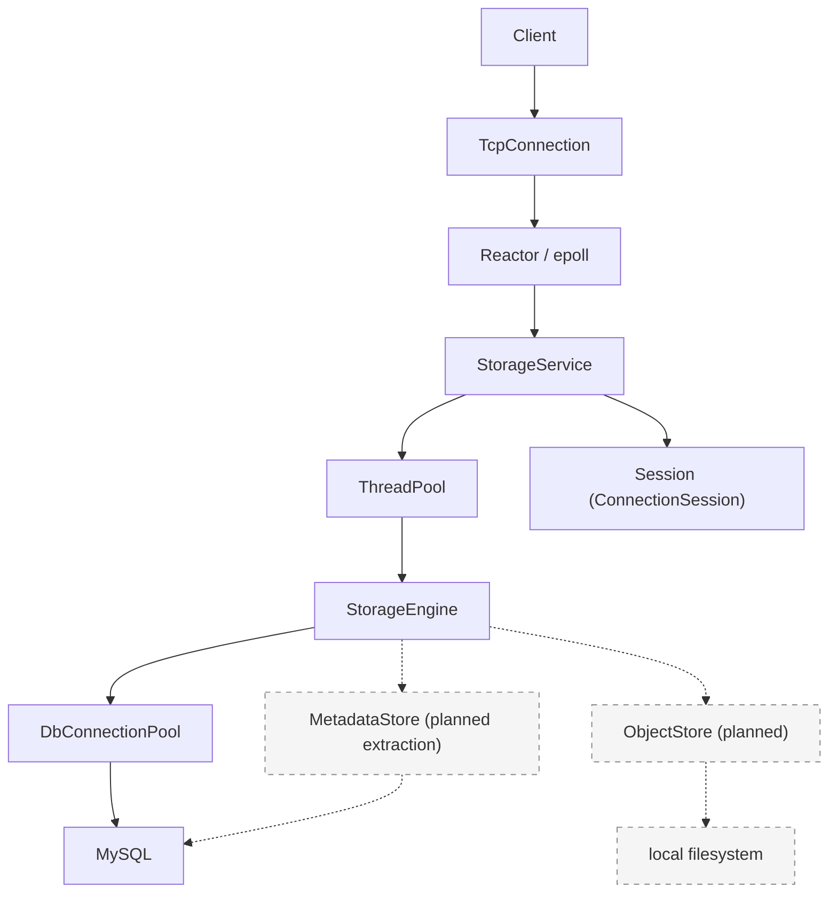

<p align="right">潮水成诗，破碎生长</p>

# TLSS
[简体中文](README.md) | **English**

This project is licensed under Apache License 2.0. See [LICENSE](LICENSE).

A C++17 file storage system built from scratch.

## Features

- **epoll Reactor networking** — Custom event loop, connection management, and read/write buffers.
- **one-loop-per-thread** — Each IO thread runs its own EventLoop; connections are assigned in round-robin order.
- **bounded worker pool** — Bounded task queues, nonblocking submission, and asynchronous queue wait timeouts.
- **MySQL connection pool** — Connection reuse, prepared statements, and RAII transactions.
- **virtual filesystem namespace** — Per-user root directories and `mkdir / cd / ls / pwd` commands.
- **content-addressed object storage** — **planned**; SHA-256 will identify file contents, with an `object_hash` field already reserved in the schema.
- **graceful shutdown** — Handles `SIGINT / SIGTERM`, drains tasks, and releases connections and threads.
- **monitoring subsystem** — Independent metric storage, policies, CLI, UDP metrics, and reliable TCP alarms.

## Demo

**Target client interaction:** `tlss-client`, file uploads, and persistent object storage by content hash are still planned. For directory operations available today, see [Build and run](#build-and-run).

```text
$ tlss-client
Username: alice
Password: ****

tlss@alice:/> mkdir documents
tlss@alice:/> cd documents
tlss@alice:/documents> upload hello.txt

uploaded:
SHA256 b94d27...

tlss@alice:/documents> ls

hello.txt   file   11 B
```

## Architecture



Solid lines show the current implementation; dashed lines show planned storage boundaries. `StorageEngine` currently reads and writes virtual directory metadata in MySQL through `DbConnectionPool`. Metadata access will be extracted into `MetadataStore`, while `ObjectStore` will manage file contents on the local filesystem.

The networking layer handles connections and message callbacks. `StorageService` parses commands and maintains sessions. Each connection's `ConnectionSession` stores its authentication state, user identity, and current directory, and is accessed by its owning IO thread. Database operations and password computation run in the worker pool; authentication and directory change results return to the connection's EventLoop through `queue_in_loop`.

The defaults are 4 IO threads, 8 worker threads, 256 execution queue slots, and 128 asynchronous wait queue slots. Directory operations use `try_run` and report a busy server when the queue is full. Login and signup use `submit_async` with a 2-second queue wait deadline.

Shutdown first stops accepting connections and pauses reads, then drains worker tasks and shuts down the write side of existing connections. Connections are forcibly closed if the connection grace period expires. The service then joins IO threads, shuts down the database pool, and exits the main event loop. Logging shuts down last.

## Network service lifecycle and threading requirements

This section documents the current usage contract for `TcpServer` and `StorageService`. Safe operation requires **correct call ordering, thread ownership, and object lifetimes** together. Atomic variables and queued tasks do not make arbitrary concurrent calls safe. The following flow applies to a successfully started service; applications using `TcpServer` directly must coordinate the corresponding shutdown steps themselves.

### Complete startup and runtime flow

See [main.cpp](src/main.cpp) for the entry point and [StorageService](src/ftp/server.cpp) for service coordination.

1. Before creating any worker threads, the **main thread** blocks `SIGINT` and `SIGTERM` through `pthread_sigmask`, then initializes logging. A control thread created later receives shutdown signals synchronously through `sigwait`.
2. The **main thread** constructs `EventLoop` before constructing the `StorageService` that references it. Service construction creates `TcpServer`, obtains the database connection pool, and configures connection/message callbacks, the IO thread count, and worker queue capacity.
3. The **main thread** calls `StorageService::start()`: it starts the worker pool first, then calls `TcpServer::start()` to start the IO thread pool and begin listening. Configuration must finish before startup; startup must not run concurrently with shutdown or destruction.
4. After startup completes, a **dedicated control thread** starts waiting for shutdown signals, while the main thread enters `EventLoop::loop()`. The control thread may request shutdown and wait for completion, but the main loop must keep running to process those requests.
5. During normal operation, the **main loop** accepts connections, assigns IO loops, and maintains `_connections`. Each connection's **owning IO loop** handles reads, writes, connection state, and application callbacks. The **worker pool** performs database work and other expensive operations, returning results to IO loops through queued tasks.

With `0` IO threads, the main loop also manages connections; there are no separate IO worker threads. Application callbacks must not assume they always run on a separate IO thread.

### Complete shutdown and destruction flow

The current main program follows this call chain:

```text
Control thread receives SIGINT / SIGTERM through sigwait()
  → StorageService::stop(grace_period)
  → Mark the service as stopping and serialize shutdown requests
  → TcpServer::stop_accepting(done)
  → Wait for done: listener closed and existing connections' reads paused
  → Stop the worker pool and wait for tasks in its execution queue to finish
  → TcpServer::shutdown_connections(done)
  → Wait for connections to close; call force_close_connections() on timeout
  → Keep waiting for the same done: connection map empty and IO cleanup past barriers
  → TcpServer::stop_io_threads(): exit and join IO threads
  → Shut down the database connection pool
  → Quit the main EventLoop
  → Publish the StorageService shutdown result and finish the control thread

Main thread returns from EventLoop::loop()
  → Join the control thread
  → Destroy StorageService / TcpServer
  → Destroy the main EventLoop
  → Logger::shutdown()
```

Each stage must meet its completion condition before the next stage begins:

| Stage | Thread and operation | Condition for proceeding |
| --- | --- | --- |
| Mark shutdown | The control thread sets `StorageService::_stopping`; stop accepting new application work | Startup has finished, and the application no longer produces new tasks |
| Stop accepting | The control thread calls `stop_accepting()`; the main loop releases Acceptor, and each IO loop executes `pause_read_for_shutdown()` | `done` runs on the main loop and notifies the control thread through a future or equivalent synchronization |
| Finish worker tasks | The control thread calls the worker pool's `stop()`; reject new submissions, cancel tasks still in the asynchronous wait queue, finish tasks already in the execution queue, and join workers | Worker pool `stop()` returns; IO loops and the database are still available at this stage |
| Drain connections | The control thread calls `shutdown_connections()`; IO loops drain output buffers, shut down the write side, and continue reading to wait for peer FIN | Wait for connection cleanup; request forced closure if `grace_period` expires |
| Force close, if needed | The control thread calls `force_close_connections()`; owning IO loops execute closure | Still wait for the earlier `shutdown_connections()` callback; returning from the force-close API does not permit immediate thread teardown |
| Confirm IO cleanup | The main loop removes connections from its map; IO loops execute `connect_destroyed()`, then notify the main loop through `when_io_idle()` barriers | The map is empty, relevant cleanup has passed the barriers, and `done` has notified the control thread |
| Release resources | The dedicated control thread calls `stop_io_threads()`, shuts down the database pool, and finally calls `quit()` on the main loop | IO threads have been joined; the control thread completes shutdown and publishes its result |
| Destroy objects | The main thread returns from `loop()`, joins the control thread, destroys the service and main loop, then shuts down logging | No remaining tasks, callbacks, or external calls can access the service or a destroyed loop |

`StorageService::stop()` defaults to a 5-second connection grace period and accepts a nonnegative duration. This limits only the wait for connections to close naturally, not the entire shutdown: worker completion, cleanup after forced closure, and other stages may still wait. The return value reports whether the database connection pool shut down successfully under its shutdown policy; it does not mean the entire process completed within `grace_period`.

### Waiting for completion when using TcpServer directly

When using `StorageService`, call its `stop()` from a dedicated control thread instead of also manipulating its internal `TcpServer`. If you compose `TcpServer`, a worker pool, and a database connection pool directly, the following illustrates shutdown on the control thread. Startup has already completed, the main loop remains running, and the caller keeps all participating objects alive throughout the flow.

```cpp
// Run on a dedicated control thread, never in the main loop, an IO callback, or a worker task.
// First close application entry points so no new tasks are produced.
auto paused = std::make_shared<std::promise<void>>();
auto paused_future = paused->get_future();
tcp_server.stop_accepting([paused] { paused->set_value(); });
paused_future.wait();

worker_pool.stop();  // IO loops and the database must remain alive for existing tasks.

auto drained = std::make_shared<std::promise<void>>();
auto drained_future = drained->get_future();
tcp_server.shutdown_connections([drained] { drained->set_value(); });
if (drained_future.wait_for(std::chrono::seconds(5)) == std::future_status::timeout) {
    tcp_server.force_close_connections();
}
drained_future.wait();  // Forced closure is also asynchronous; wait for the same done.

tcp_server.stop_io_threads();
const bool db_stopped = db_pool.shutdown();  // Adapt to your ownership model and record the result.
(void)db_stopped;
base_loop.quit();
// The main thread joins this control thread after loop() returns, then destroys the service and loop.
```

Here, `worker_pool`, `db_pool`, and `base_loop` represent the corresponding objects owned by the caller. Include `<future>`, `<memory>`, and `<chrono>`. Do not use `sleep()` to guess whether asynchronous work has finished, and do not stop EventLoop before waiting on the control thread: completion callbacks need the loop to execute.

### Required threading and lifetime constraints

| Object or operation | Current implementation requirement | Risk if violated |
| --- | --- | --- |
| `TcpServer` construction, configuration, and startup | Follow the current entry point and perform these on the main loop's owning thread; finish all setter calls before startup and do not modify configuration concurrently afterward | Concurrent reads and writes of callback `std::function` objects, thread counts, or thread pool containers |
| `start()` and shutdown | Finish startup before requesting shutdown; never restart after shutdown begins | Checking `_stopping` and accessing resources are not one atomic operation; Acceptor may already have been released |
| `_connections` and connection IDs | Maintain them on the main loop; complete shutdown before destruction so another thread cannot access the map concurrently | Container data races and invalidated iterators |
| TcpConnection / Channel | Direct operations on IO state, buffers, and Channels belong to the owning IO loop; cross-thread callers must use interfaces that provide dispatch | Races with event dispatch and Channel removal; `shared_ptr` preserves lifetime but does not synchronize member access |
| Shutdown callback `done` | Runs on the main loop; notify waiters or perform lightweight work without blocking on that same loop | The main loop cannot advance, so shutdown cannot complete |
| `StorageService::stop()` and `stop_io_threads()` | Run on a dedicated control thread outside the main loop, IO pool, and worker pool | Waiting for the current thread to process a barrier, or joining the current thread; existing thread checks do not catch every misuse |
| Tasks capturing raw `this` | Keep TcpServer, StorageService, and objects referenced by application callbacks alive until the relevant tasks and callbacks finish | Close callbacks, barriers, or other queued tasks access destroyed objects |
| Loop lifetimes | Finish IO cleanup before joining IO threads; keep the main loop alive through shutdown notification and service destruction | Shutdown tasks cannot execute, or connections/tasks access a destroyed loop through a raw pointer |
| Externally held connections and tasks | Coordinate all external producers before shutdown; after IO thread teardown, do not submit work through old connections or use their loops | Holding a `TcpConnectionPtr` does not extend the lifetime of its referenced EventLoop |
| Multiple shutdown callers | Coordinate through the mutex and completion notification in `StorageService::stop()`; direct TcpServer users must arrange a single shutdown flow | Repeated `shutdown_connections()` calls may overwrite the completion callback; thread pool teardown may interleave with other operations |

`when_io_idle()` queues a barrier on each IO loop and collects their notifications on the main loop. It confirms that relevant earlier tasks have reached the barrier, but **does not prevent future submissions from other threads or recursively wait for all follow-up tasks spawned by earlier work**. Stop task producers first, then wait for worker completion and connection cleanup. This barrier alone is not proof that the server can be destroyed safely at an arbitrary point.

`TcpServer::~TcpServer()` does not automatically perform the complete shutdown flow above or extend the lifetimes of objects referenced by raw `this` callbacks. A started `StorageService` must explicitly complete `stop()` before destruction; otherwise its destructor terminates the process. Do not directly delete a running server inside an application callback, and do not equate requesting shutdown with completing it.

Implementation entry points: [TcpServer](src/common/net/tcp_server.cpp), [EventLoop](src/common/net/event_loop.cpp), [EventLoopThread](src/common/net/event_loop_thread.cpp), and [worker pool](src/common/base/tlss_thread_pool.cpp). Existing [shutdown regression tests](tests/test_tcp_server_shutdown.cpp) cover waiting for peer FIN and forced closure with zero IO worker threads, among other paths. They do not establish safety for arbitrary interleavings of startup, shutdown, and destruction.

## Current implementation

| Component | Current state | Entry points |
| --- | --- | --- |
| Main service | Listens for TCP connections on port `9000`; accepts LF / CRLF line commands for signup, login, and directory operations; `q / quit` closes the session | [main.cpp](src/main.cpp), [server.cpp](src/ftp/server.cpp) |
| Authentication | Verifies passwords with salted PBKDF2-HMAC-SHA256; signup creates the user and root directory in one transaction, then requires login | [auth/](src/auth/) |
| Virtual filesystem | The MySQL `virtual_files` table stores users, parent directories, and paths; `mkdir / cd / ls / pwd` are connected, and `ls` currently shows names, types, and creation/update timestamps | [service_engine.cpp](src/ftp/service_engine.cpp), [schema script](sql/init_tlss_db.sql) |
| Networking and infrastructure | epoll Reactor, IO thread pool, connection buffers, and output high-water-mark backpressure; worker pool and MySQL connection pool | [net/](src/common/net/), [base/](src/common/base/) |
| Monitoring | Independent metric store, module registry, timers, policies, CLI, UDP metric transport, and reliable TCP alarms; includes demos and tests | [monitor/](src/monitor/) |
| Memory copy | Shared library exposing `TLSS::MEMORY::memcpy`, with runtime backend selection and assembly implementations | [memory/](src/common/memory/) |
| File content storage | Hash field reserved in the schema; `upload / download` handling, the standalone client, and ObjectStore remain to be implemented | [server.cpp](src/ftp/server.cpp), [schema script](sql/init_tlss_db.sql) |
| Gateway and RPC | Gateway and RPC skeletons plus four empty `.proto` files; the main program does not yet start these services | [gateway/](src/gateway/), [rpc/](src/rpc/), [proto/](proto/) |

The main service uses a custom line command protocol. The monitoring subsystem has its own `TLSSMON::Engine` lifecycle and currently runs through standalone demos; it has not yet been integrated into the main service.

```text
src/monitor/demo/*
  └─ Engine → Timer / AIO → MonitorReporter → MonitorStore
                              ├─ UDP metric publishing
                              └─ reliable alarm publishing → local spool → TCP collector
```

`demo-m9-node` and `demo-m9-collector` form an independent example with two processes, covering module registration, sampling, policy evaluation, reporting, transport, and CLI queries.

## Code layout

| Path | Purpose |
| --- | --- |
| `inc/`, `src/` | Headers and implementations grouped under `common`, `auth`, `ftp`, `gateway`, `logger`, `monitor`, and `rpc` |
| `proto/` | Placeholder files for storage, authentication, monitoring, and gateway protocols; CMake includes code generation steps targeting `build/generated/` |
| `tests/`, `src/monitor/test/` | Tests for the main service and infrastructure, plus monitoring subsystem tests |
| `config/`, `sql/` | MySQL connection settings and schema script; `config/config.yaml.example` is empty, and the main program does not read YAML |
| `scripts/build.sh` | Wrapper for configuration, compilation, and tests |
| `third/`, `third_party/` | Bundled dependencies and upstream submodules; do not commit their build output |
| `doc/` | Supplementary material for the networking and memory copy subsystems |

## Build and run

### Requirements

- Linux, a C++17 compiler, CMake 3.21+, Make, NASM, and pkg-config.
- OpenSSL, Protobuf (including `protoc`), gRPC (including `grpc_cpp_plugin`), yaml-cpp, and pthreads. GoogleTest is needed for some optional tests.
- The CMake build uses the MySQL client files at `third/mysql/inc` and `third/mysql/lib/libmysqlclient.so`. Running the main service also requires a reachable MySQL 8.0 instance; the schema script uses a MySQL 8.0 collation.

The upstream gRPC and Protobuf repositories are recorded as Git submodules. Run `git submodule update --init --recursive` if you need their source. CMake currently looks for installed Protobuf and gRPC packages instead of building the submodules automatically.

### Configure the database

Constructing `StorageService` initializes the MySQL connection pool, which connects to a database named `tlss_db`. Create the database and tables locally, then adjust the connection settings for your environment:

```bash
mysql -u root -p < sql/init_tlss_db.sql
```

The pool reads `config/mysql.cnf` from the **parent directory of the executable's directory**. With the default layout, `bin/storage-service` uses `config/mysql.cnf` in the repository root. The file uses `key=value` lines without surrounding spaces; key settings include `ip`, `port`, `username`, `password`, `initSize`, and `maxSize`. Do not commit real credentials. The process exits if it cannot load the configuration or open its initial database connections.

### Compile, test, and start

```bash
cmake --preset debug
cmake --build --preset debug
ctest --preset debug
./bin/storage-service
```

Start the program from the repository root so relative log files are written under `logs/`. The main program does not currently parse command line options; its listening port is fixed at `9000`. Open another terminal and connect with `nc` to try the implemented commands.

On your first connection, enter `signup` and follow the prompts to create a username and password. Usernames accept 3–64 letters, digits, or underscores; passwords accept 8–128 bytes without control characters. Signup also creates the user's root directory. Enter `login` after registration succeeds.

The example below assumes `alice` is registered and `documents` does not yet exist. `<password>` stands for the password chosen at signup; `nc` does not automatically hide input. Listing an empty directory returns only the prompt.

```text
$ nc 127.0.0.1 9000
Welcome to TLSS.
Please enter login or signup:
tlss>login
Username:alice
Password:<password>
Login successful.
tlss@alice:/>mkdir documents
tlss@alice:/>cd documents
tlss@alice:/documents>pwd
/documents
tlss@alice:/documents>ls
tlss@alice:/documents>cd ..
tlss@alice:/>quit
bye!
```

The service attempts an orderly shutdown on `SIGINT` or `SIGTERM`. `scripts/build.sh -t Debug` also configures, builds, and tests the project. Use `-n` to skip building and running tests. The `-c` option deletes `build/`, `bin/`, and `lib/`, so check those directories for local files first. For an optimized build, run `cmake --preset release && cmake --build --preset release`. Both presets share `build/`; reconfigure when switching build types.

Monitoring demos are placed in `bin/dome/`. For example, `./bin/dome/demo-m9-policy` demonstrates three monitoring policies. `demo-m9-collector` and `demo-m9-node` run separately: by default, the collector listens on local UDP `9300` for metrics, TCP `9400` for alarms, and TCP `9310` for its CLI. The node requires a module, source ID, outbox directory, and CLI port. See `src/monitor/demo/` for details.

## Tests and where to start reading

`ctest --preset debug` runs the tests registered with CMake. `tests/` covers TCP shutdown, asynchronous worker pool submission, MySQL prepared statements, memory copy linking, and GoogleTest cases for authentication, signup, and transactions. `src/monitor/test/` covers the monitoring engine, policies, wire protocols, storage, CLI, and reliable alarms. If GoogleTest is unavailable, only tests that require it are skipped; the other tests are still registered.

Suggested source reading order:

1. `src/main.cpp` → `src/ftp/server.cpp` → `inc/ftp/context.h`: service entry point, command dispatch, session state, and shutdown flow.
2. `src/common/net/event_loop.cpp` → `src/common/net/tcp_server.cpp` → `src/common/net/tcp_connection.cpp`: connection and message handling.
3. `src/common/base/tlss_thread_pool.cpp`, `src/common/base/mysql_connection_pool.cpp`: task and database resource lifecycles.
4. `src/auth/auth_service.cpp` → `src/auth/user_repository.cpp` → `src/ftp/service_engine.cpp`: database operations for signup, login, and virtual directories.
5. `src/monitor/demo/demo-m9-node.cpp` → `src/monitor/engine.cpp` → `src/monitor/monitor_reporter.cpp` → `src/monitor/demo/demo-m9-collector.cpp`: the independent monitoring example.

## Roadmap

- Implement `tlss-client`, `upload / download`, and a local ObjectStore using SHA-256 content hashes.
- Extract virtual file metadata access into MetadataStore, with clear boundaries between the namespace and file content storage.
- Integrate monitoring into the main service to collect connection, task queue, and database pool metrics.
- Define the Protobuf contracts and implement gRPC services and the gateway.

