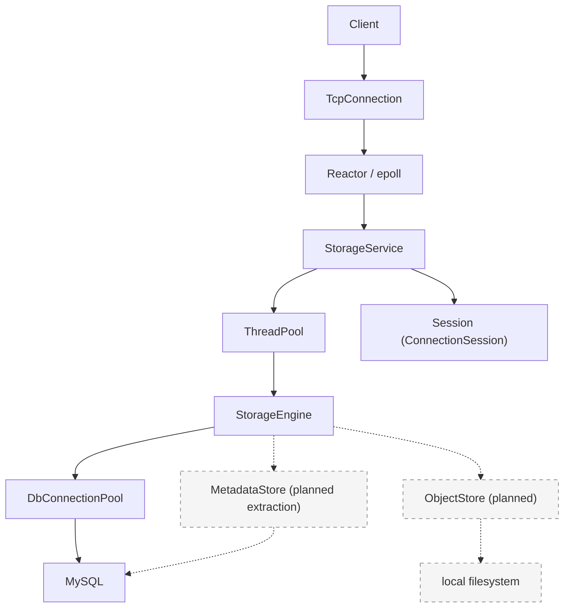

# TLSS

A C++17 file storage system built from scratch.

## Features

- **epoll Reactor networking** — Custom event loop, connection management, and read/write buffers.
- **one-loop-per-thread** — Each IO thread runs its own EventLoop; connections are assigned in round-robin order.
- **bounded worker pool** — Bounded task queues, nonblocking submission, and asynchronous queue wait timeouts.
- **MySQL connection pool** — Connection reuse, prepared statements, and RAII transactions.
- **virtual filesystem namespace** — Per-user root directories and `mkdir / cd / ls / pwd` commands.
- **content-addressed object storage** — **planned**; SHA-256 will identify file contents, with an `object_hash` field already reserved in the schema.
- **graceful shutdown** — Handles `SIGINT / SIGTERM`, drains tasks, and releases connections and threads.
- **monitoring subsystem** — Independent metric storage, policies, CLI, UDP metrics, and reliable TCP alarms.

## Demo

**Target client interaction:** `tlss-client`, file uploads, and persistent object storage by content hash are still planned. For directory operations available today, see [Build and run](#build-and-run).

```text
$ tlss-client
Username: alice
Password: ****

tlss@alice:/> mkdir documents
tlss@alice:/> cd documents
tlss@alice:/documents> upload hello.txt

uploaded:
SHA256 b94d27...

tlss@alice:/documents> ls

hello.txt   file   11 B
```

## Architecture



Solid lines show the current implementation; dashed lines show planned storage boundaries. `StorageEngine` currently reads and writes virtual directory metadata in MySQL through `DbConnectionPool`. Metadata access will be extracted into `MetadataStore`, while `ObjectStore` will manage file contents on the local filesystem.

The networking layer handles connections and message callbacks. `StorageService` parses commands and maintains sessions. Each connection's `ConnectionSession` stores its authentication state, user identity, and current directory, and is accessed by its owning IO thread. Database operations and password computation run in the worker pool; authentication and directory change results return to the connection's EventLoop through `queue_in_loop`.

The defaults are 4 IO threads, 8 worker threads, 256 execution queue slots, and 128 asynchronous wait queue slots. Directory operations use `try_run` and report a busy server when the queue is full. Login and signup use `submit_async` with a 2-second queue wait deadline.

Shutdown first stops accepting connections and pauses reads, then drains worker tasks and shuts down the write side of existing connections. Connections are forcibly closed if the connection grace period expires. The service then joins IO threads, shuts down the database pool, and exits the main event loop. Logging shuts down last.

## Current implementation

| Component | Current state | Entry points |
| --- | --- | --- |
| Main service | Listens for TCP connections on port `9000`; accepts LF / CRLF line commands for signup, login, and directory operations; `q / quit` closes the session | [main.cpp](src/main.cpp), [server.cpp](src/ftp/server.cpp) |
| Authentication | Verifies passwords with salted PBKDF2-HMAC-SHA256; signup creates the user and root directory in one transaction, then requires login | [auth/](src/auth/) |
| Virtual filesystem | The MySQL `virtual_files` table stores users, parent directories, and paths; `mkdir / cd / ls / pwd` are connected, and `ls` currently shows names, types, and creation/update timestamps | [service_engine.cpp](src/ftp/service_engine.cpp), [schema script](sql/init_tlss_db.sql) |
| Networking and infrastructure | epoll Reactor, IO thread pool, connection buffers, and output high-water-mark backpressure; worker pool and MySQL connection pool | [net/](src/common/net/), [base/](src/common/base/) |
| Monitoring | Independent metric store, module registry, timers, policies, CLI, UDP metric transport, and reliable TCP alarms; includes demos and tests | [monitor/](src/monitor/) |
| Memory copy | Shared library exposing `TLSS::MEMORY::memcpy`, with runtime backend selection and assembly implementations | [memory/](src/common/memory/) |
| File content storage | Hash field reserved in the schema; `upload / download` handling, the standalone client, and ObjectStore remain to be implemented | [server.cpp](src/ftp/server.cpp), [schema script](sql/init_tlss_db.sql) |
| Gateway and RPC | Gateway and RPC skeletons plus four empty `.proto` files; the main program does not yet start these services | [gateway/](src/gateway/), [rpc/](src/rpc/), [proto/](proto/) |

The main service uses a custom line command protocol. The monitoring subsystem has its own `TLSSMON::Engine` lifecycle and currently runs through standalone demos; it has not yet been integrated into the main service.

```text
src/monitor/demo/*
  └─ Engine → Timer / AIO → MonitorReporter → MonitorStore
                              ├─ UDP metric publishing
                              └─ reliable alarm publishing → local spool → TCP collector
```

`demo-m9-node` and `demo-m9-collector` form an independent example with two processes, covering module registration, sampling, policy evaluation, reporting, transport, and CLI queries.

## Code layout

| Path | Purpose |
| --- | --- |
| `inc/`, `src/` | Headers and implementations grouped under `common`, `auth`, `ftp`, `gateway`, `logger`, `monitor`, and `rpc` |
| `proto/` | Placeholder files for storage, authentication, monitoring, and gateway protocols; CMake includes code generation steps targeting `build/generated/` |
| `tests/`, `src/monitor/test/` | Tests for the main service and infrastructure, plus monitoring subsystem tests |
| `config/`, `sql/` | MySQL connection settings and schema script; `config/config.yaml.example` is empty, and the main program does not read YAML |
| `scripts/build.sh` | Wrapper for configuration, compilation, and tests |
| `third/`, `third_party/` | Bundled dependencies and upstream submodules; do not commit their build output |
| `doc/` | Supplementary material for the networking and memory copy subsystems |

## Build and run

### Requirements

- Linux, a C++17 compiler, CMake 3.21+, Make, NASM, and pkg-config.
- OpenSSL, Protobuf (including `protoc`), gRPC (including `grpc_cpp_plugin`), yaml-cpp, and pthreads. GoogleTest is needed for some optional tests.
- The CMake build uses the MySQL client files at `third/mysql/inc` and `third/mysql/lib/libmysqlclient.so`. Running the main service also requires a reachable MySQL 8.0 instance; the schema script uses a MySQL 8.0 collation.

The upstream gRPC and Protobuf repositories are recorded as Git submodules. Run `git submodule update --init --recursive` if you need their source. CMake currently looks for installed Protobuf and gRPC packages instead of building the submodules automatically.

### Configure the database

Constructing `StorageService` initializes the MySQL connection pool, which connects to a database named `tlss_db`. Create the database and tables locally, then adjust the connection settings for your environment:

```bash
mysql -u root -p < sql/init_tlss_db.sql
```

The pool reads `config/mysql.cnf` from the **parent directory of the executable's directory**. With the default layout, `bin/storage-service` uses `config/mysql.cnf` in the repository root. The file uses `key=value` lines without surrounding spaces; key settings include `ip`, `port`, `username`, `password`, `initSize`, and `maxSize`. Do not commit real credentials. The process exits if it cannot load the configuration or open its initial database connections.

### Compile, test, and start

```bash
cmake --preset debug
cmake --build --preset debug
ctest --preset debug
./bin/storage-service
```

Start the program from the repository root so relative log files are written under `logs/`. The main program does not currently parse command line options; its listening port is fixed at `9000`. Open another terminal and connect with `nc` to try the implemented commands.

On your first connection, enter `signup` and follow the prompts to create a username and password. Usernames accept 3–64 letters, digits, or underscores; passwords accept 8–128 bytes without control characters. Signup also creates the user's root directory. Enter `login` after registration succeeds.

The example below assumes `alice` is registered and `documents` does not yet exist. `<password>` stands for the password chosen at signup; `nc` does not automatically hide input. Listing an empty directory returns only the prompt.

```text
$ nc 127.0.0.1 9000
Welcome to TLSS.
Please enter login or signup:
tlss>login
Username:alice
Password:<password>
Login successful.
tlss@alice:/>mkdir documents
tlss@alice:/>cd documents
tlss@alice:/documents>pwd
/documents
tlss@alice:/documents>ls
tlss@alice:/documents>cd ..
tlss@alice:/>quit
bye!
```

The service attempts an orderly shutdown on `SIGINT` or `SIGTERM`. `scripts/build.sh -t Debug` also configures, builds, and tests the project. Use `-n` to skip building and running tests. The `-c` option deletes `build/`, `bin/`, and `lib/`, so check those directories for local files first. For an optimized build, run `cmake --preset release && cmake --build --preset release`. Both presets share `build/`; reconfigure when switching build types.

Monitoring demos are placed in `bin/dome/`. For example, `./bin/dome/demo-m9-policy` demonstrates three monitoring policies. `demo-m9-collector` and `demo-m9-node` run separately: by default, the collector listens on local UDP `9300` for metrics, TCP `9400` for alarms, and TCP `9310` for its CLI. The node requires a module, source ID, outbox directory, and CLI port. See `src/monitor/demo/` for details.

## Tests and where to start reading

`ctest --preset debug` runs the tests registered with CMake. `tests/` covers TCP shutdown, asynchronous worker pool submission, MySQL prepared statements, memory copy linking, and GoogleTest cases for authentication, signup, and transactions. `src/monitor/test/` covers the monitoring engine, policies, wire protocols, storage, CLI, and reliable alarms. If GoogleTest is unavailable, only tests that require it are skipped; the other tests are still registered.

Suggested source reading order:

1. `src/main.cpp` → `src/ftp/server.cpp` → `inc/ftp/context.h`: service entry point, command dispatch, session state, and shutdown flow.
2. `src/common/net/event_loop.cpp` → `src/common/net/tcp_server.cpp` → `src/common/net/tcp_connection.cpp`: connection and message handling.
3. `src/common/base/tlss_thread_pool.cpp`, `src/common/base/mysql_connection_pool.cpp`: task and database resource lifecycles.
4. `src/auth/auth_service.cpp` → `src/auth/user_repository.cpp` → `src/ftp/service_engine.cpp`: database operations for signup, login, and virtual directories.
5. `src/monitor/demo/demo-m9-node.cpp` → `src/monitor/engine.cpp` → `src/monitor/monitor_reporter.cpp` → `src/monitor/demo/demo-m9-collector.cpp`: the independent monitoring example.

## Roadmap

- Implement `tlss-client`, `upload / download`, and a local ObjectStore using SHA-256 content hashes.
- Extract virtual file metadata access into MetadataStore, with clear boundaries between the namespace and file content storage.
- Integrate monitoring into the main service to collect connection, task queue, and database pool metrics.
- Define the Protobuf contracts and implement gRPC services and the gateway.

[简体中文](README.md) | **English**

This project is licensed under Apache License 2.0. See [LICENSE](LICENSE).
