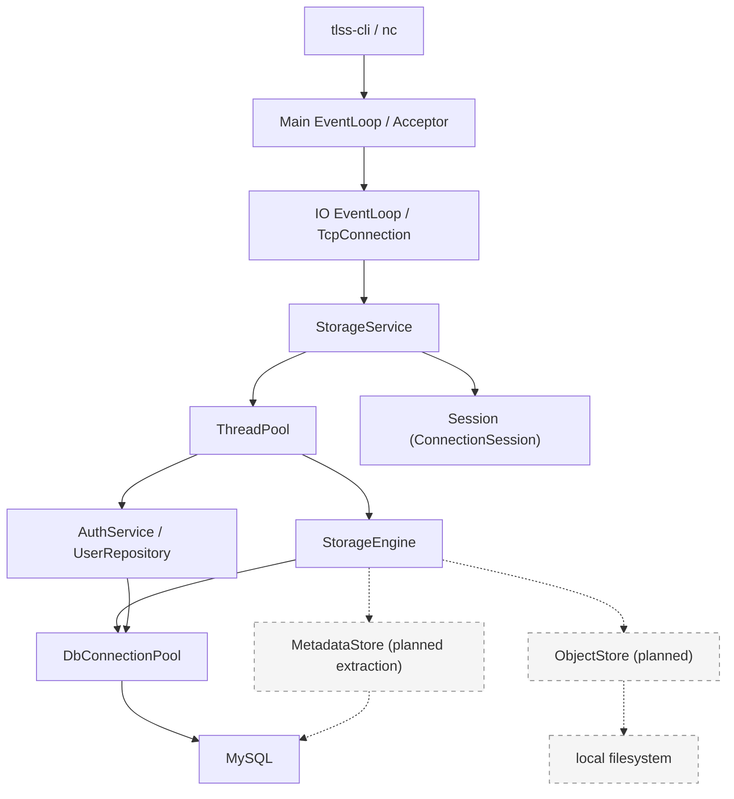

<p align="right">潮水成诗，破碎生长</p>


# TLSS — C++17 Reactor-Based Storage Service

[简体中文](README.md) | **English**
**A learning-oriented C++17/Linux file storage service built around a custom epoll Reactor and asynchronous networking library.**

TLSS explores how networking, concurrency, authentication, database transactions, and virtual filesystem metadata work together in a single-node storage service.

**Currently implemented:** epoll Reactor, asynchronous TCP client (`tlss-cli`), bounded thread pool, MySQL connection pool, PBKDF2 password hashing, user registration/login, virtual directories (`mkdir`, `cd`, `ls`, `pwd`), and graceful shutdown.

**Independent subsystems:** monitoring and reliable alarm delivery, optimized AVX2/REP MOVSB memory copy.

**Under development:** file upload/download, content-addressed object storage, gRPC interfaces, and distributed storage.

### Quick Start

After building the project and starting MySQL and the TLSS server:

```bash
./bin/storage-service
./bin/tlss-cli 127.0.0.1 9000
```

See the build instructions, architecture, and implementation notes below.

## Contents

- [Features and implementation status](#features-and-implementation-status)
- [Current interaction](#current-interaction)
- [Architecture and execution model](#architecture-and-execution-model)
- [Module implementation](#module-implementation)
- [Network service lifecycle and threading requirements](#network-service-lifecycle-and-threading-requirements)
- [Code layout](#code-layout)
- [Build and run](#build-and-run)
- [Tests and where to start reading](#tests-and-where-to-start-reading)
- [Current limitations and remaining work](#current-limitations-and-remaining-work)
- [Evolution roadmap and integration timing](#evolution-roadmap-and-integration-timing)

## Features and implementation status

- **epoll Reactor networking** — Custom event loop, connection management, and read/write buffers.
- **one-loop-per-thread** — Each IO thread runs its own EventLoop; connections are assigned in round-robin order.
- **bounded worker pool** — Bounded task queues, nonblocking submission, and asynchronous queue wait timeouts.
- **MySQL connection pool** — Connection reuse, prepared statements, and RAII transactions.
- **virtual filesystem namespace** — Per-user root directories and `mkdir / cd / ls / pwd` commands.
- **content-addressed object storage** — **planned**; SHA-256 will identify file contents, with an `object_hash` field already reserved in the schema.
- **graceful shutdown** — Handles `SIGINT / SIGTERM`, drains tasks, and releases connections and threads.
- **monitoring subsystem** — Independent metric storage, policies, CLI, UDP metrics, and reliable TCP alarms.
- **interactive client** — `tlss-cli`, with asynchronous connections, terminal input, and orderly shutdown.
- **memory copy library** — AVX2, REP MOVSB, non-temporal stores (NT), and runtime selection of parallel copying.

| Component | Current capability | Main service integration |
| --- | --- | --- |
| Networking | epoll Reactor, connection buffers, IO thread pool, asynchronous TCP client | In use |
| Worker pool | Bounded execution queue, nonblocking submission, asynchronous queue wait timeouts | In use |
| MySQL | Connection pool, prepared statements, RAII transactions | In use |
| Authentication | Signup, password verification, transactional user and root directory creation | In use |
| Virtual directories | `mkdir / cd / ls / pwd` | In use |
| Client | `tlss-cli <IPv4> <port>` | Standalone executable |
| Monitoring | Metrics, policies, CLI, UDP, reliable TCP alarms | Library linked; runs through standalone demos, not started by the main entry point |
| Memory copy | `TLSS::MEMORY::memcpy` shared library | Linked; networking `Buffer::append()` still uses `std::copy` |
| File contents | `object_hash` field reserved | Uploads, downloads, and object persistence not implemented |
| RPC and gateway | Build targets and code skeletons | No business services; all four `.proto` files are empty |
| Kafka | Event and consumer design | Planned; no producer, consumer, or deployment configuration yet |

## Current interaction

Prepare the database and start the service as described in [Build and run](#build-and-run), then run `./bin/tlss-cli 127.0.0.1 9000` in another interactive terminal. The following shows directory operations for a registered user, omitting connection notices. It assumes `documents` does not yet exist; `<password>` represents the actual password.

```text
$ ./bin/tlss-cli 127.0.0.1 9000
Welcome to TLSS.
Please enter login or signup:
tlss>login
Username:alice
Password:<password>
Login successful.
tlss@alice:/>mkdir documents
tlss@alice:/>cd documents
tlss@alice:/documents>pwd
/documents
tlss@alice:/documents>cd ..
tlss@alice:/>quit
```

On first use, choose `signup` and enter a username, password, and password confirmation. After registration succeeds, choose `login` again. The client does not currently hide password input, and the service connection does not use TLS. Although the server recognizes upload and download commands, their handlers are not implemented and they are not available operations.

## Architecture and execution model



Solid lines show the current implementation; dashed lines show planned storage boundaries. `StorageEngine` currently reads and writes virtual directory metadata in MySQL through `DbConnectionPool`. Metadata access will be extracted into `MetadataStore`, while `ObjectStore` will manage file contents on the local filesystem.

The networking layer handles connections and message callbacks. `StorageService` parses commands and maintains sessions. Each connection's `ConnectionSession` stores its authentication state, user identity, and current directory, and is accessed by its owning IO thread. Database operations and password computation run in the worker pool; authentication and directory change results return to the connection's EventLoop through `queue_in_loop`.

The defaults are 4 IO threads, 8 worker threads, 256 execution queue slots, and 128 asynchronous wait queue slots. Directory operations use `try_run` and report a busy server when the queue is full. Login and signup use `submit_async` with a 2-second queue wait deadline.

Additional threads include the signal control thread, the worker pool's deadline management thread, and the database connection producer and idle scanner. The 2-second deadline only limits how long authentication tasks wait to enter the execution queue; it does not interrupt SQL or password computation that has already started.

Shutdown first stops accepting connections and pauses reads, then drains worker tasks and shuts down the write side of existing connections. Connections are forcibly closed if the connection grace period expires. The service then joins IO threads, shuts down the database pool, and exits the main event loop. Logging shuts down last.

## Module implementation

### Networking library and command protocol

Implementations are in [common/net](src/common/net/), with headers in [inc/common/net](inc/common/net/).

| Type | Responsibility |
| --- | --- |
| `EventLoop` | Wait for IO events, dispatch Channels, and execute pending callbacks |
| `Poller / EPollPoller` | epoll event waiting and registration management |
| `Channel` | File descriptor event interests, callbacks, and lifetime association |
| `Acceptor / TcpServer` | Accept connections, maintain the connection map, and assign IO loops in round-robin order |
| `TcpConnection` | Connection state, input/output buffers, backpressure, half-close, and forced closure |
| `EventLoopThreadPool` | Manage IO threads using one loop per thread |
| `Connector / TcpClient` | Nonblocking connection setup, retries, and client connection management |

Cross-thread calls use `queue_in_loop()` and wake the target loop through `eventfd`. `run_in_loop()` executes immediately on the owning thread and queues work otherwise. Cross-thread sends retain the message contents and a connection reference until execution. `Channel::tie()` and deferred cleanup coordinate object destruction with event dispatch.

`Buffer::read_fd()` uses `readv` with its internal writable region and a 64 KiB stack buffer. The service configures a 256 KiB output high-water mark: reaching it pauses reads, which resume after the output buffer drains. Connections also have a 1 MiB pending output buffer limit. These mechanisms do not replace capacity limits on all upstream task queues.

[StorageService::on_message()](src/ftp/server.cpp) splits input on `\n`, accepts `\r\n`, retains incomplete commands, and processes multiple complete commands in a loop. A command may contain at most 4096 bytes; exceeding the limit closes the connection.

### Sessions, signup, and login

[ConnectionSession](inc/ftp/context.h) stores login state, temporary username and password input, an authentication attempt number, authenticated identity, the current directory, and a directory change flag. Only the owning IO thread accesses session contents; a separate mutex protects the session index.

```text
Login:
login → username → password → verifying
      → worker queries the active user and verifies the password
      → IO loop checks the connection, original session, and auth_attempt
      → publish identity and set the current directory to /

Signup:
signup → username → password → confirmation → registering
       → worker computes the password hash first
       → insert the user and root directory in one database transaction
       → return the result and require a separate login
```

[AuthService](src/auth/auth_service.cpp) handles validation, username normalization, and result mapping. [MySqlUserRepository](src/auth/user_repository.cpp) handles user data access. Signup usernames contain 3–64 ASCII letters, digits, or underscores and are converted to lowercase before storage. Passwords contain 8–128 bytes; spaces are preserved and control characters are rejected.

[PasswordHasher](src/auth/password_hasher.cpp) uses a 16-byte random salt, 600000 PBKDF2-HMAC-SHA256 iterations, a 32-byte derived key, and an encoding that includes the version and iteration count. Verification compares results using `CRYPTO_memcmp`. Signup computes the hash before borrowing a database connection for the transaction, reducing connection occupancy.

The database username unique index resolves concurrent signup attempts. If commit confirmation is lost, the service returns an unknown outcome and suggests trying login first; it does not automatically retry signup. Authentication completion callbacks check weak references, session identity, and `auth_attempt` so stale results cannot overwrite current state.

### Virtual directories and storage boundaries

The [schema script](sql/init_tlss_db.sql) defines `users` and `virtual_files`. The latter separates users by `username`, represents parent-child relationships with `parent_id`, and stores `path`, `file_type`, `object_hash`, and timestamps. A root directory uses `parent_id = -1`, `file_name = '/'`, and `path = '/'`. A unique index prevents duplicate names under the same parent for the same user.

| Command | Current execution |
| --- | --- |
| `pwd` | Read the current directory directly from the session |
| `ls` | Look up the current directory ID, then list child names, types, and creation/update timestamps |
| `cd <child>` | Join parent and child nodes, filtering by user, parent path, and directory type |
| `cd ..` | Look up the parent; remain at `/` when already at the root |
| `mkdir <name>` | Look up the parent, construct the path, and insert a directory record |
| `upload / download` | Commands recognized; handler calls remain commented out |

[StorageEngine](src/ftp/service_engine.cpp) currently executes prepared SQL directly. `cd` supports direct children and the parent directory, without a general absolute/relative path parser. While a directory change is pending, `directory_change_pending` blocks subsequent directory commands. Other asynchronous commands do not have a complete per-connection serial execution queue, so responses must not be assumed to follow input order strictly.

`object_hash` is reserved for content-addressed storage. Byte transfer, hash verification, temporary files, atomic publication, object reclamation, and metadata consistency still need implementation. Metadata access is planned to move into `MetadataStore`, with content persistence encapsulated in `ObjectStore`.

### Worker pool and database resources

[ThreadPool](inc/common/base/tlss_thread_pool.h) provides three submission methods:

| API | When the queue is full | Current use |
| --- | --- | --- |
| `run()` | External callers wait for capacity; nested submissions from the pool are rejected when full to avoid deadlock | General blocking submission |
| `try_run()` | Fail immediately | Directory database operations |
| `submit_async()` | Enter a bounded wait queue until admitted to the execution queue or a timeout callback fires | Login and signup |

Shutdown rejects new work, cancels the wait queue, drains the execution queue, and joins workers. A pool can only start once. With zero workers, `run / try_run` execute on the caller's thread; `submit_async` does not support this mode. Uncaught exceptions from worker tasks terminate the process; individual tasks do not currently have exception isolation.

[DbConnectionPool](src/common/base/mysql_connection_pool.cpp) manages initial connections, a capacity limit, background production, idle scanning, acquisition wait deadlines, `ping` before borrowing, and shutdown coordination. RAII handles return connections. Invalid connections and connections with unfinished transactions do not return to the idle queue. The acquisition deadline limits condition-variable waiting; it cannot interrupt subsequent MySQL network calls.

[DbConnection / DbTransaction](inc/common/base/mysql_connection.h) wrap parameter binding, query results, transaction commits, and rollback on destruction. A failed commit is reported as an unknown outcome and invalidates the connection. Signup creates the user and root directory in the same transaction.

### Interactive client and logging

[client_main.cpp](src/client_main.cpp) builds `tlss-cli`. [Client](src/ftp/client.cpp) registers terminal input, `signalfd`, and an exit-timeout `timerfd` with EventLoop. It displays server responses directly. `exit / q / quit`, terminal EOF, or a shutdown signal initiates closure, with a 2-second connection shutdown wait.

The underlying [Connector](inc/common/net/connector.h) increases retry delays exponentially from 500 milliseconds to at most 30 seconds. The CLI retries initial connection attempts, but exits if an established session disconnects, avoiding an automatic new session without the original authentication context.

[Logger](src/logger/logger.cpp) wraps spdlog console, file, rotating file, and dual-sink output. The main program initializes `net`, `storage_service`, and `mysql` loggers, and shuts logging down after service objects and background threads are cleaned up.

### Independent monitoring and reliable alarms

Monitoring uses the `TLSSMON` namespace. Its [Engine](src/monitor/engine.cpp) runs on **select and a wakeup pipe**, independently of the business networking layer's epoll EventLoop. Its lifecycle is `CREATED → INITIALIZING → READY → RUNNING → STOPPING → STOPPED`; it cannot restart after stopping.

| Component | Current implementation |
| --- | --- |
| `AioManager / TimerManager` | Descriptor readiness callbacks, deferred removal, deadline-ordered one-shot and periodic timers |
| `CallbackRegistry` | Callback registration, asynchronous workers, invocation counts, and timing statistics |
| `MonitorModuleRegistry` | Module and error metadata, registered before the engine runs |
| `MonitorStore` | Current records indexed by the full key, protected by a mutex; queries return copies |
| `MonitorReporter` | Metadata enrichment, publishing on value changes, and ordinary metric/reliable alarm routing |
| `MonitorPolicy` | Sustained threshold violations, event counts in rolling windows, moving averages, and outlier filtering |
| `CliServer / CliRegistry` | Command registration, session context, module selection, and data queries |
| `MonitorWire / UDP` | Custom V1/V2 binary protocols and metric transmission/reception |
| `ReliableAlarmPublisher / Collector / AlarmSpool` | Local persistence, TCP delivery, ACKs, retries, deduplication, and recovery |

Metric keys are `(mid, level, fid, eid)`, and values are numeric or strings. Store keeps each key's current record and change timestamp; it is not a historical time-series database. An ordinary initial zero may be ignored, and unchanged values usually do not publish. `report_count()` submits the caller's value rather than incrementing automatically. V2 carries descriptions and producer change timestamps; V1 uses the Collector's time on receipt.

```text
Ordinary metrics:
Sampling → policy → Reporter → Store update → UDP publish
         → Collector decode → receiving Engine / Store

Reliable alarms:
report_error → persist outbox → commit local Store
             → background TCP send / retry
             → Collector validation → persist inbox → update receiving Store
             → ACK → sender removes the acknowledged file
```

If reliable-channel persistence fails, the new local Store value is not committed, allowing the same value to be retried. Ordinary publishing callbacks run after releasing the Store lock. Reliable alarms perform pre-commit persistence under the Store lock; only bounded local persistence is allowed, with no network waiting or Store reentry.

Alarm handling includes CRC verification, stream decoding, deduplication by message identity, partial writes, retry backoff, corrupt-file quarantine, restart recovery, and file/directory synchronization. This provides persistent retries and receiver deduplication, not end-to-end exactly-once guarantees for arbitrary external business effects.

The CLI supports `help`, `modules`, `use`, `db_dump`, and `alarm_status`; `db_dump` queries the monitoring Store. `demo-m9-node` and `demo-m9-collector` demonstrate sampling through queries across two processes. The main service does not currently start these components or report metrics automatically.

### Memory copy library

The [public API](inc/common/memory/tlss_memcpy.h) exposes `TLSS::MEMORY::memcpy`, with `Auto / Avx2 / RepMovsb / NonTemporal` backends and `Default / Streaming` hints. The shared library is emitted as `lib/libtlss_memory.so`.

Automatic selection follows CPU capability detection → CopyPlan selection by size and hint → capability adaptation → execution or fallback. The [current policy](src/common/memory/internal/copy_policy.cpp) is:

| Hint | Size `n` | Initial strategy |
| --- | --- | --- |
| Default | `n ≤ 2 KiB` | AVX2 cached |
| Default | `n > 2 KiB` | REP MOVSB |
| Streaming | `n ≤ 2 KiB` | AVX2 cached |
| Streaming | `2 KiB < n < 3 KiB` | libc memcpy |
| Streaming | `3 KiB ≤ n < 8 KiB` | AVX2 cached |
| Streaming | `8 KiB ≤ n < 64 KiB` | Single-thread NT |
| Streaming | `64 KiB ≤ n < 128 KiB` | Request 4-worker parallel NT |
| Streaming | `n ≥ 128 KiB` | Request 8-worker parallel NT |

Actual execution depends on CPU capabilities, available topology, and worker count. The implementation includes CPU affinity, persistent workers, precomputed worker selection, lazy initialization, fallback when the parallel pool is busy, and automatic fallback without AVX2 support. Explicitly requesting an unsupported backend raises an error. The API retains memcpy's non-overlapping-memory requirement.

The custom memcpy call in the networking Buffer remains commented out, so independent library benchmarks are not evidence of main-service throughput gains. See the [V1 design and validation report](doc/TLSS_Memory_Copy_Subsystem_V1_Design_Validation_Report_Final.md) and [memory copy guide](doc/tlss_memcpy_tutorial.md) for implementation and measurement details.

## Network service lifecycle and threading requirements

This section documents the current usage contract for `TcpServer` and `StorageService`. Safe operation requires **correct call ordering, thread ownership, and object lifetimes** together. Atomic variables and queued tasks do not make arbitrary concurrent calls safe. The following flow applies to a successfully started service; applications using `TcpServer` directly must coordinate the corresponding shutdown steps themselves.

### Complete startup and runtime flow

See [main.cpp](src/main.cpp) for the entry point and [StorageService](src/ftp/server.cpp) for service coordination.

1. Before creating any worker threads, the **main thread** blocks `SIGINT` and `SIGTERM` through `pthread_sigmask`, then initializes logging. A control thread created later receives shutdown signals synchronously through `sigwait`.
2. The **main thread** constructs `EventLoop` before constructing the `StorageService` that references it. Service construction creates `TcpServer`, obtains the database connection pool, and configures connection/message callbacks, the IO thread count, and worker queue capacity.
3. The **main thread** calls `StorageService::start()`: it starts the worker pool first, then calls `TcpServer::start()` to start the IO thread pool and begin listening. Configuration must finish before startup; startup must not run concurrently with shutdown or destruction.
4. After startup completes, a **dedicated control thread** starts waiting for shutdown signals, while the main thread enters `EventLoop::loop()`. The control thread may request shutdown and wait for completion, but the main loop must keep running to process those requests.
5. During normal operation, the **main loop** accepts connections, assigns IO loops, and maintains `_connections`. Each connection's **owning IO loop** handles reads, writes, connection state, and application callbacks. The **worker pool** performs database work and other expensive operations, returning results to IO loops through queued tasks.

With `0` IO threads, the main loop also manages connections; there are no separate IO worker threads. Application callbacks must not assume they always run on a separate IO thread.

### Complete shutdown and destruction flow

The current main program follows this call chain:

```text
Control thread receives SIGINT / SIGTERM through sigwait()
  → StorageService::stop(grace_period)
  → Mark the service as stopping and serialize shutdown requests
  → TcpServer::stop_accepting(done)
  → Wait for done: listener closed and existing connections' reads paused
  → Stop the worker pool and wait for tasks in its execution queue to finish
  → TcpServer::shutdown_connections(done)
  → Wait for connections to close; call force_close_connections() on timeout
  → Keep waiting for the same done: connection map empty and IO cleanup past barriers
  → TcpServer::stop_io_threads(): exit and join IO threads
  → Shut down the database connection pool
  → Quit the main EventLoop
  → Publish the StorageService shutdown result and finish the control thread

Main thread returns from EventLoop::loop()
  → Join the control thread
  → Destroy StorageService / TcpServer
  → Destroy the main EventLoop
  → Logger::shutdown()
```

Each stage must meet its completion condition before the next stage begins:

| Stage | Thread and operation | Condition for proceeding |
| --- | --- | --- |
| Mark shutdown | The control thread sets `StorageService::_stopping`; stop accepting new application work | Startup has finished, and the application no longer produces new tasks |
| Stop accepting | The control thread calls `stop_accepting()`; the main loop releases Acceptor, and each IO loop executes `pause_read_for_shutdown()` | `done` runs on the main loop and notifies the control thread through a future or equivalent synchronization |
| Finish worker tasks | The control thread calls the worker pool's `stop()`; reject new submissions, cancel tasks still in the asynchronous wait queue, finish tasks already in the execution queue, and join workers | Worker pool `stop()` returns; IO loops and the database are still available at this stage |
| Drain connections | The control thread calls `shutdown_connections()`; IO loops drain output buffers, shut down the write side, and continue reading to wait for peer FIN | Wait for connection cleanup; request forced closure if `grace_period` expires |
| Force close, if needed | The control thread calls `force_close_connections()`; owning IO loops execute closure | Still wait for the earlier `shutdown_connections()` callback; returning from the force-close API does not permit immediate thread teardown |
| Confirm IO cleanup | The main loop removes connections from its map; IO loops execute `connect_destroyed()`, then notify the main loop through `when_io_idle()` barriers | The map is empty, relevant cleanup has passed the barriers, and `done` has notified the control thread |
| Release resources | The dedicated control thread calls `stop_io_threads()`, shuts down the database pool, and finally calls `quit()` on the main loop | IO threads have been joined; the control thread completes shutdown and publishes its result |
| Destroy objects | The main thread returns from `loop()`, joins the control thread, destroys the service and main loop, then shuts down logging | No remaining tasks, callbacks, or external calls can access the service or a destroyed loop |

`StorageService::stop()` defaults to a 5-second connection grace period and accepts a nonnegative duration. This limits only the wait for connections to close naturally, not the entire shutdown: worker completion, cleanup after forced closure, and other stages may still wait. The return value reports whether the database connection pool shut down successfully under its shutdown policy; it does not mean the entire process completed within `grace_period`.

### Waiting for completion when using TcpServer directly

When using `StorageService`, call its `stop()` from a dedicated control thread instead of also manipulating its internal `TcpServer`. If you compose `TcpServer`, a worker pool, and a database connection pool directly, the following illustrates shutdown on the control thread. Startup has already completed, the main loop remains running, and the caller keeps all participating objects alive throughout the flow.

```cpp
// Run on a dedicated control thread, never in the main loop, an IO callback, or a worker task.
// First close application entry points so no new tasks are produced.
auto paused = std::make_shared<std::promise<void>>();
auto paused_future = paused->get_future();
tcp_server.stop_accepting([paused] { paused->set_value(); });
paused_future.wait();

worker_pool.stop();  // IO loops and the database must remain alive for existing tasks.

auto drained = std::make_shared<std::promise<void>>();
auto drained_future = drained->get_future();
tcp_server.shutdown_connections([drained] { drained->set_value(); });
if (drained_future.wait_for(std::chrono::seconds(5)) == std::future_status::timeout) {
    tcp_server.force_close_connections();
}
drained_future.wait();  // Forced closure is also asynchronous; wait for the same done.

tcp_server.stop_io_threads();
const bool db_stopped = db_pool.shutdown();  // Adapt to your ownership model and record the result.
(void)db_stopped;
base_loop.quit();
// The main thread joins this control thread after loop() returns, then destroys the service and loop.
```

Here, `worker_pool`, `db_pool`, and `base_loop` represent the corresponding objects owned by the caller. Include `<future>`, `<memory>`, and `<chrono>`. Do not use `sleep()` to guess whether asynchronous work has finished, and do not stop EventLoop before waiting on the control thread: completion callbacks need the loop to execute.

### Required threading and lifetime constraints

| Object or operation | Current implementation requirement | Risk if violated |
| --- | --- | --- |
| `TcpServer` construction, configuration, and startup | Follow the current entry point and perform these on the main loop's owning thread; finish all setter calls before startup and do not modify configuration concurrently afterward | Concurrent reads and writes of callback `std::function` objects, thread counts, or thread pool containers |
| `start()` and shutdown | Finish startup before requesting shutdown; never restart after shutdown begins | Checking `_stopping` and accessing resources are not one atomic operation; Acceptor may already have been released |
| `_connections` and connection IDs | Maintain them on the main loop; complete shutdown before destruction so another thread cannot access the map concurrently | Container data races and invalidated iterators |
| TcpConnection / Channel | Direct operations on IO state, buffers, and Channels belong to the owning IO loop; cross-thread callers must use interfaces that provide dispatch | Races with event dispatch and Channel removal; `shared_ptr` preserves lifetime but does not synchronize member access |
| Shutdown callback `done` | Runs on the main loop; notify waiters or perform lightweight work without blocking on that same loop | The main loop cannot advance, so shutdown cannot complete |
| `StorageService::stop()` and `stop_io_threads()` | Run on a dedicated control thread outside the main loop, IO pool, and worker pool | Waiting for the current thread to process a barrier, or joining the current thread; existing thread checks do not catch every misuse |
| Tasks capturing raw `this` | Keep TcpServer, StorageService, and objects referenced by application callbacks alive until the relevant tasks and callbacks finish | Close callbacks, barriers, or other queued tasks access destroyed objects |
| Loop lifetimes | Finish IO cleanup before joining IO threads; keep the main loop alive through shutdown notification and service destruction | Shutdown tasks cannot execute, or connections/tasks access a destroyed loop through a raw pointer |
| Externally held connections and tasks | Coordinate all external producers before shutdown; after IO thread teardown, do not submit work through old connections or use their loops | Holding a `TcpConnectionPtr` does not extend the lifetime of its referenced EventLoop |
| Multiple shutdown callers | Coordinate through the mutex and completion notification in `StorageService::stop()`; direct TcpServer users must arrange a single shutdown flow | Repeated `shutdown_connections()` calls may overwrite the completion callback; thread pool teardown may interleave with other operations |

`when_io_idle()` queues a barrier on each IO loop and collects their notifications on the main loop. It confirms that relevant earlier tasks have reached the barrier, but **does not prevent future submissions from other threads or recursively wait for all follow-up tasks spawned by earlier work**. Stop task producers first, then wait for worker completion and connection cleanup. This barrier alone is not proof that the server can be destroyed safely at an arbitrary point.

`TcpServer::~TcpServer()` does not automatically perform the complete shutdown flow above or extend the lifetimes of objects referenced by raw `this` callbacks. A started `StorageService` must explicitly complete `stop()` before destruction; otherwise its destructor terminates the process. Do not directly delete a running server inside an application callback, and do not equate requesting shutdown with completing it.

Implementation entry points: [TcpServer](src/common/net/tcp_server.cpp), [EventLoop](src/common/net/event_loop.cpp), [EventLoopThread](src/common/net/event_loop_thread.cpp), and [worker pool](src/common/base/tlss_thread_pool.cpp). Existing [shutdown regression tests](tests/test_tcp_server_shutdown.cpp) cover waiting for peer FIN and forced closure with zero IO worker threads, among other paths. They do not establish safety for arbitrary interleavings of startup, shutdown, and destruction.

## Code layout

```text
cpp_TLFSS/
├── CMakeLists.txt / CMakePresets.json
├── inc/                          Public headers, matching src modules
├── src/
│   ├── main.cpp                  storage-service entry point
│   ├── client_main.cpp           tlss-cli entry point
│   ├── common/
│   │   ├── base/                 Threads, worker pool, database wrappers
│   │   ├── net/                  Reactor, TCP server and client
│   │   ├── memory/               Copy runtime and assembly
│   │   └── benchmark/            Memory copy experiments and benchmarks
│   ├── auth/                     Authentication, user repository, password hashing
│   ├── ftp/                      Command entry point, directory engine, client
│   ├── logger/                   spdlog wrapper
│   ├── monitor/                  Independent monitoring, including demo/ and test/
│   ├── rpc/                      RPC placeholders
│   └── gateway/                  Gateway placeholders
├── tests/                        Networking, worker pool, auth, and database tests
├── proto/                        Empty protocol placeholders
├── config/ / sql/                Configuration and database scripts
├── scripts/ / doc/               Build scripts and technical documentation
├── third/ / third_party/         Third-party dependencies
└── build/, bin/, lib/            Default build output
```

| Path | Purpose |
| --- | --- |
| `inc/`, `src/` | Headers and implementations grouped under `common`, `auth`, `ftp`, `gateway`, `logger`, `monitor`, and `rpc` |
| `proto/` | Placeholder files for storage, authentication, monitoring, and gateway protocols; CMake includes code generation steps targeting `build/generated/` |
| `tests/`, `src/monitor/test/` | Tests for the main service and infrastructure, plus monitoring subsystem tests |
| `config/`, `sql/` | MySQL connection settings and schema script; `config/config.yaml.example` is empty, and the main program does not read YAML |
| `scripts/build.sh` | Wrapper for configuration, compilation, and tests |
| `third/`, `third_party/` | Bundled dependencies and upstream submodules; do not commit their build output |
| `doc/` | Supplementary material for the networking and memory copy subsystems |

The top-level CMake configuration organizes `common_lib`, `auth_lib`, `ftp_lib`, `logger_lib`, `monitor_lib`, `rpc_lib`, `gateway_lib`, `proto_lib`, and `tlss_memory`. The main service links several libraries, but `main.cpp` determines which components actually run. Additional infrastructure examples and checks live in `src/common/base/example/`; not all are registered with the top-level CTest setup.

## Build and run

### Requirements

- Linux x86-64, a C++17 compiler, CMake 3.21+, Make, NASM, and pkg-config. The build includes x86 assembly and is not a general cross-architecture build.
- OpenSSL, Protobuf (including `protoc`), gRPC (including `grpc_cpp_plugin`), yaml-cpp, and pthreads. GoogleTest is needed for some optional tests.
- The CMake build uses the MySQL client files at `third/mysql/inc` and `third/mysql/lib/libmysqlclient.so`. Running the main service also requires a reachable MySQL 8.0 instance; the schema script uses a MySQL 8.0 collation.

The upstream gRPC and Protobuf repositories are recorded as Git submodules. Run `git submodule update --init --recursive` if you need their source. CMake currently looks for installed Protobuf and gRPC packages instead of building the submodules automatically.

Although RPC business services are not implemented, the top-level build still requires gRPC, Protobuf, and their code generation tools. Python 3 is used for optional directory SQL and client interaction tests. Kafka is not integrated and is not a current build or runtime dependency.

### Configure the database

Constructing `StorageService` initializes the MySQL connection pool, which connects to a database named `tlss_db`. Create the database and tables locally, then adjust the connection settings for your environment:

```bash
mysql -u root -p < sql/init_tlss_db.sql
```

The pool reads `config/mysql.cnf` from the **parent directory of the executable's directory**. With the default layout, `bin/storage-service` uses `config/mysql.cnf` in the repository root. The file uses `key=value` lines without surrounding spaces; key settings include `ip`, `port`, `username`, `password`, `initSize`, and `maxSize`. Do not commit real credentials. The process exits if it cannot load the configuration or open its initial database connections.

### Compile, test, and start

```bash
cmake --preset debug
cmake --build --preset debug
ctest --preset debug
./bin/storage-service
```

Start the program from the repository root so relative log files are written under `logs/`. The main program does not currently parse command line options; its listening port is fixed at `9000`. Do not pass the unimplemented `--config` option. Start the client in another interactive terminal:

```bash
./bin/tlss-cli 127.0.0.1 9000
```

Alternatively, use `nc 127.0.0.1 9000` to inspect the line protocol manually. `tlss-cli` targets interactive terminals; batch commands and file transfer are not implemented client capabilities.

On your first connection, enter `signup` and follow the prompts to create a username and password. Usernames accept 3–64 letters, digits, or underscores; passwords accept 8–128 bytes without control characters. Signup also creates the user's root directory. Enter `login` after registration succeeds.

The example below assumes `alice` is registered and `documents` does not yet exist. `<password>` stands for the password chosen at signup; `nc` does not automatically hide input. Listing an empty directory returns only the prompt.

```text
$ nc 127.0.0.1 9000
Welcome to TLSS.
Please enter login or signup:
tlss>login
Username:alice
Password:<password>
Login successful.
tlss@alice:/>mkdir documents
tlss@alice:/>cd documents
tlss@alice:/documents>pwd
/documents
tlss@alice:/documents>ls
tlss@alice:/documents>cd ..
tlss@alice:/>quit
bye!
```

The service attempts an orderly shutdown on `SIGINT` or `SIGTERM`. `scripts/build.sh -t Debug` also configures, builds, and tests the project. Use `-n` to skip building and running tests. The `-c` option deletes `build/`, `bin/`, and `lib/`, so check those directories for local files first. For an optimized build, run `cmake --preset release && cmake --build --preset release`. Both presets share `build/`; reconfigure when switching build types.

Monitoring demos are placed in `bin/dome/`. For example, `./bin/dome/demo-m9-policy` demonstrates three monitoring policies. `demo-m9-collector` and `demo-m9-node` run separately: by default, the collector listens on local UDP `9300` for metrics, TCP `9400` for alarms, and TCP `9310` for its CLI. The node requires a module, source ID, outbox directory, and CLI port. See `src/monitor/demo/` for details.

Run the following in three separate terminals. The sample data directories under `/tmp` can be retained for process restart recovery experiments, but are not intended for long-term persistence. Use distinct source IDs, outbox directories, and CLI ports for different sending nodes.

```bash
# Terminal 1: receive metrics and alarms.
./bin/dome/demo-m9-collector /tmp/tlss-m9/collector-inbox

# Terminal 2: sample the disk module.
./bin/dome/demo-m9-node disk 1 /tmp/tlss-m9/disk-outbox 9320

# Terminal 3: connect to the Collector management CLI.
nc 127.0.0.1 9310
```

Enter `modules`, `db_dump`, or `alarm_status` in the management CLI to inspect results. Use each demo's CLI `stop` command to request shutdown.

### Optional memory copy benchmark

The benchmark target is disabled by default. Enable and build it separately:

```bash
cmake --preset release -DTLSS_BUILD_MEMCPY_GLIBC_BENCHMARK=ON
cmake --build --preset release --target memcpy_glibc_benchmark
./bin/memcpy_glibc_benchmark streaming
```

The program also supports `hot / runtime` modes. Only `runtime` accepts an optional caller CPU ID, defaulting to CPU 8; check that this CPU is in the allowed affinity set before running it. Results depend on the CPU, affinity, memory layout, build options, and workload, so record the environment and methodology when comparing results. The option persists in the shared CMake cache; explicitly set it to `OFF` when no longer needed.

## Tests and where to start reading

`ctest --preset debug` runs the tests registered with CMake. `tests/` covers TCP shutdown, asynchronous worker pool submission, MySQL prepared statements, memory copy linking, and GoogleTest cases for authentication, signup, and transactions. `src/monitor/test/` covers the monitoring engine, policies, wire protocols, storage, CLI, and reliable alarms. If GoogleTest is unavailable, only tests that require it are skipped; the other tests are still registered.

| Area | Coverage and boundaries |
| --- | --- |
| Networking | Server shutdown, client cancellation/reconnection, stale callbacks, and connection lifetimes |
| Worker pool | Asynchronous waiting, timeouts, capacity, and shutdown |
| Directory queries | Python extracts production SQL and checks parent/child queries and user isolation in in-memory SQLite; not a complete MySQL/TCP integration test |
| Interactive client | Python pseudoterminal interaction with a test server |
| Authentication and database | GoogleTest cases; some require an explicitly configured test database |
| Monitoring | Engine, Store, policies, protocols, CLI, concurrency, reliable alarms, and demo smoke tests |
| Memory copy | Linking/basic correctness in CTest; deeper checks and benchmarks are spread across benchmark code and dedicated scripts |

Use `ctest --preset debug -N` to list tests registered in the current build directory. This does not run tests or establish that they pass. Counts depend on configuration, dependencies, and whether CMake has been rerun; this document does not claim a fixed passing test count.

MySQL integration tests use `TLSS_TEST_MYSQL_HOST`, `TLSS_TEST_MYSQL_USER`, `TLSS_TEST_MYSQL_PASSWORD`, and `TLSS_TEST_MYSQL_DATABASE`, with optional `TLSS_TEST_MYSQL_PORT`. The signup end-to-end test additionally requires `TLSS_TEST_FTP_SIGNUP=1` and uses the service connection pool configuration. Use a dedicated test database. Some cases skip when their environment is not configured; a skip is not successful validation. Some old tests still reference obsolete interfaces; see [remaining work](#current-limitations-and-remaining-work).

Suggested source reading order:

1. `src/main.cpp` → `src/ftp/server.cpp` → `inc/ftp/context.h`: service entry point, command dispatch, session state, and shutdown flow.
2. `src/common/net/event_loop.cpp` → `src/common/net/tcp_server.cpp` → `src/common/net/tcp_connection.cpp`: connection and message handling.
3. `src/common/base/tlss_thread_pool.cpp`, `src/common/base/mysql_connection_pool.cpp`: task and database resource lifecycles.
4. `src/auth/auth_service.cpp` → `src/auth/user_repository.cpp` → `src/ftp/service_engine.cpp`: database operations for signup, login, and virtual directories.
5. `src/monitor/demo/demo-m9-node.cpp` → `src/monitor/engine.cpp` → `src/monitor/monitor_reporter.cpp` → `src/monitor/demo/demo-m9-collector.cpp`: the independent monitoring example.
6. `src/client_main.cpp` → `src/ftp/client.cpp` → `src/common/net/tcp_client.cpp` → `src/common/net/connector.cpp`: client connection setup, retries, and shutdown.
7. `src/common/memory/memcpy_dispatch.cpp` → `internal/copy_policy.cpp` → `internal/copy_executor.cpp` → `internal/memory_runtime.cpp` (the last three paths are relative to `src/common/memory/`): copy policy and runtime behavior.

## Current limitations and remaining work

- File uploads, downloads, content verification, and object storage are incomplete. Directory operations provide a working metadata flow, but not a complete file storage flow.
- The main service does not initialize monitoring. Connection counts, worker queues, and database pool metrics are not automatically reported.
- RPC and gateway code are placeholders; `.proto` files and the YAML example are empty. Ports, thread counts, and other settings do not yet share a unified configuration entry point.
- Business TCP connections do not use TLS. Password hashing protects stored credentials, not transport. The client still echoes password input.
- `mkdir` writes the string `'NULL'` to directory `object_hash`, while signup writes SQL `NULL` for the root directory; these semantics need to be unified.
- [test_mysql_prepared.cpp](tests/test_mysql_prepared.cpp) still references the old `StorageEngine::ConnectionProvider`, `find_user_by_name()`, and session fields. These cases need updating when GoogleTest is enabled. [test_ftp_server.cpp](tests/test_ftp_server.cpp) still contains a placeholder assertion.
- Monitoring isolates some exceptions but leaves error reporting as TODO work. Uncaught worker pool exceptions can terminate the process, so the two components have different exception policies.
- The final run hint in `scripts/build.sh` still includes the unimplemented `--config` option. Use `./bin/storage-service` as documented here.

## Evolution roadmap and integration timing

The following is a proposed roadmap for the current code, not a list of delivered features. The recommended order is **clarify business boundaries → introduce a small gRPC API → complete file storage → add Kafka events → split deployments when needed**.

| Stage | Work | Verifiable completion criteria |
| --- | --- | --- |
| 1. Stabilize business boundaries | Extract protocol-independent interfaces, unify error types, repair obsolete tests and directory field semantics | Business cases can be tested without `TcpConnection`; existing commands have regression checks |
| 2. gRPC entry point | Authentication, directory listing, and directory creation sharing TCP business logic | Both entry points enforce the same permissions and results; validate deadlines, cancellation, duplicate writes, and orderly shutdown |
| 3. Complete file storage | MetadataStore, ObjectStore, uploads/downloads, hashes, temporary files, and recovery | Uploaded contents can be downloaded and verified; interruptions, retries, and object/metadata inconsistencies have defined handling |
| 4. Kafka events | Transactional Outbox, publisher, and one audit or indexing consumer | Events survive broker outages and publish after recovery; duplicate consumption does not duplicate business effects |
| 5. Operations and deployment | Integrate service monitoring and split services when independent scaling or failure isolation requires it | Backlogs, failures, and resource usage are observable; deployment and recovery procedures can be validated |

Monitoring can progress alongside these stages, particularly for RPC latency, rejected tasks, database acquisition failures, outbox backlog, and consumer failures. Stages are defined by capabilities and verification, not fixed development dates.

### gRPC: integrate once business interfaces are stable

`AuthService` and `StorageEngine` already provide reusable foundations. Keep protocol parsing, session prompts, and connection objects in the entry layer. Business interfaces should accept identity context, directory IDs/paths, and structured requests, and return structured results.

```text
TCP command entry ─┐
                  ├→ Shared business APIs → User repository / MetadataStore / ObjectStore
gRPC entry ────────┘
```

The first version can serve TCP and gRPC on different ports in the same process. Keep the custom Reactor for existing clients and let gRPC use its own runtime. RPC integration does not require splitting authentication, directories, and storage into microservices at the same time, or managing gRPC sockets in the existing epoll loop.

Start with `Register`, `Login`, `ListDirectory`, and `CreateDirectory`; add `GetFileInfo` after implementing its business behavior. Validate the APIs with unary RPCs, then design client-streaming uploads and server-streaming downloads around the file workflow. gRPC supports unary, client-streaming, server-streaming, and bidirectional-streaming calls; see [gRPC core concepts](https://grpc.io/docs/what-is-grpc/core-concepts/).

| Design point | Recommended contract |
| --- | --- |
| Identity | Carry verifiable credentials on each call; derive identity and enforce resource permissions on the server. A caller-supplied user ID is not authentication |
| Current directory | Maintain it on the client and pass a directory ID or path explicitly. `cd` can resolve and update client context |
| Errors | Define shared business errors and map them separately for TCP and gRPC; do not return internal SQL or credentials |
| Deadlines and cancellation | Set client deadlines explicitly; stop cancellable work cooperatively. Cancellation does not establish that a committed database write failed |
| Idempotent writes | Define request IDs, deduplication scope, and result queries for signup, directory creation, and upload completion to prevent duplicate effects after timeout retries |
| Execution and shutdown | Separate gRPC processing responsibilities from worker pool work. With asynchronous APIs, avoid long SQL/hash operations blocking callbacks. Stop new requests before draining work and cleaning up the runtime |

gRPC has no default deadline. A timeout or cancellation also does not imply that side effects were rolled back. Preserve the existing unknown-commit-outcome distinction and validate retry behavior; see [Deadlines](https://grpc.io/docs/guides/deadlines/) and [Cancellation](https://grpc.io/docs/guides/cancellation/).

gRPC need not wait until uploads and downloads are complete. Introducing stable authentication and directory APIs first lets file transfer use the same business boundaries and reduces later protocol rework.

### Kafka: integrate when durable business events have real consumers

Kafka fits asynchronous post-upload processing, multiple subscribers, backlog recovery, and historical event replay. The current service mainly handles directory requests and responses, so prioritize the complete storage workflow and use `FileUploaded → audit or indexing` as the first event pipeline.

Candidate events include `FileUploaded`, `FileDeleted`, `DirectoryCreated`, and `UserRegistered`. These are proposed contracts, not existing topics. Start with one event and one consumer; validate reliability before adding thumbnail generation, scanning, or other processing.

```text
File durably stored; metadata ready to publish
            ↓
One MySQL transaction: update business metadata + insert outbox_events
            ↓
Background publisher reads outbox → Kafka → audit / indexing consumer
            ↓
Mark sent after delivery confirmation; consumer handles event_id idempotently
```

Calling `send()` once after an SQL commit leaves a window where the database is committed but the event is not sent. Write business records and event records in the same database transaction. The first publisher can poll the database; introduce CDC later if needed. Outbox event IDs support deduplication, and business entity IDs can serve as message keys; see [Debezium Outbox Event Router](https://debezium.io/documentation/reference/stable/transformations/outbox-event-router.html).

Define the following semantics first:

| Concern | Recommended handling |
| --- | --- |
| Message contents | Carry event ID, version, file/user IDs, object hash, size, and other metadata; transfer file contents through storage and transfer APIs |
| File/database consistency | Complete temporary-file handling, verification, and durable object publication before committing available metadata and its event; handle orphaned objects left by failures |
| Publishing failures | Retain pending outbox records and retry with backoff; monitor capacity and backlog during broker outages |
| Duplicate publication | A process can exit after sending but before updating outbox state, so duplicate events must be expected |
| Idempotent consumption | Commit consumer positions after successful processing. Database consumers should record event_id deduplication and business changes in one transaction; external effects need their own idempotency mechanism |
| Ordering | Choose an appropriate partition key, such as file ID, and control publication order. Kafka partition ordering is not global topic ordering |
| Failure isolation | Define retry limits, failed-event retention, and manual replay so a bad event cannot indefinitely block normal processing |

Kafka transactions do not automatically include MySQL and the local filesystem in an atomic transaction. Exactly-once guarantees have a defined scope, and external writes still require coordination; see [Kafka delivery semantics](https://kafka.apache.org/43/design/design/).

The existing alarm file spool provides useful persistence, retry, and recovery experience, but cannot directly make MySQL business updates and event publication atomic. Business events should use a database transactional Outbox.

### Optional early experiment: monitoring events in Kafka

If the immediate goal is learning messaging, the independent monitoring Collector offers an earlier integration point:

```text
Existing reliable alarm Collector
→ Durable pending-forward records
→ Kafka
→ Alarm archive consumer
```

The forwarder must recover pending work from durable alarms and maintain recoverable publishing progress. A single in-memory send after the Collector returns ACK leaves an event-loss window if the process exits. Preserve the existing reliable channel while validating Kafka through a bridge, then decide whether to change node reporting.

Introduce a gateway and cross-process RPC when independent deployment or scaling requires them. gRPC handles business calls that need an immediate response; Kafka distributes facts about completed business operations asynchronously. Each stage should demonstrate a benefit for a concrete use case.

