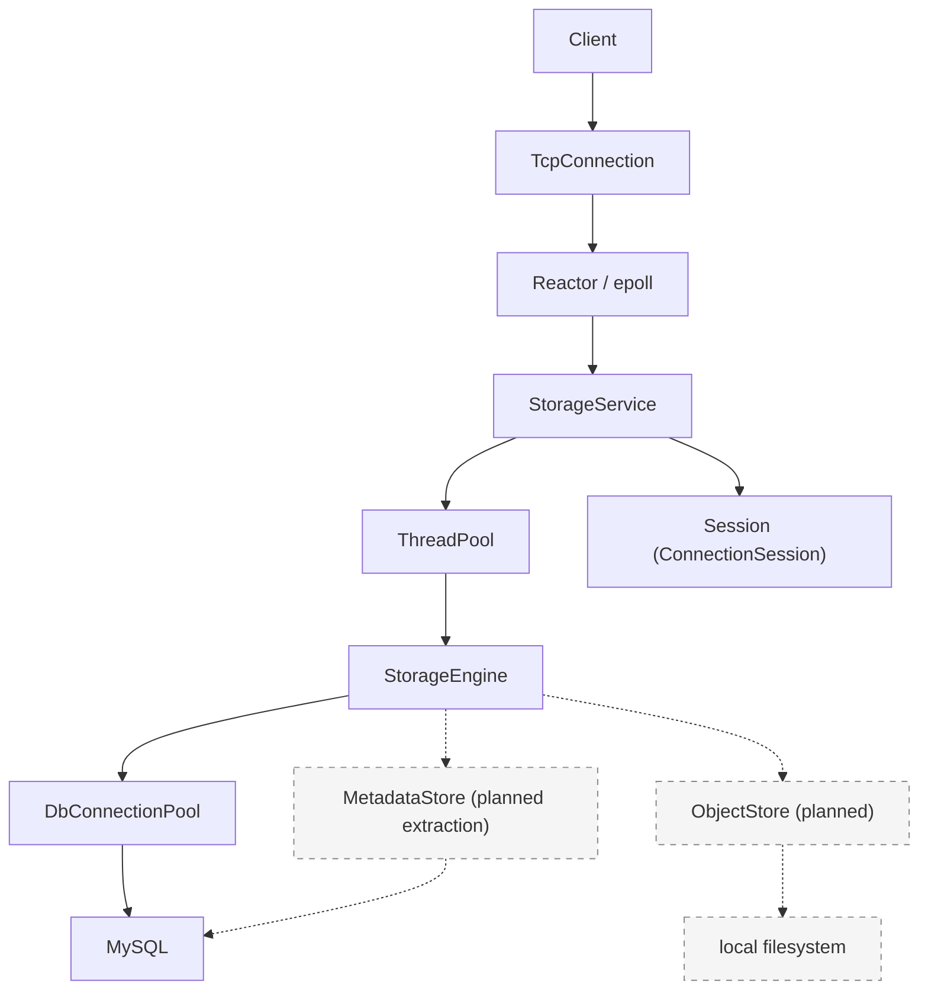

# TLSS

A C++17 file storage system built from scratch.

## Features

- **epoll Reactor networking** — 自行实现事件循环、连接管理与读写缓冲。
- **one-loop-per-thread** — 每个 IO 线程运行独立的 EventLoop，连接按轮询分配。
- **bounded worker pool** — 有界任务队列、非阻塞提交与异步排队超时。
- **MySQL connection pool** — 连接复用、预处理语句与 RAII 事务。
- **virtual filesystem namespace** — 用户根目录与 `mkdir / cd / ls / pwd` 命令。
- **content-addressed object storage** — **planned**；以 SHA-256 标识文件内容，表结构已预留 `object_hash`。
- **graceful shutdown** — 响应 `SIGINT / SIGTERM`，排空任务并回收连接与线程。
- **monitoring subsystem** — 独立的指标存储、策略、CLI、UDP 指标与可靠 TCP 告警。

## Demo

**目标客户端交互：** `tlss-client`、文件上传与内容哈希对象落盘尚待实现；当前可运行的目录操作示例见[构建与运行](#构建与运行)。

```text
$ tlss-client
Username: alice
Password: ****

tlss@alice:/> mkdir documents
tlss@alice:/> cd documents
tlss@alice:/documents> upload hello.txt

uploaded:
SHA256 b94d27...

tlss@alice:/documents> ls

hello.txt   file   11 B
```

## Architecture



图中实线表示当前实现，虚线表示规划中的存储边界。当前 `StorageEngine` 通过 `DbConnectionPool` 直接读写 MySQL 中的虚拟目录元数据；后续将元数据访问抽取为 `MetadataStore`，由 `ObjectStore` 管理本地文件内容。

网络层负责连接与消息回调，`StorageService` 解析命令并维护会话。每个连接的 `ConnectionSession` 保存认证状态、用户身份与当前目录，由所属 IO 线程读写。数据库操作和密码计算派发到业务线程池；认证结果与目录切换结果通过 `queue_in_loop` 返回连接所属的 EventLoop。

默认配置为 4 个 IO 线程、8 个业务线程、256 个执行队列槽位和 128 个异步等待队列槽位。目录操作通过 `try_run` 提交，队列已满时返回忙碌提示；登录与注册通过 `submit_async` 提交，排队等待期限为 2 秒。

停机时先停止接受连接并暂停读取，再排空业务任务，半关闭现有连接；连接等待超时后强制清理。随后回收 IO 线程和数据库连接池，退出主事件循环，最后关闭日志系统。

## 当前实现

| 部分 | 当前状态 | 代码入口 |
| --- | --- | --- |
| 主服务 | 在 `9000` 端口监听 TCP 连接；接受 LF / CRLF 行命令，支持注册、登录与目录操作，`q / quit` 关闭会话 | [main.cpp](src/main.cpp)、[server.cpp](src/ftp/server.cpp) |
| 用户认证 | 使用加盐 PBKDF2-HMAC-SHA256 验证密码；注册时在同一事务中创建用户与根目录，注册后需登录 | [auth/](src/auth/) |
| 虚拟文件系统 | MySQL `virtual_files` 表保存用户、父目录与路径；已接入 `mkdir / cd / ls / pwd`，`ls` 当前显示名称、类型及创建/更新时间 | [service_engine.cpp](src/ftp/service_engine.cpp)、[建表脚本](sql/init_tlss_db.sql) |
| 网络与基础设施 | epoll Reactor、IO 线程池、连接缓冲与输出高水位背压；业务线程池与 MySQL 连接池 | [net/](src/common/net/)、[base/](src/common/base/) |
| 监控 | 独立的指标存储、模块注册、定时器、策略、CLI、UDP 指标传输与可靠 TCP 告警，提供演示程序和测试 | [monitor/](src/monitor/) |
| 内存拷贝 | `TLSS::MEMORY::memcpy` 共享库，包含运行时后端选择与汇编实现 | [memory/](src/common/memory/) |
| 文件内容存储 | 已预留哈希字段；`upload / download` 处理、独立客户端与 ObjectStore 尚待实现 | [server.cpp](src/ftp/server.cpp)、[建表脚本](sql/init_tlss_db.sql) |
| 网关与 RPC | 保留网关、RPC 代码骨架及四份空的 `.proto` 文件；主程序尚未启动相关服务 | [gateway/](src/gateway/)、[rpc/](src/rpc/)、[proto/](proto/) |

主服务使用自定义行命令协议。监控子系统有自己的 `TLSSMON::Engine` 生命周期，目前通过独立演示程序运行，尚未接入主服务。

```text
src/monitor/demo/*
  └─ Engine → Timer / AIO → MonitorReporter → MonitorStore
                              ├─ UDP 指标发布
                              └─ 可靠告警发布 → 本地 spool → TCP collector
```

`demo-m9-node` 与 `demo-m9-collector` 组成独立的双进程示例，展示模块注册、采样、策略判定、上报、传输与 CLI 查询。

## 代码结构

| 路径 | 用途 |
| --- | --- |
| `inc/`、`src/` | 按 `common`、`auth`、`ftp`、`gateway`、`logger`、`monitor`、`rpc` 分组的头文件与实现 |
| `proto/` | 存储、认证、监控、网关的协议占位文件；CMake 配置了向 `build/generated/` 生成代码的步骤 |
| `tests/`、`src/monitor/test/` | 主服务/基础模块测试，以及监控子系统测试 |
| `config/`、`sql/` | MySQL 连接配置和建表脚本；`config/config.yaml.example` 目前为空，主程序不读取 YAML |
| `scripts/build.sh` | 配置、编译、测试的封装脚本 |
| `third/`、`third_party/` | 仓库内依赖与上游子模块；不要提交其构建产物 |
| `doc/` | 网络和内存拷贝子系统的补充资料 |

## 构建与运行

### 环境要求

- Linux；C++17 编译器、CMake 3.21+、Make、NASM、pkg-config。
- OpenSSL、Protobuf（含 `protoc`）、gRPC（含 `grpc_cpp_plugin`）、yaml-cpp、pthread；GoogleTest 用于部分可选测试。
- CMake 构建使用 `third/mysql/inc` 和 `third/mysql/lib/libmysqlclient.so` 中的 MySQL 客户端文件。运行主服务还需要可连接的 MySQL 8.0 实例（建库脚本使用 MySQL 8.0 排序规则）。

项目的 gRPC/Protobuf 上游仓库以 Git 子模块记录；按需使用 `git submodule update --init --recursive` 获取源码。CMake 当前优先查找已安装的 Protobuf 和 gRPC，而不是自动编译子模块。

### 配置数据库

主程序构造 `StorageService` 时会初始化 MySQL 连接池，并连接固定的 `tlss_db` 数据库。先在本地 MySQL 中执行建库脚本，再按本机环境调整配置：

```bash
mysql -u root -p < sql/init_tlss_db.sql
```

连接池从**可执行文件所在目录的上一级**读取 `config/mysql.cnf`。按默认输出布局，即 `bin/storage-service` 对应仓库根目录的 `config/mysql.cnf`。配置采用无空格的 `key=value` 格式，主要字段是 `ip`、`port`、`username`、`password`、`initSize`、`maxSize`；不要将真实凭据提交到仓库。启动时无法读取配置或建立初始数据库连接会导致进程退出。

### 编译、测试、启动

```bash
cmake --preset debug
cmake --build --preset debug
ctest --preset debug
./bin/storage-service
```

建议从仓库根目录启动，日志会写到相对路径 `logs/`。主程序当前不解析命令行参数，监听端口固定为 `9000`。另开终端，通过 `nc` 连接即可体验当前已实现的交互。

首次使用时输入 `signup`，按提示创建用户名和密码；用户名为 3–64 个字母、数字或下划线，密码为 8–128 字节且不含控制字符。注册同时创建用户根目录，成功后再输入 `login` 登录。

下面假设 `alice` 已注册，`documents` 尚不存在。`<password>` 代指注册时设置的密码，`nc` 不会自动隐藏输入；`ls` 查询空目录时只返回提示符。

```text
$ nc 127.0.0.1 9000
Welcome to TLSS.
Please enter login or signup:
tlss>login
Username:alice
Password:<password>
Login successful.
tlss@alice:/>mkdir documents
tlss@alice:/>cd documents
tlss@alice:/documents>pwd
/documents
tlss@alice:/documents>ls
tlss@alice:/documents>cd ..
tlss@alice:/>quit
bye!
```

服务收到 `SIGINT` 或 `SIGTERM` 后会尝试有序停机。`scripts/build.sh -t Debug` 也可完成配置、构建和测试；`-n` 不构建或运行测试，`-c` 会清理 `build/`、`bin/`、`lib/`，使用前请确认这些目录中的本地文件可以删除。优化构建使用 `cmake --preset release && cmake --build --preset release`。两个 preset 共用 `build/`，切换构建类型时需要重新配置。

监控演示程序输出到 `bin/dome/`，例如 `./bin/dome/demo-m9-policy` 可单独演示三种监控策略。`demo-m9-collector` 和 `demo-m9-node` 是独立示例，前者默认监听本机 UDP `9300`（指标）、TCP `9400`（告警）和 TCP `9310`（CLI）；后者需要指定模块、源 ID、outbox 目录和 CLI 端口。详情见 `src/monitor/demo/`。

## 测试与开发入口

`ctest --preset debug` 运行 CMake 注册的测试。`tests/` 包含 TCP 停机、线程池异步提交、MySQL 预处理语句、内存拷贝链接，以及依赖 GoogleTest 的认证、注册、事务等测试；`src/monitor/test/` 覆盖监控引擎、策略、协议、存储、CLI 与可靠告警。若未找到 GoogleTest，仅跳过依赖它的测试；其他测试仍会注册。

建议按以下顺序阅读源码：

1. `src/main.cpp` → `src/ftp/server.cpp` → `inc/ftp/context.h`：了解服务入口、命令派发、会话状态与停机流程。
2. `src/common/net/event_loop.cpp` → `src/common/net/tcp_server.cpp` → `src/common/net/tcp_connection.cpp`：追踪连接与消息处理。
3. `src/common/base/tlss_thread_pool.cpp`、`src/common/base/mysql_connection_pool.cpp`：查看任务与数据库资源的生命周期。
4. `src/auth/auth_service.cpp` → `src/auth/user_repository.cpp` → `src/ftp/service_engine.cpp`：追踪注册、登录与虚拟目录的数据库操作。
5. `src/monitor/demo/demo-m9-node.cpp` → `src/monitor/engine.cpp` → `src/monitor/monitor_reporter.cpp` → `src/monitor/demo/demo-m9-collector.cpp`：追踪独立监控示例。

## 后续方向

- 实现 `tlss-client`、`upload / download` 与基于 SHA-256 的本地 ObjectStore。
- 将虚拟文件元数据访问抽取为 MetadataStore，明确命名空间与文件内容的存储边界。
- 将监控子系统接入主服务，采集连接、任务队列与数据库连接池等运行指标。
- 完善 Protobuf 契约、gRPC 服务与网关。

**简体中文** | [English](README.es.md)

本项目采用 Apache License 2.0，见 [LICENSE](LICENSE)。
