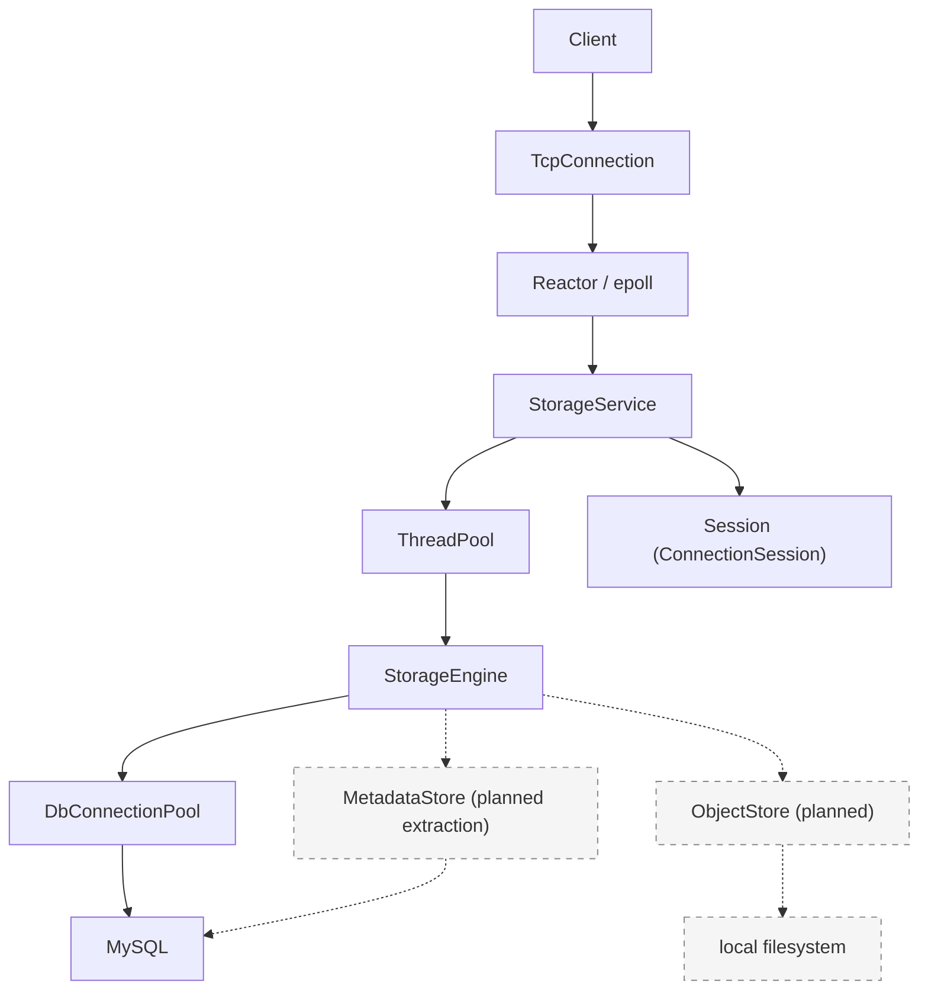

<p align="right">潮水成诗，破碎生长</p>

# TLSS
**简体中文** | [English](README.es.md)

本项目采用 Apache License 2.0，见 [LICENSE](LICENSE)。

A C++17 file storage system built from scratch.

## Features

- **epoll Reactor networking** — 自行实现事件循环、连接管理与读写缓冲。
- **one-loop-per-thread** — 每个 IO 线程运行独立的 EventLoop，连接按轮询分配。
- **bounded worker pool** — 有界任务队列、非阻塞提交与异步排队超时。
- **MySQL connection pool** — 连接复用、预处理语句与 RAII 事务。
- **virtual filesystem namespace** — 用户根目录与 `mkdir / cd / ls / pwd` 命令。
- **content-addressed object storage** — **planned**；以 SHA-256 标识文件内容，表结构已预留 `object_hash`。
- **graceful shutdown** — 响应 `SIGINT / SIGTERM`，排空任务并回收连接与线程。
- **monitoring subsystem** — 独立的指标存储、策略、CLI、UDP 指标与可靠 TCP 告警。

## Demo

**目标客户端交互：** `tlss-client`、文件上传与内容哈希对象落盘尚待实现；当前可运行的目录操作示例见[构建与运行](#构建与运行)。

```text
$ tlss-client
Username: alice
Password: ****

tlss@alice:/> mkdir documents
tlss@alice:/> cd documents
tlss@alice:/documents> upload hello.txt

uploaded:
SHA256 b94d27...

tlss@alice:/documents> ls

hello.txt   file   11 B
```

## Architecture



图中实线表示当前实现，虚线表示规划中的存储边界。当前 `StorageEngine` 通过 `DbConnectionPool` 直接读写 MySQL 中的虚拟目录元数据；后续将元数据访问抽取为 `MetadataStore`，由 `ObjectStore` 管理本地文件内容。

网络层负责连接与消息回调，`StorageService` 解析命令并维护会话。每个连接的 `ConnectionSession` 保存认证状态、用户身份与当前目录，由所属 IO 线程读写。数据库操作和密码计算派发到业务线程池；认证结果与目录切换结果通过 `queue_in_loop` 返回连接所属的 EventLoop。

默认配置为 4 个 IO 线程、8 个业务线程、256 个执行队列槽位和 128 个异步等待队列槽位。目录操作通过 `try_run` 提交，队列已满时返回忙碌提示；登录与注册通过 `submit_async` 提交，排队等待期限为 2 秒。

停机时先停止接受连接并暂停读取，再排空业务任务，半关闭现有连接；连接等待超时后强制清理。随后回收 IO 线程和数据库连接池，退出主事件循环，最后关闭日志系统。

## 网络服务生命周期与线程约束

本节描述当前 `TcpServer` / `StorageService` 的使用契约。安全运行需要同时满足**调用顺序、线程归属和对象生命周期**；接口使用了原子变量或把任务放入队列，并不代表允许任意并发调用。以下流程适用于已成功启动的服务，直接使用 `TcpServer` 时也须由上层执行对应的停机步骤。

### 完整启动与运行路径

当前入口见 [main.cpp](src/main.cpp)，服务编排见 [StorageService](src/ftp/server.cpp)。

1. **主线程**在创建工作线程前，通过 `pthread_sigmask` 阻塞 `SIGINT` / `SIGTERM`，然后初始化日志。退出信号由后续控制线程通过 `sigwait` 同步接收。
2. **主线程**先构造 `EventLoop`，再构造引用它的 `StorageService`。服务构造期间创建 `TcpServer`、获取数据库连接池，并设置连接/消息回调、IO 线程数及业务队列容量。
3. **主线程**调用 `StorageService::start()`：先启动业务线程池，再调用 `TcpServer::start()` 启动 IO 线程池并开放监听。配置必须先于启动完成；启动不能与停机或析构并发。
4. 启动完成后创建**独立控制线程**，让它等待退出信号；主线程进入 `EventLoop::loop()`。控制线程可以提交停机请求并等待，但主 loop 必须继续运行以处理这些请求。
5. 正常运行时，**主 loop**接受连接、分配 IO loop、维护 `_connections`；连接所属的 **IO loop**处理读写、连接状态和业务回调；**业务线程池**执行数据库等耗时操作，结果通过事件循环任务返回 IO loop。

IO 线程数为 `0` 时，连接也由主 loop 管理，没有独立的 IO 工作线程。业务回调不能假定自己一定在单独的 IO 线程中。

### 完整停机与析构路径

当前主程序的调用链是：

```text
控制线程 sigwait() 收到 SIGINT / SIGTERM
  → StorageService::stop(grace_period)
  → 标记业务停机，串行化停机请求
  → TcpServer::stop_accepting(done)
  → 等待 done：监听关闭、已有连接暂停读取
  → 业务线程池 stop()，等待已进入执行队列的任务结束
  → TcpServer::shutdown_connections(done)
  → 等待连接关闭；超过宽限期则 force_close_connections()
  → 继续等待同一个 done：连接表清空、相关 IO 清理已越过屏障
  → TcpServer::stop_io_threads()，退出并 join IO 线程
  → 数据库连接池 shutdown()
  → 主 EventLoop::quit()
  → 发布 StorageService 停机结果，控制线程结束

主线程 EventLoop::loop() 返回
  → join 控制线程
  → 析构 StorageService / TcpServer
  → 析构主 EventLoop
  → Logger::shutdown()
```

每一步都必须满足完成条件，才能进入下一阶段：

| 阶段 | 执行线程与实际操作 | 进入下一阶段的条件 |
| --- | --- | --- |
| 标记停机 | 控制线程设置 `StorageService::_stopping`；停止接受新的业务提交 | 上层不再产生新的业务任务；启动已经完成 |
| 停止接收 | 控制线程调用 `stop_accepting()`；主 loop 释放 Acceptor，各 IO loop 执行 `pause_read_for_shutdown()` | `done` 在主 loop 被调用，控制线程通过 future 等机制收到通知 |
| 结束业务任务 | 控制线程调用业务线程池 `stop()`；拒绝新提交、取消异步等待队列中尚未进入执行队列的任务，执行完已入队任务并 join 工作线程 | 业务线程池 `stop()` 返回；此时 IO loop 和数据库仍可用 |
| 排空连接 | 控制线程调用 `shutdown_connections()`；各 IO loop 排空发送缓冲后半关闭写端，并继续读取以等待对端 FIN | 等待连接清理完成；若超过 `grace_period`，提交强制关闭请求 |
| 强制关闭（按需） | 控制线程调用 `force_close_connections()`，各 IO loop 执行关闭 | 仍须等待此前 `shutdown_connections()` 的 `done`，不能因强制关闭接口返回就继续回收线程 |
| 确认 IO 清理 | 主 loop 从连接表移除连接，IO loop 执行 `connect_destroyed()`，随后通过 `when_io_idle()` 屏障通知主 loop | 连接表已空，相关清理任务越过屏障；`done` 已通知控制线程 |
| 回收资源 | 独立控制线程调用 `stop_io_threads()`，再关闭数据库池，最后 `quit()` 主 loop | IO 线程已 join；控制线程完成停机并发布结果 |
| 析构 | 主线程退出 `loop()`，join 控制线程，依次销毁服务与主 loop，最后关闭日志 | 没有仍会访问服务对象或已销毁 loop 的任务、回调及外部调用 |

`StorageService::stop()` 默认的连接宽限期为 5 秒，可传入非负时长。它只限制等待连接自然关闭的阶段，不是整个停机过程的超时：业务任务结束、强制关闭后的清理和其他阶段仍可能等待。返回值表示数据库连接池是否按其关闭策略成功结束，不应解释为整个停机过程一定在 `grace_period` 内完成。

### 直接使用 TcpServer 时如何等待完成

使用 `StorageService` 时，应由独立控制线程调用其 `stop()`，不要同时绕过它操作内部 `TcpServer`。若直接组合 `TcpServer`、业务线程池和数据库连接池，下面展示控制线程中的停机顺序；各对象已完成启动，主 loop 仍在运行，调用方在整个流程中保持它们存活。

```cpp
// 此代码运行在独立控制线程中；不能放进主 loop、IO 回调或业务线程池任务。
// 先由上层关闭业务入口，停止产生新任务。
auto paused = std::make_shared<std::promise<void>>();
auto paused_future = paused->get_future();
tcp_server.stop_accepting([paused] { paused->set_value(); });
paused_future.wait();

worker_pool.stop();  // IO loop 和数据库此时仍须存活，供已有任务完成。

auto drained = std::make_shared<std::promise<void>>();
auto drained_future = drained->get_future();
tcp_server.shutdown_connections([drained] { drained->set_value(); });
if (drained_future.wait_for(std::chrono::seconds(5)) == std::future_status::timeout) {
    tcp_server.force_close_connections();
}
drained_future.wait();  // 强制关闭也只是提交请求，完成通知仍来自同一个 done。

tcp_server.stop_io_threads();
const bool db_stopped = db_pool.shutdown();  // 按实际持有方式调用，并记录停机结果。
(void)db_stopped;
base_loop.quit();
// 主线程在 loop() 返回后 join 此控制线程，再析构服务和 base_loop。
```

示例中的 `worker_pool`、`db_pool` 和 `base_loop` 代表调用方持有的对应对象，需包含 `<future>`、`<memory>` 和 `<chrono>`。不要用 `sleep()` 猜测异步操作是否完成，也不要在控制线程等待之前先停止 EventLoop，否则完成回调无法执行。

### 必须遵守的线程与生命周期约束

| 对象或操作 | 当前实现要求 | 违反约束的风险 |
| --- | --- | --- |
| `TcpServer` 构造、配置、启动 | 按当前入口在主 loop 所属线程执行；所有 setter 在启动前配置完毕，启动后不再并发修改 | 回调 `std::function`、线程数或线程池容器发生并发读写 |
| `start()` 与停机 | 启动完成后才允许发起停机；停机开始后不能再次启动 | `_stopping` 的检查与资源访问不是整体原子操作，Acceptor 可能已被释放 |
| `_connections`、连接编号 | 由主 loop 维护；析构前先完成停机，避免其他线程与主 loop 同时访问连接表 | 容器数据竞争、迭代器失效 |
| TcpConnection / Channel | 对读写状态、缓冲和 Channel 的直接操作归所属 IO loop；跨线程使用提供了调度的接口 | 与事件分发、Channel 注销产生竞态；`shared_ptr` 只保活，不自动同步成员访问 |
| 停机回调 `done` | 在主 loop 执行；只做通知或轻量操作，不阻塞等待同一 loop 的任务 | 主 loop 无法推进，停机等待无法结束 |
| `StorageService::stop()`、`stop_io_threads()` | 由主 loop、IO 线程池和业务线程池之外的独立控制线程执行 | 阻塞等待自身处理屏障，或 join 当前线程；当前代码的线程检查未覆盖所有误用 |
| 捕获裸 `this` 的任务 | TcpServer、StorageService 以及用户回调引用的对象必须活到相关任务和回调执行完 | 关闭回调、屏障或其他排队任务访问已析构对象 |
| loop 生命周期 | IO loop 清理完成后才能 join IO 线程；主 loop 活到停机通知完成及服务析构之后 | 停机任务无法执行，或连接/任务通过裸 loop 指针访问已销毁对象 |
| 外部持有的连接和任务 | 停机前协调所有外部生产者；IO 线程回收后不能再通过旧连接提交任务或使用其 loop | 持有 `TcpConnectionPtr` 并不会延长它所引用的 EventLoop 生命周期 |
| 多个停机调用者 | 使用 `StorageService::stop()` 的互斥与完成通知统一协调；直接使用 TcpServer 时由上层保证只有一个停机流程 | 重复 `shutdown_connections()` 可能覆盖完成回调；线程池回收可能与其他操作交错 |

`when_io_idle()` 在各 IO loop 中排入屏障，再回主 loop 汇总结果。它保证相关先前任务已执行到屏障位置，**不保证其他线程今后不会继续提交任务，也不自动递归等待这些任务派生的所有后续任务**。因此必须先停止任务生产，再依次等待业务结束和连接清理；不能把这个函数当成任意时刻都能安全销毁服务器的证明。

`TcpServer::~TcpServer()` 不会自动完成上述完整停机流程，也不会自动延长裸 `this` 回调引用的对象生命周期。已启动的 `StorageService` 必须显式完成 `stop()` 后再析构，否则其析构函数会终止进程。不要在业务回调里直接删除仍在运行的服务器，也不要把“已调用停止接口”等同于“已完成停止”。

实现入口：[TcpServer](src/common/net/tcp_server.cpp)、[EventLoop](src/common/net/event_loop.cpp)、[EventLoopThread](src/common/net/event_loop_thread.cpp)、[业务线程池](src/common/base/tlss_thread_pool.cpp)。现有[停机回归测试](tests/test_tcp_server_shutdown.cpp)覆盖等待对端 FIN、零 IO 工作线程下的强制关闭等路径；它不代表已经验证任意启动/停机/析构交错都安全。

## 当前实现

| 部分 | 当前状态 | 代码入口 |
| --- | --- | --- |
| 主服务 | 在 `9000` 端口监听 TCP 连接；接受 LF / CRLF 行命令，支持注册、登录与目录操作，`q / quit` 关闭会话 | [main.cpp](src/main.cpp)、[server.cpp](src/ftp/server.cpp) |
| 用户认证 | 使用加盐 PBKDF2-HMAC-SHA256 验证密码；注册时在同一事务中创建用户与根目录，注册后需登录 | [auth/](src/auth/) |
| 虚拟文件系统 | MySQL `virtual_files` 表保存用户、父目录与路径；已接入 `mkdir / cd / ls / pwd`，`ls` 当前显示名称、类型及创建/更新时间 | [service_engine.cpp](src/ftp/service_engine.cpp)、[建表脚本](sql/init_tlss_db.sql) |
| 网络与基础设施 | epoll Reactor、IO 线程池、连接缓冲与输出高水位背压；业务线程池与 MySQL 连接池 | [net/](src/common/net/)、[base/](src/common/base/) |
| 监控 | 独立的指标存储、模块注册、定时器、策略、CLI、UDP 指标传输与可靠 TCP 告警，提供演示程序和测试 | [monitor/](src/monitor/) |
| 内存拷贝 | `TLSS::MEMORY::memcpy` 共享库，包含运行时后端选择与汇编实现 | [memory/](src/common/memory/) |
| 文件内容存储 | 已预留哈希字段；`upload / download` 处理、独立客户端与 ObjectStore 尚待实现 | [server.cpp](src/ftp/server.cpp)、[建表脚本](sql/init_tlss_db.sql) |
| 网关与 RPC | 保留网关、RPC 代码骨架及四份空的 `.proto` 文件；主程序尚未启动相关服务 | [gateway/](src/gateway/)、[rpc/](src/rpc/)、[proto/](proto/) |

主服务使用自定义行命令协议。监控子系统有自己的 `TLSSMON::Engine` 生命周期，目前通过独立演示程序运行，尚未接入主服务。

```text
src/monitor/demo/*
  └─ Engine → Timer / AIO → MonitorReporter → MonitorStore
                              ├─ UDP 指标发布
                              └─ 可靠告警发布 → 本地 spool → TCP collector
```

`demo-m9-node` 与 `demo-m9-collector` 组成独立的双进程示例，展示模块注册、采样、策略判定、上报、传输与 CLI 查询。

## 代码结构

| 路径 | 用途 |
| --- | --- |
| `inc/`、`src/` | 按 `common`、`auth`、`ftp`、`gateway`、`logger`、`monitor`、`rpc` 分组的头文件与实现 |
| `proto/` | 存储、认证、监控、网关的协议占位文件；CMake 配置了向 `build/generated/` 生成代码的步骤 |
| `tests/`、`src/monitor/test/` | 主服务/基础模块测试，以及监控子系统测试 |
| `config/`、`sql/` | MySQL 连接配置和建表脚本；`config/config.yaml.example` 目前为空，主程序不读取 YAML |
| `scripts/build.sh` | 配置、编译、测试的封装脚本 |
| `third/`、`third_party/` | 仓库内依赖与上游子模块；不要提交其构建产物 |
| `doc/` | 网络和内存拷贝子系统的补充资料 |

## 构建与运行

### 环境要求

- Linux；C++17 编译器、CMake 3.21+、Make、NASM、pkg-config。
- OpenSSL、Protobuf（含 `protoc`）、gRPC（含 `grpc_cpp_plugin`）、yaml-cpp、pthread；GoogleTest 用于部分可选测试。
- CMake 构建使用 `third/mysql/inc` 和 `third/mysql/lib/libmysqlclient.so` 中的 MySQL 客户端文件。运行主服务还需要可连接的 MySQL 8.0 实例（建库脚本使用 MySQL 8.0 排序规则）。

项目的 gRPC/Protobuf 上游仓库以 Git 子模块记录；按需使用 `git submodule update --init --recursive` 获取源码。CMake 当前优先查找已安装的 Protobuf 和 gRPC，而不是自动编译子模块。

### 配置数据库

主程序构造 `StorageService` 时会初始化 MySQL 连接池，并连接固定的 `tlss_db` 数据库。先在本地 MySQL 中执行建库脚本，再按本机环境调整配置：

```bash
mysql -u root -p < sql/init_tlss_db.sql
```

连接池从**可执行文件所在目录的上一级**读取 `config/mysql.cnf`。按默认输出布局，即 `bin/storage-service` 对应仓库根目录的 `config/mysql.cnf`。配置采用无空格的 `key=value` 格式，主要字段是 `ip`、`port`、`username`、`password`、`initSize`、`maxSize`；不要将真实凭据提交到仓库。启动时无法读取配置或建立初始数据库连接会导致进程退出。

### 编译、测试、启动

```bash
cmake --preset debug
cmake --build --preset debug
ctest --preset debug
./bin/storage-service
```

建议从仓库根目录启动，日志会写到相对路径 `logs/`。主程序当前不解析命令行参数，监听端口固定为 `9000`。另开终端，通过 `nc` 连接即可体验当前已实现的交互。

首次使用时输入 `signup`，按提示创建用户名和密码；用户名为 3–64 个字母、数字或下划线，密码为 8–128 字节且不含控制字符。注册同时创建用户根目录，成功后再输入 `login` 登录。

下面假设 `alice` 已注册，`documents` 尚不存在。`<password>` 代指注册时设置的密码，`nc` 不会自动隐藏输入；`ls` 查询空目录时只返回提示符。

```text
$ nc 127.0.0.1 9000
Welcome to TLSS.
Please enter login or signup:
tlss>login
Username:alice
Password:<password>
Login successful.
tlss@alice:/>mkdir documents
tlss@alice:/>cd documents
tlss@alice:/documents>pwd
/documents
tlss@alice:/documents>ls
tlss@alice:/documents>cd ..
tlss@alice:/>quit
bye!
```

服务收到 `SIGINT` 或 `SIGTERM` 后会尝试有序停机。`scripts/build.sh -t Debug` 也可完成配置、构建和测试；`-n` 不构建或运行测试，`-c` 会清理 `build/`、`bin/`、`lib/`，使用前请确认这些目录中的本地文件可以删除。优化构建使用 `cmake --preset release && cmake --build --preset release`。两个 preset 共用 `build/`，切换构建类型时需要重新配置。

监控演示程序输出到 `bin/dome/`，例如 `./bin/dome/demo-m9-policy` 可单独演示三种监控策略。`demo-m9-collector` 和 `demo-m9-node` 是独立示例，前者默认监听本机 UDP `9300`（指标）、TCP `9400`（告警）和 TCP `9310`（CLI）；后者需要指定模块、源 ID、outbox 目录和 CLI 端口。详情见 `src/monitor/demo/`。

## 测试与开发入口

`ctest --preset debug` 运行 CMake 注册的测试。`tests/` 包含 TCP 停机、线程池异步提交、MySQL 预处理语句、内存拷贝链接，以及依赖 GoogleTest 的认证、注册、事务等测试；`src/monitor/test/` 覆盖监控引擎、策略、协议、存储、CLI 与可靠告警。若未找到 GoogleTest，仅跳过依赖它的测试；其他测试仍会注册。

建议按以下顺序阅读源码：

1. `src/main.cpp` → `src/ftp/server.cpp` → `inc/ftp/context.h`：了解服务入口、命令派发、会话状态与停机流程。
2. `src/common/net/event_loop.cpp` → `src/common/net/tcp_server.cpp` → `src/common/net/tcp_connection.cpp`：追踪连接与消息处理。
3. `src/common/base/tlss_thread_pool.cpp`、`src/common/base/mysql_connection_pool.cpp`：查看任务与数据库资源的生命周期。
4. `src/auth/auth_service.cpp` → `src/auth/user_repository.cpp` → `src/ftp/service_engine.cpp`：追踪注册、登录与虚拟目录的数据库操作。
5. `src/monitor/demo/demo-m9-node.cpp` → `src/monitor/engine.cpp` → `src/monitor/monitor_reporter.cpp` → `src/monitor/demo/demo-m9-collector.cpp`：追踪独立监控示例。

## 后续方向

- 实现 `tlss-client`、`upload / download` 与基于 SHA-256 的本地 ObjectStore。
- 将虚拟文件元数据访问抽取为 MetadataStore，明确命名空间与文件内容的存储边界。
- 将监控子系统接入主服务，采集连接、任务队列与数据库连接池等运行指标。
- 完善 Protobuf 契约、gRPC 服务与网关。

