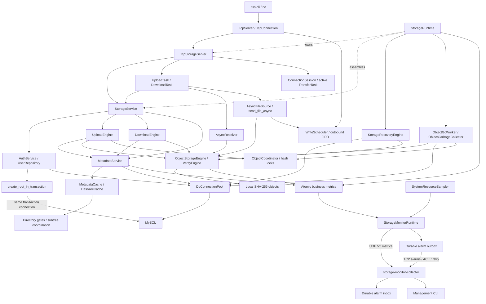

<p align="right">潮水成诗，破碎生长</p>


# TLSS — Toy-Level File Storage Service

[简体中文](README.cn.md) | **English**

**A toy-level file storage service built from the ground up with C++17 on Linux.**

TLSS (Toy-Level File Storage Service) is my long-term personal open-source project for exploring Linux systems programming, networking, concurrency models, and storage system design.

Built on a custom epoll Reactor networking framework, the project has gradually grown to include a thread pool, a MySQL connection pool, user authentication, a virtual filesystem, SHA-256 content-addressed storage, and asynchronous file uploads and downloads.

By building foundational components rather than simply assembling established frameworks, TLSS explores how a storage service is built, runs, handles errors, and becomes more reliable through continued iteration.

TLSS now provides single-node file storage with virtual file management, asynchronous disk I/O, bounded transfer buffering, background object reclamation, and startup recovery. Work continues on failure handling, recovery procedures, and validation with real database workloads.

**Currently implemented:** epoll Reactor, asynchronous TCP client (`tlss-cli`), bounded thread pool, MySQL connection pool, PBKDF2 password hashing, user registration/login, virtual directories and path resolution, file upload/download/deletion/rename/move, empty and recursive directory deletion, sharded metadata caching with subtree coordination, SHA-256 objects, background garbage collection, startup cleanup/recovery, and graceful shutdown.

**Supporting subsystems:** the main service reports business and resource metrics to a separate monitoring collector, with durable reliable alarms; the AVX2/REP MOVSB memory copy library is used by network buffers and has a separate benchmark entry point.

**Next steps:** broader crash and real-MySQL validation, explicit retry/result-query semantics, integrity checking and repair procedures, gRPC interfaces, and deployment evolution driven by actual requirements.

### Quick Start

Prepare dependencies, initialize the database, and adjust `config/mysql.cnf` as described in [Build and run](#build-and-run), then build from the repository root:

```bash
cmake --preset debug
cmake --build --preset debug --parallel 4
```

The `debug` preset sets `BUILD_TESTS=OFF`. To build and run tests, use the explicit test configuration in [Compile, test, and start](#compile-test-and-start).

Start the server and client in separate interactive terminals:

```bash
# Terminal 1
./bin/storage-service
# Terminal 2
./bin/tlss-cli 127.0.0.1 9000
```

### Project scope

TLSS is an actively developed single-node storage system prototype intended for technical learning, architectural exploration, and open-source discussion.

It is not yet suitable for production use or for storing important data. Work continues on reliability, testability, and file lifecycle management.

See the build instructions, architecture, and implementation notes below.

## Contents

- [Features and implementation status](#features-and-implementation-status)
- [Current interaction](#current-interaction)
- [Architecture and execution model](#architecture-and-execution-model)
- [Storage component responsibilities and call chains](#storage-component-responsibilities-and-call-chains)
- [Module implementation](#module-implementation)
- [Write scheduling and backpressure](#write-scheduling-and-backpressure)
- [File operations and transaction outcomes](#file-operations-and-transaction-outcomes)
- [Metadata cache](#metadata-cache)
- [File transfer and asynchronous disk work](#file-transfer-and-asynchronous-disk-work)
- [Object reclamation and startup recovery](#object-reclamation-and-startup-recovery)
- [Service monitoring](#service-monitoring)
- [Monitoring metric reference](#monitoring-metric-reference)
- [Monitoring commands and query examples](#monitoring-commands-and-query-examples)
- [Network service lifecycle and threading requirements](#network-service-lifecycle-and-threading-requirements)
- [Code layout](#code-layout)
- [Build and run](#build-and-run)
- [Tests and where to start reading](#tests-and-where-to-start-reading)
- [Current limitations and remaining work](#current-limitations-and-remaining-work)
- [Evolution roadmap and integration timing](#evolution-roadmap-and-integration-timing)
- [Why "Toy-Level"?](#about-tlss)

## Features and implementation status

- **epoll Reactor networking** — Custom event loop, connection management, and read/write buffers.
- **one-loop-per-thread** — Each IO thread runs its own EventLoop; connections are assigned in round-robin order.
- **ordered write scheduling** — A loop-owned `WriteScheduler` sequences control text, direct file sends, and asynchronous file chunks with bounded buffering and per-round work budgets.
- **bounded worker pool** — Bounded task queues, nonblocking submission, and asynchronous queue wait timeouts.
- **MySQL connection pool** — Connection reuse, prepared statements, and RAII transactions.
- **virtual filesystem namespace** — Per-user roots; absolute/relative `cd` paths; directory creation, empty/recursive deletion, and file deletion/rename/move.
- **metadata cache** — Per-user listings, resolved directories, and download hashes, with sharding, TTLs, load coalescing, two-directory invalidation, and subtree coordination.
- **content-addressed object storage** — Local objects identified by SHA-256 and referenced by virtual files through `object_hash`; identical contents reuse an object.
- **asynchronous file transfer** — Uploads/downloads use a dedicated disk pool, chunked IO, temporary files, persistence, and transfer acknowledgments.
- **object lifecycle management** — Object registration, reference checks, a grace period before garbage collection, exclusive object-root ownership, and startup recovery of temporary files, unregistered objects, and interrupted deletions.
- **graceful shutdown** — Handles `SIGINT / SIGTERM`, drains tasks, and releases connections and threads.
- **monitoring subsystem** — Independent metric storage, policies, CLI, UDP metrics, and reliable TCP alarms.
- **interactive client** — `tlss-cli`, with asynchronous connections, terminal input, and orderly shutdown.
- **memory copy library** — AVX2, REP MOVSB, non-temporal stores (NT), and runtime selection of parallel copying.

| Component | Current capability | Main service integration |
| --- | --- | --- |
| Networking | epoll Reactor, connection buffers, IO thread pool, asynchronous TCP client, FIFO write scheduler | In use |
| Worker pool | Bounded execution queue, nonblocking submission, asynchronous queue wait timeouts | In use |
| MySQL | Connection pool, prepared statements, RAII transactions | In use |
| Authentication | Signup, password verification, transactional user and root directory creation | In use |
| Virtual directories and files | `mkdir / cd / ls / pwd / rm / rmdir [-r] / rename / move`; `cd` and move targets accept absolute/relative virtual paths | In use; rename/move apply to files and reject destination conflicts |
| Metadata cache | `HashArcCache`, TTLs, directory/subtree generations, exact/subtree access coordination, statistics | Queries and mutations share cache coordination; moves invalidate both directories and recursive deletion invalidates descendants |
| Client | `tlss-cli <IPv4> <port>` with interactive commands and file upload/download | Standalone executable |
| Monitoring | Business/resource metrics, CLI, UDP, reliable TCP alarms | Main owns the monitor runtime and resource sampler; separate `storage-monitor-collector` receives reports |
| Memory copy | `TLSS::MEMORY::memcpy` shared library | Called by networking `Buffer::append()` with the Default hint |
| File contents and recovery | SHA-256 objects, asynchronous transfer, object states, background GC, temporary cleanup, startup backfill and deletion recovery | In use; filesystem publication and MySQL commit remain separate steps, and comprehensive integrity repair is still future work |
| RPC and gateway | Build targets and code skeletons | No business services; all four `.proto` files are empty |
| Kafka | Event and consumer design | Planned; no producer, consumer, or deployment configuration yet |

## Current interaction

Prepare the database and start the service as described in [Build and run](#build-and-run), then run `./bin/tlss-cli 127.0.0.1 9000` in another interactive terminal. The following shows directory operations for a registered user, omitting connection notices. It assumes `documents` does not yet exist; `<password>` represents the actual password.

```text
$ ./bin/tlss-cli 127.0.0.1 9000
Welcome to TLSS.
Please enter login or signup:
tlss>login
Username:alice
Password:<password>
Login successful.
tlss@alice:/>mkdir documents
tlss@alice:/>cd documents
tlss@alice:/documents>pwd
/documents
tlss@alice:/documents>cd ..
tlss@alice:/>quit
```

On first use, choose `signup` and enter a username, password, and password confirmation. After registration succeeds, choose `login` again. The client does not currently hide password input, and the service connection does not use TLS.

After login, transfer files using the following commands inside `tlss-cli`, not in the shell:

```text
upload <local-file-path> [remote-filename]
download <remote-filename> [local-destination-path]
```

For example, start the client from the repository root, enter the remote `documents` directory, and issue these commands one at a time, waiting for each operation to finish:

```text
upload "./README.md" "readme-copy.md"
download "readme-copy.md" "./readme-downloaded.md"
```

An upload defaults to the local basename if the remote name is omitted. A download defaults to the client working directory if the destination is omitted. Use double quotes for arguments containing spaces. A remote filename is a single name in the current virtual directory. Uploads do not replace existing nodes, downloads do not overwrite local files, and the local parent directory must exist. Each connection allows one transfer at a time; `exit / q / quit` during a transfer cancels it and disconnects.

Other file-management commands available after login:

| Command | Behavior |
| --- | --- |
| `cd "/documents"`, `cd "../archive"`, `cd "."` | Resolve absolute/relative virtual paths; `..` stops at the root |
| `rm "file.txt"` | Delete the file's virtual record; reclaim its object later only if unreferenced |
| `rmdir "empty-dir"` | Delete an empty child directory |
| `rmdir -r "tree"` | Delete a child directory and all descendant metadata in one transaction |
| `rename "old.txt" "new.txt"` | Rename a file in the current directory without overwriting another node |
| `move "file.txt" "/archive"` | Move a file to an existing directory, retaining its name; relative targets such as `../archive` also work |

For example, after the upload/download example above, while still in `/documents`, run each command separately and wait for its response. This assumes `archive` does not yet exist:

```text
rename "readme-copy.md" "readme-renamed.md"
mkdir archive
move "readme-renamed.md" "archive"
cd archive
rm "readme-renamed.md"
cd ..
rmdir archive
```

File names and directory names for create/delete/rename operations are single components. `cd` and the destination of `move` accept paths. Directory rename/move, overwrite updates, and resumable transfers are not implemented. Deletion removes virtual metadata immediately after a confirmed commit; physical reclamation runs separately.

## Architecture and execution model

Three executables provide the business interface and monitoring:

| Executable | Responsibility | Default endpoints |
| --- | --- | --- |
| `bin/storage-service` | Authentication, virtual file management, transfers, object GC/recovery, and metric production | Business TCP `9000` |
| `bin/tlss-cli <IPv4> <port>` | Interactive business commands and local file transfers | Connects to the supplied address and port |
| `bin/storage-monitor-collector` | Receive metrics and durable alarms; expose management commands | UDP metrics `9300`, TCP alarms `9400`, TCP management CLI `9310` |

The collector is started separately. Its management CLI and the business client's command interface serve different purposes.



The diagram shows the current implementation. The main service uses the custom TCP library directly; `src/gateway/` does not participate in request handling. `MetadataService` checks its cache before borrowing a database connection and executing SQL on a miss. Signup creates the root directory using the transaction connection already borrowed by the user repository, bypassing ordinary cache operations.

The networking layer handles connections and message callbacks. `TcpStorageServer` parses commands and maintains sessions. The injected `StorageService` accepts structured identity/directory requests and coordinates AuthService, MetadataService, UploadEngine, and DownloadEngine; its public API has no TCP or resource-pool dependency. `StorageRuntime` assembles these components and owns execution resources, recovery, metrics snapshots, and shutdown. Each connection's `ConnectionSession` stores its authentication state, user identity, current directory, and an active transfer task handle. The task owns the transfer state; both are accessed by the owning IO thread. Authentication, directory operations, and upload preflight checks run in the business pool. File IO, download lookups, and final upload metadata insertion run in disk tasks. Authentication, directory change, and transfer results return to the connection's EventLoop through `queue_in_loop`.

Server defaults are 4 IO threads, 8 business worker threads, 256 business execution queue slots, and 128 asynchronous wait queue slots. A separate disk pool uses 2 threads by default. Directory operations use `try_run` and report a busy server when the queue is full. Login and signup use `submit_async` with a 2-second queue wait deadline.

Additional threads include the object GC worker, resource sampler, monitor runtime and reliable alarm transport, signal control thread, worker pool deadline manager, and database connection producer and idle scanner. The 2-second deadline only limits how long authentication tasks wait to enter the execution queue; it does not interrupt SQL or password computation that has already started.

| Execution resource | Current work | Result handoff |
| --- | --- | --- |
| Main EventLoop | Accept connections, assign IO loops, maintain the connection map | Connections move to their owning IO loop |
| Owning IO loop | Protocol framing, session access, transfer state transitions, socket reads/writes | Expensive operations go to the business or disk pool |
| Business worker pool | Login/signup, directory SQL, upload preflight checks | Session and transfer state changes return to the IO loop; text responses use the connection's scheduled send interface |
| Disk worker pool | File open, chunked IO, hashing, sync, publication, and close; download metadata lookups and final upload metadata insertion | Results return through `queue_in_loop()` |
| Object GC thread | Periodic candidate scans, reference/state transactions, object removal and finalization | Logs batch failures and retries on subsequent scans; stopped before database teardown |
| Separate control thread | Wait for signals, coordinate shutdown, join resource threads | The main loop keeps running until shutdown barriers complete |

“Asynchronous disk IO” means moving blocking file operations to a dedicated worker pool. The implementation does not use io_uring or kernel asynchronous file APIs. SQL can also execute on disk workers; splitting components did not create a dedicated pool for each engine.

Before startup, main holds an exclusive lock on the object root and calls `prepare_storage()` to clean temporary files, backfill object records, and resume interrupted deletions. Failure prevents listening. Shutdown stops accepting connections and pauses reads, drains business tasks, cancels and waits for disk work, then stops the GC worker before shutting down existing connections. It subsequently joins IO threads, shuts down the database pool, and exits the main event loop. Logging shuts down last.

### Storage component responsibilities and call chains

| Component and source | Responsibilities | Boundary |
| --- | --- | --- |
| [StorageService](src/ftp/server.cpp) | Protocol-independent authentication, directory/file operations, and upload/download coordination | Injected engine references; no sockets, sessions, connection pool, worker pool, or lifecycle ownership |
| [TcpStorageServer](src/ftp/tcp_storage_server.cpp) | Authentication dialogue, framing, session index, TCP task creation, and responses | Borrows the business service and execution resources; owns only the TCP adapter and sessions |
| [StorageRuntime](src/ftp/storage_runtime.cpp) | Dependency assembly, execution resources, metrics snapshots, start/stop | Keeps service/engines alive through task cleanup and network barriers |
| [StorageRecoveryEngine](src/ftp/storage_recovery_engine.cpp) | Temporary cleanup, object-table checks, backfill, and DELETING recovery | Blocking startup work before business listeners and workers |
| [TransferTask / TransferContext](inc/ftp/transfer_task.h) | Per-transfer phase, cancellation, events, identity and directory snapshots | Validates connection, session, user, directory, and generation on the IO loop to discard stale results |
| [UploadEngine](src/ftp/upload_engine.cpp) | Preflight, temporary receiver creation, object publication and metadata commit | Protocol-independent; hash lock spans publication and commit |
| [UploadTask / DownloadTask](src/ftp/tcp_transfer_tasks.cpp) | TCP transfer phases, async adapters, cancellation, events, sends, and ACK | Call StorageService with immutable identity/directory snapshots on existing execution resources |
| [DownloadEngine](src/ftp/download_engine.cpp) | Resolve metadata and open objects, returning a source handle and hash | Does not send socket data or manage ACK state |
| [MetadataService](src/ftp/metadata_service.cpp) | Directory queries and mutations, file deletion/rename/move, upload registration, download hashes, and cache coordination | Holds no file contents; transaction helpers share the borrowed connection; `prepare_upload()` queries the database directly |
| [ObjectStorageEngine](src/ftp/object_storage_engine.cpp) | Temporary objects, publication, validation, reads, removal, temporary cleanup, and object enumeration | Synchronous filesystem primitives without database, protocol, or session state; callers choose execution threads |
| [ObjectRepository](src/ftp/object_repository.cpp) / [GC transactions](src/ftp/object_gc_transaction.cpp) | Object states, reference checks, unreferenced timestamps, and deletion preparation/finalization | Use the caller's database connection; physical removal follows confirmed DELETING commit |
| [ObjectCoordinator](inc/ftp/object_coordinator.h) / [StorageRootLock](src/ftp/storage_root_lock.cpp) | Hash-sharded locks for upload/GC; exclusive process ownership of an object root | In-process coordination plus a lifetime-held filesystem lock; not distributed coordination |
| [ObjectGarbageCollector](src/ftp/object_garbage_collector.cpp) / [ObjectGcWorker](src/ftp/object_gc_worker.cpp) / [ObjectBackfill](src/ftp/object_backfill.cpp) | Background reclamation, interrupted-deletion recovery, and startup object registration | Recheck actual references; do not treat metadata deletion as permission to immediately unlink shared content |
| [VerifyEngine](src/ftp/verify_engine.cpp) | Exact-length validation, incremental SHA-256, expected digest comparison | File integrity, separate from user authentication |
| [DiskExecutor](inc/ftp/disk_executor.h) / [async adapters](inc/ftp/async_file_receiver.h) | Disk scheduling, active resource tracking, cancellation, cleanup, result delivery to IO loops | Execution and adaptation, without business permissions or virtual directories |

Uploads follow `TcpStorageServer → UploadTask → StorageService / UploadEngine → AsyncReceiver → publish object + metadata commit → UOK`. Downloads follow `TcpStorageServer → DownloadTask → StorageService / DownloadEngine → AsyncFileSource → send_file_async → DONE → ACK → OK`. The client sends ACK only after local verification, sync, and publication succeed.

Signup still starts a transaction through `AuthService → MySqlUserRepository` and calls `MetadataService::create_root_in_transaction()` to create the root directory. This function neither borrows another connection nor commits independently: the user and root share one transaction. `StorageEngine` in the compatibility header [service_engine.h](inc/ftp/service_engine.h) aliases `MetadataService`.

## Module implementation

### Networking library and command protocol

Implementations are in [common/net](src/common/net/), with headers in [inc/common/net](inc/common/net/).

| Type | Responsibility |
| --- | --- |
| `EventLoop` | Wait for IO events, dispatch Channels, and execute pending callbacks |
| `Poller / EPollPoller` | epoll event waiting and registration management |
| `Channel` | File descriptor event interests, callbacks, and lifetime association |
| `Acceptor / TcpServer` | Accept connections, maintain the connection map, and assign IO loops in round-robin order |
| `TcpConnection` | Connection state, input buffer, read controls, write-scheduler integration, half-close, and forced closure |
| `WriteScheduler` | FIFO memory/file writes, partial-write progress, asynchronous read sequencing, queue limits, and send completion |
| `EventLoopThreadPool` | Manage IO threads using one loop per thread |
| `Connector / TcpClient` | Nonblocking connection setup, retries, and client connection management |

Cross-thread calls use `queue_in_loop()` and wake the target loop through `eventfd`. `run_in_loop()` executes immediately on the owning thread and queues work otherwise. Cross-thread sends retain the message contents and a connection reference until execution. `Channel::tie()` and deferred cleanup coordinate object destruction with event dispatch.

`Buffer::read_fd()` uses `readv` with its internal writable region and a 64 KiB stack buffer. The service configures a 256 KiB output high-water mark: reaching it pauses reads, which resume after the output buffer drains. Connections also have a 1 MiB pending memory limit, including reservations for asynchronous file chunks, rather than buffering entire files. These mechanisms do not replace capacity limits on all upstream task queues.

[TcpStorageServer::on_message()](src/ftp/tcp_storage_server.cpp) splits control input on `\n`, accepts `\r\n`, retains incomplete commands, and processes complete commands in a loop. A control command may contain at most 4096 bytes; exceeding the limit closes the connection. Upload bodies are consumed by their declared length, not split on newlines. The `ftp/` module implements a custom TCP storage protocol, not standard FTP.

### Write scheduling and backpressure

[WriteScheduler](src/common/net/write_scheduler.cpp) is owned by `TcpConnection` and runs on the connection's IO loop. Its FIFO holds memory writes, direct `sendfile` tasks, and asynchronous-reader tasks. Control messages and file bodies share this ordering, so a queued completion frame cannot overtake the preceding body. This preserves send order; it does not serialize independently executing business commands.

| Limit | Current value | Scope |
| --- | --- | --- |
| Pending memory charge | 1 MiB | Per connection; full retained memory messages plus one bounded reservation for each asynchronous file task |
| Queued write tasks | 1024 | Per connection, including memory and file tasks |
| Queued file tasks | 64 | Per connection, across both file-send modes |
| Asynchronous read chunk | 64 KiB | At most one outstanding read for the front file task |
| Writable-event budget | 1 MiB and 64 steps | Stop the current round when either budget is exhausted |
| Business output high-water mark | 256 KiB | Pause application reads on crossing; resume after the output queue drains |

Direct `sendfile` payloads are not charged as buffered memory. Asynchronous file tasks reserve at most one chunk rather than their complete file size. These limits are distinct from the disk executor's 64 attached resources and the business task queues.

While the front task awaits disk data, the scheduler disables `EPOLLOUT`. Completion is queued to the owning loop and checked against its read sequence; stale results are ignored. Partial writes retain their offsets, and connection closure cancels pending tasks. File completion callbacks are deferred through the loop, after the scheduler releases file/reader references. The scheduler borrows the socket; `TcpConnection` controls its lifetime and applies event-interest changes.

### Sessions, signup, and login

[ConnectionSession](inc/ftp/context.h) stores login state, temporary username and password input, an authentication attempt number, authenticated identity, the current directory, a directory change flag, an active transfer task handle, and a transfer generation. Only the owning IO thread accesses session contents; a separate mutex protects the session index.

```text
Login:
login → username → password → verifying
      → worker queries the active user and verifies the password
      → IO loop checks the connection, original session, and auth_attempt
      → publish identity and set the current directory to /

Signup:
signup → username → password → confirmation → registering
       → worker computes the password hash first
       → insert the user and root directory in one database transaction
       → return the result and require a separate login
```

[AuthService](src/auth/auth_service.cpp) handles validation, username normalization, and result mapping. [MySqlUserRepository](src/auth/user_repository.cpp) handles user data access. Signup usernames contain 3–64 ASCII letters, digits, or underscores and are converted to lowercase before storage. Passwords contain 8–128 bytes; spaces are preserved and control characters are rejected.

After successful password verification, `AuthService` issues an immutable [AuthenticatedPrincipal](inc/auth/authenticated_principal.h) containing the database user ID and canonical username. `AuthResult` carries its `PrincipalHandle`; signup receipts cannot establish an authenticated session. Each AuthService has a distinct private issuer, and `owns()` validates a handle without querying the user repository. TCP login completion requires both successful status and a principal from the expected issuer.

[StorageRequestContext](inc/ftp/storage_request.h) carries this principal and the request directory, with no caller-writable user ID or username. StorageService and the upload/download engines validate issuer ownership and directory syntax before accessing metadata or publishing objects. Metadata queries still check the cache first. IO completion callbacks compare principal handles, so a new login by the same user invalidates old callbacks as well as logins by another user.

Disconnect cancels incomplete transfers and releases the session's identity reference. Admitted asynchronous work retains its own reference until completion; the last reference automatically destroys the identity. An already running upload finalizer can finish under the existing commit rules. These are process-local identities, with no expiry or revocation registry; they are not network bearer tokens, and future RPC entries must authenticate remote callers before obtaining one.

[PasswordHasher](src/auth/password_hasher.cpp) uses a 16-byte random salt, 600000 PBKDF2-HMAC-SHA256 iterations, a 32-byte derived key, and an encoding that includes the version and iteration count. Verification compares results using `CRYPTO_memcmp`. Signup computes the hash before borrowing a database connection for the transaction, reducing connection occupancy.

The database username unique index resolves concurrent signup attempts. If commit confirmation is lost, the service returns an unknown outcome and suggests trying login first; it does not automatically retry signup. Authentication completion callbacks check weak references, session identity, and `auth_attempt` so stale results cannot overwrite current state.

### Virtual directories and storage boundaries

The [initial schema](sql/init_tlss_db.sql) defines `users` and `virtual_files`; the [object-table migration](sql/migrations/001_create_storage_objects.sql) adds `storage_objects`. Virtual files are scoped by `username`, use `parent_id` for parent-child relationships, and store `path`, `file_type`, `object_hash`, and timestamps. A root uses `parent_id = -1`, `file_name = '/'`, and `path = '/'`. A unique index prevents duplicate sibling names. Object records store a hash, `LIVE / DELETING / UNAVAILABLE` state, and `unreferenced_at`; reference existence is queried from `virtual_files`, without a stored reference-count field.

| Command | Current execution |
| --- | --- |
| `pwd` | Read the current directory directly from the session |
| `ls` | Look up the current directory ID, then list child names, types, and creation/update timestamps |
| `cd <path>` | Normalize an absolute/relative virtual path, including `.` and `..`, then query the current user's directory by its exact resolved path |
| `mkdir <name>` | Lock the active user and parent, insert a child directory, and commit |
| `rm <name>` | Delete one virtual file in a transaction; leave object reclamation to GC |
| `rmdir [-r] <name>` | Reject nonempty directories unless `-r` is supplied; recursive deletion follows parent IDs and deletes descendants before ancestors in one transaction |
| `rename <old> <new>` | Update a file's name and path in its current directory; reject conflicts |
| `move <name> <target-directory>` | Resolve the destination path, verify both directories, and update a file's parent ID and path without changing the object |
| `upload / download` | Check the directory and duplicate names before uploading; insert file metadata after object publication; look up download hashes by user, current directory, and filename |

[MetadataService](src/ftp/metadata_service.cpp) executes prepared SQL on cache misses and wraps writes in cache coordination. [Path resolution](inc/ftp/transfer_validation.h) normalizes `.` and `..`, stops at the virtual root, and rejects invalid components, repeated separators, and non-root trailing separators. The normalized path must still resolve to a directory owned by the authenticated user. `directory_change_pending` gates directory changes and guarded mutations such as removal, rename, and move. There is no complete serial execution queue for every asynchronous command; wait for each response when issuing dependent operations.

Directory records use SQL `NULL` for `object_hash`; file records store a SHA-256 hash. Object files are independent of the user directory tree, and multiple virtual file records can reference identical contents. Metadata access goes through `MetadataService`, and content persistence through `ObjectStorageEngine`. `StorageEngine` remains a source-compatible alias for the metadata service.

### File operations and transaction outcomes

Metadata mutations use dedicated [directory creation](src/ftp/directory_creation.cpp), [directory deletion](src/ftp/directory_deletion.cpp), [file deletion](src/ftp/file_deletion.cpp), [rename](src/ftp/file_rename.cpp), [move](src/ftp/file_move.cpp), and [upload registration](src/ftp/upload_registration.cpp) transaction helpers. They lock the active user and relevant rows, validate query results and affected-row counts, and use one borrowed connection for the entire transaction.

Writes distinguish `committed`, `failed`, and `outcome_unknown`; empty-directory deletion also returns `not_empty`. A missing COMMIT acknowledgment can mean the server committed but the reply was lost. The connection is invalidated, and callers must not assume rollback or retry a mutation blindly. Cache generations advance when a coordinated write exits, including failure and exception paths.

Recursive deletion builds a checked descendant list using `parent_id`, rejects repeated or malformed nodes, deletes in reverse order, and commits once. It protects the user root and leaves shared objects for GC. Large trees still require memory for the list and can hold long transactions. Rename and move currently apply only to files and reject destination conflicts; they update virtual metadata without copying or republishing object contents.

### Metadata cache

[MetadataCache](inc/ftp/metadata_cache.h) is an in-process cache used by the main service. It stores metadata query results, not file contents, descriptors, passwords, or authentication results. Length-prefixed keys include the authenticated username and query namespace. Successful hits avoid borrowing a MySQL connection. Directory navigation uses the resolved target's parent and name, so equivalent paths share a cache entry regardless of the starting directory.

| Category | Query key | Default total capacity | Base TTL |
| --- | --- | --- | --- |
| Directory listing | User + current directory | 1024 entries | 5 seconds |
| Download hash | User + current directory + filename | 4096 entries | 30 seconds |
| Successful `cd` path | User + resolved target's parent + target name | 4096 entries | 60 seconds |

Each category has 16 storage shards by default, sharing its total capacity. The underlying [HashArcCache](inc/common/cache/arc_cache.h) uses a custom adaptive LRU/LFU combination: recent entries enter LRU, repeated access promotes entries to LFU, and eviction history adjusts their capacity shares. TTLs have approximately ±10% per-key jitter and are checked on access; there is no background expiry scanner.

Consistency and concurrency behavior:

- A separate set of 64 fixed directory coordination shards uses shared locks for hits. Misses acquire an exclusive lock, check again, and hold it through database loading and cache fill. This coalesces concurrent loads and prevents old fills from overwriting results after writes. Different directories mapped to the same coordination shard can still block each other.
- Coordinated creation, upload registration, deletion, and rename hold the exclusive directory gate during database writes and advance its generation on exit. Listings, download hashes, and directory navigation entries validate generations, including after failed, unknown-outcome, or throwing writes. `prepare_upload()` bypasses the cache; database uniqueness constraints still resolve competing names.
- `write_two_directories()` acquires source and destination scopes together and advances both directory generations for moves; empty-directory deletion also coordinates the parent and removed directory. Gate collisions take the shared gate only once, and distinct gates use deadlock-avoiding lock acquisition.
- [SubtreeCoordinator](src/ftp/subtree_coordinator.cpp) coordinates per-user read/write requests over exact directory and subtree scopes. Recursive deletion excludes conflicting descendant accesses. [SubtreeVersions](src/ftp/subtree_versions.cpp) uses 64 fixed version buckets and ancestor snapshots to invalidate descendant entries without scanning the cache. Hash collisions may cause extra waits or invalidations; version exhaustion disables affected version caching rather than wrapping.
- Only successful results are cached, including empty directory listings. Failures and missing resources are not cached. Listings exceeding an estimated logical size of 64 KiB are returned normally but skip admission; this is not a process memory limit.
- Each `MetadataService` creates its own cache by default. Multiple instances share coordination locks, generations, and statistics only when explicitly given the same `std::shared_ptr<MetadataCache>`. Other processes and direct SQL writes do not invalidate local entries; existing entries rely on TTL refresh. Cross-process strong consistency is not provided.

`MetadataCacheConfig` configures capacities, TTLs, shard count, and listing size limits at C++ construction time. Zero capacity or TTL disables that category; valid TTLs range from 0 to 24 hours. There is no environment variable, configuration file, or CLI tuning interface. `MetadataService::metadata_cache_stats()` exposes `requests / hits / misses / loads / coalesced / admission_skips` for each category. Main-service monitoring publishes aggregated `cache_requests`, `cache_hits`, and `cache_loads`; the complete per-category snapshot remains available through the C++ API.

### File transfer and asynchronous disk work

[Transfer utilities](inc/ftp/file_transfer.h) provide file handles, temporary files, and SHA-256. [AsyncReceiver](src/ftp/async_file_receiver.cpp) handles asynchronous reception and publication; [AsyncFileSource](src/ftp/async_file_source.cpp) handles asynchronous opening and reading. The server and client each own a separate `DiskExecutor`, with 2 threads by default and at most 64 attached active file sources/receivers per executor.

```text
Upload:
Client → @TLSS UPLOAD <size> "<name>"
Server → check directory and duplicate names → initialize temporary file → UREADY
Client → exactly size bytes of body
Server → write and compute SHA-256 → sync and publish object → insert metadata → UOK <hash>

Download:
Client → @TLSS DOWNLOAD "<name>"
Server → look up and open object → DATA <size> <hash> → body → DONE
Client → write temporary file → verify SHA-256 → sync and publish local file → @TLSS ACK
Server → OK
```

Server control responses use the `\n@TLSS ` prefix. The client parses them and displays transfer results. `UOK` confirms upload completion. For downloads, the client sends `ACK` only after the local file has been fully written, verified, synchronized, and published, then displays completion on `OK`. A low-level send callback only reports bytes submitted to the socket, not peer persistence.

The server tracks these phases on the owning IO loop:

```text
Upload:   preparing_upload → receiving_upload → finalizing_upload → idle
Download: preparing_download → sending_download → waiting_download_ack → idle
```

`TransferContext` captures user identity, directory, and transfer generation. Workers use these snapshots; callbacks check them against the current session before changing task state. Upload requests declare size and filename without an expected client digest. The server computes SHA-256 and returns it in `UOK`; the current client validates its format and displays it. Downloads compare the received contents with the digest in `DATA` before publishing the local file.

Receivers hand off at most 64 KiB at a time and pause reads with an independent token until disk results return to the owning IO loop. Senders use `send_file_async()` with asynchronous `pread` chunks of at most 64 KiB, sharing a FIFO output queue with control text. `EPOLLOUT` is disabled while waiting for disk data to avoid spinning. File opening, IO, verification, synchronization, and closure run on disk workers; results return through `queue_in_loop()`. The low-level direct `sendfile` API remains available, but current business file transfers use asynchronous chunks.

Uploads first write a `.tlss-part-*` temporary file, synchronize it, publish a hash-named object through a hard link on the same filesystem, remove the temporary path, and synchronize the directory. An existing object is reused only if its size and hash match. Under the object's hash lock, publication is followed by a MySQL transaction that prepares its object record and inserts virtual file metadata, then `UOK`. If registration fails or its outcome is unknown, the object is retained because it may be shared or already referenced. Startup backfill and GC handle unregistered and unreferenced objects; filesystem publication and MySQL commit remain separate steps. The upload-committed metric is recorded after confirmed commit, even if the client has disconnected before receiving the result.

Published server objects use mode `0444`; downloaded local files use `0600`. Object reads reject symbolic links and non-regular files. These filesystem checks complement the user-scoped metadata lookup.

Disconnection cancels file work and leaves cleanup to disk workers. Weak references, transfer generations, and asynchronous read sequence numbers reject stale results. Body IO failures can close the connection directly; a failed transfer does not always leave a reusable session.

### Object reclamation and startup recovery

[ObjectGcWorker](src/ftp/object_gc_worker.cpp) waits 30 seconds between batches by default. [ObjectGarbageCollector](src/ftp/object_garbage_collector.cpp) scans hash-ordered candidates with a cursor, at most 128 per batch. The default unreferenced grace period is 10 minutes, measured from GC's first observation, not directly from the user's delete command.

```text
Reference exists → clear unreferenced timestamp and skip
No reference, first observation → record unreferenced_at and skip
Still unreferenced after the grace period
  → commit DELETING state
  → remove the object and sync its directory
  → finalize deletion of the object-table record
```

[GC transactions](src/ftp/object_gc_transaction.cpp) recheck state and references. Physical removal requires confirmed DELETING commit; an unknown commit outcome stops that attempt. An already-DELETING object can resume removal and finalization. A DELETING object that still has references is an error, not permission to delete. [ObjectCoordinator](inc/ftp/object_coordinator.h) shares 256 hash-sharded mutexes between uploads and GC.

Before starting business, disk, or GC workers or listening, main holds [StorageRootLock](src/ftp/storage_root_lock.cpp), a nonblocking exclusive `flock` on `.tlss.lock` in the object directory, and invokes `StorageRuntime::prepare_storage()`:

1. Remove recognized `.tlss-part-*` temporary files and sync the object directory.
2. Verify that `storage_objects` is accessible.
3. Backfill missing records for hashes referenced by virtual files, validating their object contents; missing or corrupt objects are recorded as UNAVAILABLE.
4. Register validly named object files found on disk that have no object-table record, checking contents before assigning their state.
5. Resume DELETING objects after rechecking references.

Preparation failure prevents service startup. The root lock remains held for the service lifetime. These mechanisms cover specific interruption windows; backfill skips already registered objects and does not perform a full integrity scrub or automatically repair every metadata inconsistency. They are a single-process storage ownership contract, not a distributed locking scheme.

### Worker pool and database resources

[ThreadPool](inc/common/base/tlss_thread_pool.h) provides three submission methods:

| API | When the queue is full | Current use |
| --- | --- | --- |
| `run()` | External callers wait for capacity; nested submissions from the pool are rejected when full to avoid deadlock | General blocking submission |
| `try_run()` | Fail immediately | Directory operations, upload preparation, and disk executor tasks |
| `submit_async()` | Enter a bounded wait queue until admitted to the execution queue or a timeout callback fires | Login and signup |

Shutdown rejects new work, cancels the wait queue, drains the execution queue, and joins workers. A pool can only start once. With zero workers, `run / try_run` execute on the caller's thread; `submit_async` does not support this mode. Uncaught exceptions from worker tasks terminate the process; individual tasks do not currently have exception isolation.

[DbConnectionPool](src/common/base/mysql_connection_pool.cpp) manages initial connections, a capacity limit, background production, idle scanning, acquisition wait deadlines, `ping` before borrowing, and shutdown coordination. RAII handles return connections. Invalid connections and connections with unfinished transactions do not return to the idle queue. The acquisition deadline limits condition-variable waiting; it cannot interrupt subsequent MySQL network calls.

[DbConnection / DbTransaction](inc/common/base/mysql_connection.h) wrap parameter binding, query results, transaction commits, and rollback on destruction. A failed commit is reported as an unknown outcome and invalidates the connection. Signup creates the user and root directory in the same transaction.

### Interactive client and logging

[client_main.cpp](src/client_main.cpp) builds `tlss-cli`. [Client](src/ftp/client.cpp) registers terminal input, `signalfd`, and an exit-timeout `timerfd` with EventLoop. It displays interactive responses, parses transfer control frames, and supports local file upload/download. `exit / q / quit`, terminal EOF, or a shutdown signal initiates closure, with a 2-second connection shutdown wait.

The underlying [Connector](inc/common/net/connector.h) increases retry delays exponentially from 500 milliseconds to at most 30 seconds. The CLI retries initial connection attempts, but exits if an established session disconnects, avoiding an automatic new session without the original authentication context.

[Logger](src/logger/logger.cpp) wraps spdlog console, file, rotating file, and dual-sink output. The main program initializes `net`, `storage_service`, and `mysql` loggers, and shuts logging down after service objects and background threads are cleaned up.

### Independent monitoring and reliable alarms

Monitoring uses the `TLSSMON` namespace. Its [Engine](src/monitor/engine.cpp) runs on **select and a wakeup pipe**, independently of the business networking layer's epoll EventLoop. Its lifecycle is `CREATED → INITIALIZING → READY → RUNNING → STOPPING → STOPPED`; it cannot restart after stopping.

| Component | Current implementation |
| --- | --- |
| `AioManager / TimerManager` | Descriptor readiness callbacks, deferred removal, deadline-ordered one-shot and periodic timers |
| `CallbackRegistry` | Callback registration, asynchronous workers, invocation counts, and timing statistics |
| `MonitorModuleRegistry` | Module and error metadata, registered before the engine runs |
| `MonitorStore` | Current records indexed by the full key, protected by a mutex; queries return copies |
| `MonitorReporter` | Metadata enrichment, publishing on value changes, and ordinary metric/reliable alarm routing |
| `MonitorPolicy` | Sustained threshold violations, event counts in rolling windows, moving averages, and outlier filtering |
| `CliServer / CliRegistry` | Command registration, session context, module selection, and data queries |
| `MonitorWire / UDP` | Custom V1/V2 binary protocols and metric transmission/reception |
| `ReliableAlarmPublisher / Collector / AlarmSpool` | Local persistence, TCP delivery, ACKs, retries, deduplication, and recovery |

Metric keys are `(mid, level, fid, eid)`, and values are numeric or strings. Store keeps each key's current record and change timestamp; it is not a historical time-series database. An ordinary initial zero may be ignored. Numeric deduplication compares the value alone; unchanged values retain the previous state, description, and change timestamp and do not publish. Strings compare their complete contents. `report_count()` submits the caller's value rather than incrementing automatically. V2 carries descriptions and producer change timestamps; V1 uses the Collector's time on receipt.

```text
Ordinary metrics:
Sampling → policy → Reporter → Store update → UDP publish
         → Collector decode → receiving Engine / Store

Reliable alarms:
report_error → persist outbox → commit local Store
             → background TCP send / retry
             → Collector validation → persist inbox → update receiving Store
             → ACK → sender removes the acknowledged file
```

If reliable-channel persistence fails, the new local Store value is not committed, allowing the same value to be retried. Ordinary publishing callbacks run after releasing the Store lock. Reliable alarms perform pre-commit persistence under the Store lock; only bounded local persistence is allowed, with no network waiting or Store reentry.

Alarm handling includes CRC verification, stream decoding, deduplication by `(source_id, message_id)`, partial writes, retry backoff, corrupt-file quarantine, restart recovery, and file/directory synchronization. ACK loss can cause retransmission; the collector recognizes an already accepted identity and acknowledges it again. This provides persistent retries and receiver deduplication, not end-to-end exactly-once guarantees for arbitrary external business effects.

The CLI supports `help`, `modules`, `use`, `db_dump`, and `alarm_status`; `db_dump` queries the monitoring Store. The storage collector also provides `service_status` and `stop`. The standalone demos remain available for studying the library separately.

### Service monitoring

[main.cpp](src/main.cpp) owns a [StorageMonitorRuntime](src/observability/storage_monitor_runtime.cpp) with its own Engine thread, separate from the business epoll loops. Business paths update shared atomic counters; the runtime refreshes connection, worker, database pool, disk executor, and cache snapshots every second by default, sends changed numeric metrics over UDP V2, and sends a full snapshot every 10 seconds. Initial zero values are included, and full snapshots retain the original change timestamps. The shared [schema](src/observability/storage_monitor_schema.cpp) covers service, authentication, uploads, downloads, metadata/cache, object storage, worker/database pools, disk execution, resources, and monitor runtime state. The separate [collector](src/observability/collector_main.cpp) registers this schema and accepts exact known numeric metric keys over UDP.

A separate [SystemResourceSampler](src/observability/system_resource_sampler.cpp) thread samples every 5 seconds by default. It uses `statvfs` on `TLSS_STORAGE_ROOT` for filesystem capacity, available space, inode usage, and read-only state; `/proc/meminfo` supplies host memory, and `/proc/self/status` supplies process RSS, peak RSS, and virtual memory. These are host memory readings, without cgroup limit accounting. Published sizes are integer MiB, and percentages are multiplied by 100 (`8500` means 85.00%). Numeric wire values are clamped to `UINT32_MAX`; `overflow=1` indicates that at least one internal counter exceeded that range.

On source failure, the sampler retains the last successful values and marks the source invalid. Check `resource_disk_valid`, `resource_inode_valid`, and `resource_memory_valid` before interpreting readings; an unavailable initial sample can have zero values. Runtime freshness checks also invalidate stale samples. Sustained disk/inode/memory conditions, read-only storage, sampling failure, queue congestion, and database/metadata failures feed reliable alarms. Resource thresholds, recovery thresholds, hold durations, and outbox capacity are C++ settings in [StorageMonitorConfig](inc/observability/storage_monitor_runtime.h), with additional alarm rules in the runtime; they have no environment tuning interface.

Alarm transitions commit to the local Store only after durable outbox persistence. The sender retries TCP delivery; the collector persists its inbox before ACK, and unacknowledged records survive sender restart. Keep `./data/monitor-outbox` and `./data/monitor-inbox` in stable writable storage across restarts; `/tmp` is reserved for experiments. Ordinary UDP metrics are best effort and the periodic full snapshot repairs missing current values. Monitoring configuration/startup failures are logged and degrade monitoring while business startup continues; normal MySQL requirements still apply.

The collector exposes `never_seen`, `online`, or `suspected_unreachable` through `service_status`, using local receipt time of the exact heartbeat key. Its default timeout is 5000 ms, adjustable with `--heartbeat-timeout-ms`; unchanged heartbeat values still refresh receipt time. A timeout suggests lost contact and is not proof that the service has died. This integration supports one storage-service instance per collector: metric keys do not include instance identity, and changing `TLSS_MONITOR_SOURCE_ID` only changes reliable alarm identity. See [Run service monitoring](#run-service-monitoring) for commands and supported environment settings.

#### Monitor thread and collector process

The reporting Engine already runs in a dedicated thread inside the storage process: `main.cpp` calls `monitor.start()`, and `StorageMonitorRuntime` creates a `std::thread` that executes `Engine::run()`. A second resource sampler thread reads disk and memory data. `storage-monitor-collector` is a separate, manually started receiver process that stores current metrics and provides the CLI; the storage service does not fork it automatically.

```text
storage-service process
├── Main thread: business EventLoop
├── Monitor thread: business snapshots, alarm policies, UDP reporting
├── Resource sampler thread: disk capacity, inodes, host/process memory
└── Reliable alarm sender and other business threads

storage-monitor-collector process
└── UDP/TCP receivers, monitoring Store, management CLI (TCP 9310 by default)
```

#### Monitoring metric reference

The current schema defines 60 numeric metrics and 9 alarm states. Select any module below with `use <module>`, then run `db_dump`. Cumulative counts start with the current storage process; current values and states update on sampling. Engines expose activity, success/failure counts, and alarms rather than individual `running/stopped` fields.

**`service` — Storage service**

| Metric | Meaning |
| --- | --- |
| `service_state` | Current service phase: 1 starting, 2 running, 3 stopping, 4 stopped |
| `connections` | Current connection count |
| `commands_rejected` | Cumulative commands rejected because task submission failed |

**`auth` — Authentication and signup**

| Metric | Meaning |
| --- | --- |
| `login_success` | Cumulative successful logins |
| `login_invalid` | Cumulative authentication tasks returning invalid credentials |
| `auth_backend_failures` | Cumulative authentication backend failures and unknown signup outcomes |
| `signup_success` | Cumulative successful signups |
| `signup_failed` | Cumulative executed signup tasks returning a non-success result |
| `auth_queue_timeouts` | Cumulative login/signup tasks timing out while waiting for execution queue admission |

**`upload` — Upload engine**

| Metric | Meaning |
| --- | --- |
| `upload_started` | Cumulative started upload tasks |
| `upload_active` | Current upload tasks without a settled terminal outcome |
| `upload_committed` | Cumulative uploads with successful object publication and metadata insertion |
| `upload_failed` | Cumulative failed upload tasks |
| `upload_cancelled` | Cumulative cancelled upload tasks |

**`download` — Download engine**

| Metric | Meaning |
| --- | --- |
| `download_started` | Cumulative started download tasks |
| `download_active` | Current download tasks without a settled terminal outcome |
| `download_completed` | Cumulative downloads completed after receiving the client persistence ACK |
| `download_failed` | Cumulative failed download tasks |
| `download_cancelled` | Cumulative cancelled download tasks |

**`metadata` — Metadata service and cache**

| Metric | Meaning |
| --- | --- |
| `metadata_queries_failed` | Cumulative failed metadata query operations |
| `metadata_writes_failed` | Cumulative failed metadata write operations |
| `cache_requests` | Total requests across directory listing, download hash, and cd path caches |
| `cache_hits` | Total direct hits across the three caches |
| `cache_loads` | Total actual loads following cache misses |

**`object_storage` — Object storage and verification**

| Metric | Meaning |
| --- | --- |
| `object_published` | Cumulative successful object publications, including reuse of existing identical content |
| `object_publish_failed` | Cumulative failed object publications |
| `object_open_failed` | Cumulative object open failures, including invalid hashes |
| `verification_failed` | Verification failures caused by inconsistent existing objects or digest mismatches |

**`worker_pool` — Business worker pool**

| Metric | Meaning |
| --- | --- |
| `worker_queue` | Current execution queue size, excluding tasks already executing |
| `worker_waiting` | Current asynchronous admission wait queue size |
| `worker_rejected` | Cumulative rejected task submissions |
| `worker_timeouts` | Cumulative asynchronous admission timeouts |

**`db_pool` — Database connection pool**

| Metric | Meaning |
| --- | --- |
| `db_total` | Current pool capacity count, including slots reserved for connections being created |
| `db_idle` | Current idle connections |
| `db_borrowed` | Current borrowed connections, including connections undergoing a pre-borrow ping |
| `db_waiters` | Current callers waiting for an available connection |
| `db_failures` | Cumulative failed connection borrows |

**`disk_executor` — Async disk executor**

| Metric | Meaning |
| --- | --- |
| `disk_active` | Current active file sources and receivers attached to the executor |
| `disk_rejected` | Cumulative rejected file task attachments or submissions |

**`resources` — Disk and memory resources**

| Metric | Meaning |
| --- | --- |
| `resource_disk_total_mib` | Total capacity of the object directory filesystem, MiB |
| `resource_disk_used_mib` | Used filesystem capacity, MiB |
| `resource_disk_available_mib` | Filesystem capacity available to ordinary users, MiB |
| `resource_disk_percent` | Filesystem capacity utilization × 100; 8500 means 85% |
| `resource_inode_percent` | Inode utilization × 100 |
| `resource_readonly` | 1 means the filesystem is read-only; 0 means it is not flagged read-only |
| `resource_disk_valid` | Disk capacity/status validity: 1 valid, 0 unavailable or stale |
| `resource_inode_valid` | Inode validity: 1 valid, 0 unavailable or stale |
| `resource_memory_total_mib` | Total host memory, MiB |
| `resource_memory_available_mib` | Available host memory, MiB |
| `resource_memory_percent` | Host memory utilization × 100, calculated from MemTotal and MemAvailable |
| `resource_rss_mib` | Current resident memory of the storage process, MiB |
| `resource_peak_rss_mib` | Peak resident memory of the storage process, MiB |
| `resource_virtual_mib` | Virtual address space size of the storage process, MiB |
| `resource_memory_valid` | Memory validity: 1 valid, 0 unavailable or stale |
| `resource_sequence` | Resource sample sequence, including startup and orderly shutdown samples |

**`monitor_runtime` — Shared reporting runtime**

| Metric | Meaning |
| --- | --- |
| `heartbeat` | Heartbeat sequence incremented on each reporting sample |
| `uptime_seconds` | Reporting runtime uptime in seconds |
| `udp_failures` | Cumulative ordinary-metric UDP send failures |
| `alarm_failures` | Cumulative reliable alarm persistence failures |
| `overflow` | 1 means at least one internal numeric value exceeded the wire range and was clamped to UINT32_MAX |

Counter boundaries: invalid inputs rejected during authentication dialogue do not necessarily reach an authentication task. Metadata failures include missing resources, invalid arguments, and duplicate names, so they are not all database faults. An upload can be committed and its task cancelled: after disconnect, a finalizer already running on a disk worker may still commit successfully. These upload counters therefore do not form a simple accounting identity. Download completion requires the client's persistence ACK, not merely socket send completion. `object_published` includes identical-content reuse; there is no separate reuse counter.

`worker_queue` excludes executing tasks. `disk_active` counts software file-transfer resources, and `resource_disk_percent` measures capacity utilization; neither measures physical disk IO busy time. RSS represents resident memory; virtual address space is not physical memory usage. Invalid resources may retain older values, so check their corresponding `*_valid` flags. Unknown or missing data must not be interpreted as healthy zero.

#### Monitoring alarm states

Run `use storage_alarms`, then `db_dump`. A numeric value of `1` means active and `0` means normal or recovered. A record may be absent before a valid observation or while its first abnormal condition is awaiting its hold duration. Severity describes the condition; the alarm does not automatically stop the storage service.

| Alarm description | Meaning |
| --- | --- |
| `disk capacity high` | Sustained high filesystem capacity utilization |
| `disk capacity critical` | Sustained critical filesystem capacity utilization |
| `inode capacity high` | Sustained high inode utilization |
| `filesystem read only` | Read-only filesystem |
| `host memory high` | Sustained high host memory utilization |
| `resource sampling unavailable` | Repeated resource sampling failures or stale samples |
| `business queue congestion` | Sustained business execution queue congestion |
| `database borrow failures` | Repeated connection borrow failures across sampling intervals |
| `metadata write failures` | Repeated metadata write failures across sampling intervals |

### Memory copy library

The [public API](inc/common/memory/tlss_memcpy.h) exposes `TLSS::MEMORY::memcpy`, with `Auto / Avx2 / RepMovsb / NonTemporal` backends and `Default / Streaming` hints. The shared library is emitted as `lib/libtlss_memory.so`.

Automatic selection follows CPU capability detection → CopyPlan selection by size and hint → capability adaptation → execution or fallback. The [current policy](src/common/memory/internal/copy_policy.cpp) is:

| Hint | Size `n` | Initial strategy |
| --- | --- | --- |
| Default | `n ≤ 2 KiB` | AVX2 cached |
| Default | `n > 2 KiB` | REP MOVSB |
| Streaming | `n ≤ 2 KiB` | AVX2 cached |
| Streaming | `2 KiB < n < 3 KiB` | libc memcpy |
| Streaming | `3 KiB ≤ n < 8 KiB` | AVX2 cached |
| Streaming | `8 KiB ≤ n < 64 KiB` | Single-thread NT |
| Streaming | `64 KiB ≤ n < 128 KiB` | Request 4-worker parallel NT |
| Streaming | `n ≥ 128 KiB` | Request 8-worker parallel NT |

Actual execution depends on CPU capabilities, available topology, and worker count. The implementation includes CPU affinity, persistent workers, precomputed worker selection, lazy initialization, fallback when the parallel pool is busy, and automatic fallback without AVX2 support. Explicitly requesting an unsupported backend raises an error. The API retains memcpy's non-overlapping-memory requirement.

Networking `Buffer::append()` now calls `TLSS::MEMORY::memcpy` with `Auto / Default`, which does not enable the Streaming parallel NT policy. Independent library benchmarks still do not establish main-service throughput gains. See the [V1 design and validation report](doc/TLSS_Memory_Copy_Subsystem_V1_Design_Validation_Report_Final.md) and [memory copy guide](doc/tlss_memcpy_tutorial.md) for implementation and measurement details.

## Network service lifecycle and threading requirements

This section documents the current usage contract for `TcpServer` and `StorageRuntime`. Safe operation requires **correct call ordering, thread ownership, and object lifetimes** together. Atomic variables and queued tasks do not make arbitrary concurrent calls safe. The following flow applies to a successfully started service; applications using `TcpServer` directly must coordinate the corresponding shutdown steps themselves.

### Complete startup and runtime flow

See [main.cpp](src/main.cpp) for the entry point and [StorageRuntime](src/ftp/storage_runtime.cpp) for service coordination.

1. Before creating any worker threads, the **main thread** blocks `SIGINT` and `SIGTERM` through `pthread_sigmask`, then initializes logging. A control thread created later receives shutdown signals synchronously through `sigwait`.
2. The **main thread** resolves the object root and acquires `StorageRootLock`, then constructs `EventLoop` and the `StorageRuntime` that references it. Service construction obtains the database pool and configures callbacks, IO threads, and queue capacity. While holding the root lock and before any transfers, main calls `prepare_storage()` for cleanup, backfill, and deletion recovery. Failure stops startup. Only after preparation succeeds does main construct the monitor runtime and start monitoring/resource sampling when enabled.
3. The **main thread** calls `StorageRuntime::start()`: it starts the business pool, disk executor, and object GC worker before `TcpServer::start()` starts IO threads and begins listening. Configuration must finish before startup; startup must not run concurrently with shutdown or destruction.
4. After startup completes, a **dedicated control thread** starts waiting for shutdown signals, while the main thread enters `EventLoop::loop()`. The control thread may request shutdown and wait for completion, but the main loop must keep running to process those requests.
5. During normal operation, the **main loop** accepts connections, assigns IO loops, and maintains `_connections`. Each connection's **owning IO loop** handles reads, writes, connection state, and application callbacks. The **business worker pool** performs authentication and directory operations. The **disk pool** handles file operations and associated metadata callbacks. Results return to IO loops through queued tasks.

With `0` IO threads, the main loop also manages connections; there are no separate IO worker threads. Application callbacks must not assume they always run on a separate IO thread.

### Complete shutdown and destruction flow

The current main program follows this call chain:

```text
Control thread receives SIGINT / SIGTERM through sigwait()
  → StorageRuntime::stop(grace_period)
  → Mark the service as stopping and serialize shutdown requests
  → TcpServer::stop_accepting(done)
  → Wait for done: listener closed and existing connections' reads paused
  → Stop the worker pool and wait for tasks in its execution queue to finish
  → DiskExecutor::stop(): cancel transfers and wait for disk tasks and file cleanup
  → ObjectGcWorker::stop(): wake the worker and wait for its current batch to finish
  → TcpServer::shutdown_connections(done)
  → Wait for connections to close; call force_close_connections() on timeout
  → Keep waiting for the same done: connection map empty and IO cleanup past barriers
  → TcpServer::stop_io_threads(): exit and join IO threads
  → Shut down the database connection pool
  → Quit the main EventLoop
  → Publish the StorageRuntime shutdown result
  → Stop and join the resource sampler
  → Take the final monitor snapshot, stop and join the monitor Engine thread
  → Finish the control thread

Main thread returns from EventLoop::loop()
  → Join the control thread
  → Destroy the monitor runtime, then StorageRuntime / TcpServer
  → Destroy the main EventLoop and release the object-root lock after service cleanup
  → Logger::shutdown()
```

Each stage must meet its completion condition before the next stage begins:

| Stage | Thread and operation | Condition for proceeding |
| --- | --- | --- |
| Mark shutdown | The control thread sets `StorageRuntime::_stopping`; stop accepting new application work | Startup has finished, and the application no longer produces new tasks |
| Stop accepting | The control thread calls `stop_accepting()`; the main loop releases Acceptor, and each IO loop executes `pause_read_for_shutdown()` | `done` runs on the main loop and notifies the control thread through a future or equivalent synchronization |
| Finish worker tasks | The control thread calls the worker pool's `stop()`; reject new submissions, cancel tasks still in the asynchronous wait queue, finish tasks already in the execution queue, and join workers | Worker pool `stop()` returns; IO loops and the database are still available at this stage |
| Finish disk work | The control thread calls `DiskExecutor::stop()`, cancels active sources/receivers, waits for file cleanup, and joins disk workers | Disk executor shutdown has completed; IO loops and the database must remain alive throughout this stage |
| Finish GC | The control thread calls `ObjectGcWorker::stop()`, wakes its timed wait, and joins the worker after any active batch | GC no longer accesses the database or object directory |
| Drain connections | The control thread calls `shutdown_connections()`; IO loops drain output buffers, shut down the write side, and continue reading to wait for peer FIN | Wait for connection cleanup; request forced closure if `grace_period` expires |
| Force close, if needed | The control thread calls `force_close_connections()`; owning IO loops execute closure | Still wait for the earlier `shutdown_connections()` callback; returning from the force-close API does not permit immediate thread teardown |
| Confirm IO cleanup | The main loop removes connections from its map; IO loops execute `connect_destroyed()`, then notify the main loop through `when_io_idle()` barriers | The map is empty, relevant cleanup has passed the barriers, and `done` has notified the control thread |
| Release resources | The dedicated control thread calls `stop_io_threads()`, shuts down the database pool, and finally calls `quit()` on the main loop | IO threads have been joined; the control thread completes shutdown and publishes its result |
| Destroy objects | The main thread returns from `loop()`, joins the control thread, destroys the service and main loop, then shuts down logging | No remaining tasks, callbacks, or external calls can access the service or a destroyed loop |

`StorageRuntime::stop()` defaults to a 5-second connection grace period and accepts a nonnegative duration. This limits only the wait for connections to close naturally, not the entire shutdown: business and disk work, the current GC batch, cleanup after forced closure, and database thread joins may still wait. The return value reports whether the database connection pool shut down successfully under its shutdown policy; it does not mean the entire process completed within `grace_period`.

### Waiting for completion when using TcpServer directly

When using `StorageRuntime`, call its `stop()` from a dedicated control thread instead of also manipulating its internal `TcpServer`. If you compose `TcpServer`, a worker pool, and a database connection pool directly, the following illustrates shutdown on the control thread. Startup has already completed, the main loop remains running, and the caller keeps all participating objects alive throughout the flow.

```cpp
// Run on a dedicated control thread, never in the main loop, an IO callback, or a worker task.
// First close application entry points so no new tasks are produced.
auto paused = std::make_shared<std::promise<void>>();
auto paused_future = paused->get_future();
tcp_server.stop_accepting([paused] { paused->set_value(); });
paused_future.wait();

worker_pool.stop();  // IO loops and the database must remain alive for existing tasks.

auto drained = std::make_shared<std::promise<void>>();
auto drained_future = drained->get_future();
tcp_server.shutdown_connections([drained] { drained->set_value(); });
if (drained_future.wait_for(std::chrono::seconds(5)) == std::future_status::timeout) {
    tcp_server.force_close_connections();
}
drained_future.wait();  // Forced closure is also asynchronous; wait for the same done.

tcp_server.stop_io_threads();
const bool db_stopped = db_pool.shutdown();  // Adapt to your ownership model and record the result.
(void)db_stopped;
base_loop.quit();
// The main thread joins this control thread after loop() returns, then destroys the service and loop.
```

If the application also owns a disk executor, cancel and wait for it after `worker_pool.stop()` and before `shutdown_connections()`, then stop any GC worker before database teardown, as in `StorageRuntime::stop()`. Here, `worker_pool`, `db_pool`, and `base_loop` represent the corresponding objects owned by the caller. Include `<future>`, `<memory>`, and `<chrono>`. Do not use `sleep()` to guess whether asynchronous work has finished, and do not stop EventLoop before waiting on the control thread: completion callbacks need the loop to execute.

### Required threading and lifetime constraints

| Object or operation | Current implementation requirement | Risk if violated |
| --- | --- | --- |
| `TcpServer` construction, configuration, and startup | Follow the current entry point and perform these on the main loop's owning thread; finish all setter calls before startup and do not modify configuration concurrently afterward | Concurrent reads and writes of callback `std::function` objects, thread counts, or thread pool containers |
| `start()` and shutdown | Finish startup before requesting shutdown; never restart after shutdown begins | Checking `_stopping` and accessing resources are not one atomic operation; Acceptor may already have been released |
| `_connections` and connection IDs | Maintain them on the main loop; complete shutdown before destruction so another thread cannot access the map concurrently | Container data races and invalidated iterators |
| TcpConnection / Channel | Direct operations on IO state, buffers, and Channels belong to the owning IO loop; cross-thread callers must use interfaces that provide dispatch | Races with event dispatch and Channel removal; `shared_ptr` preserves lifetime but does not synchronize member access |
| Shutdown callback `done` | Runs on the main loop; notify waiters or perform lightweight work without blocking on that same loop | The main loop cannot advance, so shutdown cannot complete |
| `StorageRuntime::stop()` and `stop_io_threads()` | Run on a dedicated control thread outside the main loop, IO pool, business worker pool, and disk pool | Waiting for the current thread to process a barrier, or joining the current thread; existing thread checks do not catch every misuse |
| Asynchronous file work | Keep the disk executor, owning IO loop, and database alive until cancellation and worker cleanup finish; access session and receiver interfaces on the IO loop | Disk tasks or result callbacks access destroyed resources |
| Tasks capturing raw `this` | Keep TcpServer, StorageRuntime, and objects referenced by application callbacks alive until the relevant tasks and callbacks finish | Close callbacks, barriers, or other queued tasks access destroyed objects |
| Loop lifetimes | Finish IO cleanup before joining IO threads; keep the main loop alive through shutdown notification and service destruction | Shutdown tasks cannot execute, or connections/tasks access a destroyed loop through a raw pointer |
| Externally held connections and tasks | Coordinate all external producers before shutdown; after IO thread teardown, do not submit work through old connections or use their loops | Holding a `TcpConnectionPtr` does not extend the lifetime of its referenced EventLoop |
| Multiple shutdown callers | Coordinate through the mutex and completion notification in `StorageRuntime::stop()`; direct TcpServer users must arrange a single shutdown flow | Repeated `shutdown_connections()` calls may overwrite the completion callback; thread pool teardown may interleave with other operations |

`when_io_idle()` queues a barrier on each IO loop and collects their notifications on the main loop. It confirms that relevant earlier tasks have reached the barrier, but **does not prevent future submissions from other threads or recursively wait for all follow-up tasks spawned by earlier work**. Stop task producers first, then wait for worker completion and connection cleanup. This barrier alone is not proof that the server can be destroyed safely at an arbitrary point.

`TcpServer::~TcpServer()` does not automatically perform the complete shutdown flow above or extend the lifetimes of objects referenced by raw `this` callbacks. A started `StorageRuntime` must explicitly complete `stop()` before destruction; otherwise its destructor terminates the process. Do not directly delete a running server inside an application callback, and do not equate requesting shutdown with completing it.

Implementation entry points: [TcpServer](src/common/net/tcp_server.cpp), [EventLoop](src/common/net/event_loop.cpp), [EventLoopThread](src/common/net/event_loop_thread.cpp), and [worker pool](src/common/base/tlss_thread_pool.cpp). Existing [shutdown regression tests](tests/test_tcp_server_shutdown.cpp) cover waiting for peer FIN and forced closure with zero IO worker threads, among other paths. They do not establish safety for arbitrary interleavings of startup, shutdown, and destruction.

## Code layout

```text
cpp_TLFSS/
├── CMakeLists.txt / CMakePresets.json
├── inc/                          Public headers, matching src modules
├── src/
│   ├── main.cpp                  storage-service entry point
│   ├── client_main.cpp           tlss-cli entry point
│   ├── common/
│   │   ├── base/                 Threads, worker pool, database wrappers
│   │   ├── net/                  Reactor, TCP server and client
│   │   ├── memory/               Copy runtime and assembly
│   │   └── benchmark/            Memory copy experiments and benchmarks
│   ├── auth/                     Authentication, user repository, password hashing
│   ├── ftp/                      Virtual files, transfers, cache coordination, object GC/recovery, client
│   ├── logger/                   spdlog wrapper
│   ├── monitor/                  Independent monitoring, including demo/ and test/
│   ├── observability/            Service metrics, resource sampler, runtime, and collector
│   ├── rpc/                      RPC placeholders
│   └── gateway/                  Gateway placeholders
├── tests/                        Networking, worker pool, transfer, auth, and database tests
├── proto/                        Empty protocol placeholders
├── config/ / sql/                Configuration and database scripts
├── scripts/ / doc/               Build scripts and technical documentation
├── third/ / third_party/         Third-party dependencies
└── build/, bin/, lib/            Default build output
```

| Path | Purpose |
| --- | --- |
| `inc/`, `src/` | Headers and implementations grouped under `common`, `auth`, `ftp`, `gateway`, `logger`, `monitor`, `observability`, and `rpc` |
| `proto/` | Placeholder files for storage, authentication, monitoring, and gateway protocols; CMake includes code generation steps targeting `build/generated/` |
| `tests/`, `src/monitor/test/` | Tests for the main service and infrastructure, plus monitoring subsystem tests |
| `config/`, `sql/` | MySQL settings, monitoring shell exports, initial schema, and `sql/migrations/001_create_storage_objects.sql`; the YAML example is empty and main does not read YAML |
| `scripts/build.sh` | Wrapper for configuration, compilation, and tests |
| `third/`, `third_party/` | Bundled dependencies and upstream submodules; do not commit their build output |
| `inc/common/cache/`, `inc/ftp/metadata_cache.h`, `src/ftp/subtree_*.cpp` | Header-only cache storage and metadata facade, backed by subtree coordination/version implementations |
| `src/ftp/` | `storage_business_lib` provides the injected business facade and protocol-independent workflows; `metadata_lib` owns transactions/cache coordination; `transfer_lib` provides object/disk primitives; `ftp_lib` combines TCP adapters, runtime/recovery, GC, and the client |
| `doc/` | Memory copy design report and tutorial, plus local technical notes |

The top-level CMake configuration organizes `common_lib`, `auth_lib`, `metadata_lib`, `transfer_lib`, `storage_business_lib`, `ftp_lib`, `logger_lib`, `monitor_lib`, `observability_lib`, `rpc_lib`, `gateway_lib`, `proto_lib`, and `tlss_memory`. The main service links several libraries, but `main.cpp` determines which components actually run. Additional infrastructure examples and checks live in `src/common/base/example/`; not all are registered with the top-level CTest setup.

## Build and run

### Requirements

- Linux x86-64, a C++17 compiler, CMake 3.21+, Make, NASM, and pkg-config. The build includes x86 assembly and is not a general cross-architecture build.
- OpenSSL, Protobuf (including `protoc`), gRPC (including `grpc_cpp_plugin`), yaml-cpp, and pthreads. GoogleTest is needed for some optional tests.
- The CMake build uses the MySQL client files at `third/mysql/inc` and `third/mysql/lib/libmysqlclient.so`. Running the main service also requires a reachable MySQL 8.0 instance; the schema script uses a MySQL 8.0 collation.

The upstream gRPC and Protobuf repositories are recorded as Git submodules. Run `git submodule update --init --recursive` if you need their source. CMake currently looks for installed Protobuf and gRPC packages instead of building the submodules automatically.

Although RPC business services are not implemented, the top-level build still requires gRPC, Protobuf, and their code generation tools. Python 3 enables the optional directory SQL and collector process smoke tests; additional client interaction scripts are not registered with CTest. Kafka is not integrated and is not a current build or runtime dependency.

### Configure the database

Constructing `StorageRuntime` initializes the MySQL connection pool, which connects to a database named `tlss_db`. Create the database and tables locally, then adjust the connection settings for your environment:

```bash
mysql -u root -p < sql/init_tlss_db.sql
mysql -u root -p tlss_db < sql/migrations/001_create_storage_objects.sql
```

The first script creates the database, `users`, and `virtual_files`; the migration adds the required `storage_objects` table. Both steps are required for a new database. An existing installation with the current initial schema but no object table needs the migration only. Check its actual schema before applying either script: CREATE TABLE statements are not generally idempotent, and these files are not a universal upgrade tool for older layouts. A missing object table causes `prepare_storage()` to fail before listening.

The pool reads `config/mysql.cnf` from the **parent directory of the executable's directory**. With the default layout, `bin/storage-service` uses `config/mysql.cnf` in the repository root. The file uses `key=value` lines without surrounding spaces; key settings include `ip`, `port`, `username`, `password`, `initSize`, and `maxSize`. Do not commit real credentials. The process exits if it cannot load the configuration or open its initial database connections.

| Setting | Meaning | Constructor default or constraint |
| --- | --- | --- |
| `ip`, `port` | Database host and port | `127.0.0.1:3306`; port range 1–65535 |
| `username`, `password` | MySQL credentials, separate from registered TLSS users | Set for your local database account |
| `initSize`, `maxSize` | Initial connections and total connection limit | 10, 1024; require `1 <= initSize <= maxSize` |
| `maxIdleTime` | Idle reclamation threshold and scan interval, seconds | 60; positive |
| `ConnectionTimeOut` | Condition-variable wait when borrowing a connection, milliseconds | 100; positive; excludes subsequent network calls |
| `connectTimeout`, `readTimeout`, `writeTimeout` | MySQL client connect/read/write timeouts, seconds | 5 each; positive |

Keys are case-sensitive, surrounding whitespace is not trimmed, and unknown keys fail configuration loading. The current sample mistakenly repeats `readTimeout` for the last network timeout. To set the write timeout explicitly, change that line to `writeTimeout=5`; otherwise the constructor default of 5 seconds applies.

### Runtime settings and configuration boundaries

| Setting | Current value | Configuration entry point |
| --- | --- | --- |
| Listening port | `9000` | `src/main.cpp`; no command line option |
| IO / business threads, business queue capacity | 4 / 8 / 256 | `StorageRuntime` constructor arguments |
| Authentication wait queue capacity / admission deadline | 128 / 2 seconds | `src/ftp/storage_runtime.cpp` / `src/ftp/tcp_storage_server.cpp` |
| Disk threads / active file source and receiver limit | 2 / 64 combined per executor | `DiskExecutor::start()` argument / compile-time constant |
| Object directory | `./data/objects` | Override with `TLSS_STORAGE_ROOT` before startup |
| Object GC interval / grace period / batch size | 30 seconds / 10 minutes / at most 128 | `ObjectGcWorkerConfig` defaults / repository query limit; no main-program tuning interface |
| Log directory | `./logs` | Relative to the process working directory; fixed in the main program |
| Metadata cache | Default capacities and TTLs in [Metadata cache](#metadata-cache) | C++ construction arguments; not exposed through main-program configuration |
| Monitoring and resource sampling | Enabled; 1-second metric refresh, 10-second full snapshots, 5-second resource samples | Environment variables listed in [Run service monitoring](#run-service-monitoring) |

`config/config.yaml.example` is empty and the main program does not load YAML. Installation rules do not adapt the connection pool's configuration lookup path automatically; these instructions use the repository's `bin/` layout.

### Compile, test, and start

```bash
cmake --preset debug
cmake --build --preset debug
./bin/storage-service
```

The `debug` preset disables tests; `release` enables them, and both share `build/`. For Debug tests, explicitly configure a separate build directory:

```bash
cmake -S . -B build-tests -DCMAKE_BUILD_TYPE=Debug -DBUILD_TESTS=ON
cmake --build build-tests --parallel 4
ctest --test-dir build-tests --output-on-failure
```

Use the Debug test configuration for assertion-based checks. Separate build directories isolate CMake caches and object files, but this project's CMake still writes executables to the shared `bin/` and the memory library to `lib/`; do not build different configurations concurrently. Switching tests off does not guarantee that old CTest files disappear, so a stale test listing is not evidence that the current configuration builds tests.

Start the program from the repository root so relative log files are written under `logs/`. The main program does not currently parse command line options; its listening port is fixed at `9000`. Do not pass the unimplemented `--config` option. Start the client in another interactive terminal:

```bash
./bin/tlss-cli 127.0.0.1 9000
```

Alternatively, use `nc 127.0.0.1 9000` to inspect login and directory commands manually. Use `tlss-cli` for files: it handles control frames, binary bodies, verification, and acknowledgments. It targets interactive terminals and has no batch command interface.

The server stores objects under `./data/objects` by default. To choose a different location, set the environment variable in the shell that starts the server:

```bash
TLSS_STORAGE_ROOT=/absolute/path/to/tlss-objects ./bin/storage-service
```

The object directory is created as needed and must be writable by the process. Main holds `.tlss.lock` there for its lifetime; a second instance using the same root fails to acquire it. Startup cleanup and recovery run before listening. This variable only configures the server object root; client download paths come from interactive commands. See [Current interaction](#current-interaction) for examples.

On your first connection, enter `signup` and follow the prompts to create a username and password. Usernames accept 3–64 letters, digits, or underscores; passwords accept 8–128 bytes without control characters. Signup also creates the user's root directory. Enter `login` after registration succeeds.

The example below assumes `alice` is registered and `documents` does not yet exist. `<password>` stands for the password chosen at signup; `nc` does not automatically hide input. Listing an empty directory returns only the prompt.

```text
$ nc 127.0.0.1 9000
Welcome to TLSS.
Please enter login or signup:
tlss>login
Username:alice
Password:<password>
Login successful.
tlss@alice:/>mkdir documents
tlss@alice:/>cd documents
tlss@alice:/documents>pwd
/documents
tlss@alice:/documents>ls
tlss@alice:/documents>cd ..
tlss@alice:/>quit
bye!
```

The service attempts an orderly shutdown on `SIGINT` or `SIGTERM`. `scripts/build.sh -t Debug` also configures, builds, and tests the project. Use `-n` to skip building and running tests. The `-c` option deletes `build/`, `bin/`, and `lib/`, so check those directories for local files first. For an optimized build, run `cmake --preset release && cmake --build --preset release`. Both presets share `build/`; reconfigure when switching build types.

### Run service monitoring

After preparing MySQL as above, run these commands from the repository root in separate terminals. The collector itself needs no MySQL:

```bash
# Terminal 1: independent receiver with persistent inbox.
./bin/storage-monitor-collector --bind 127.0.0.1 --metrics-port 9300 \
    --alarms-port 9400 --cli-port 9310 --inbox ./data/monitor-inbox

# Terminal 2: optional environment overrides, then the business service.
source config/monitor.env.example
./bin/storage-service

# Terminal 3: collector management CLI.
nc 127.0.0.1 9310
```

#### Monitoring commands and query examples

Enter these commands in the collector CLI opened with `nc 127.0.0.1 9310`, rather than in the business `tlss-cli` or shell. Seven commands are registered; `use all` is a form of `use`.

| Command | Purpose |
| --- | --- |
| `help` | List registered commands |
| `modules` | List module names and IDs |
| `use <module>` | Select a module for this CLI session; see the metric reference for names |
| `use all` | Restore queries across all modules |
| `db_dump` | Dump selected monitoring records; this queries the monitoring Store, not MySQL |
| `service_status` | Show storage heartbeat state: never_seen, online, or suspected_unreachable |
| `alarm_status` | Show collector alarm-channel connections, received records, deduplication, persistence failures, and related statistics; this is not the alarm state list |
| `stop` | Stop the collector while the storage service keeps running; finish queries before using it |

Select an engine's module before querying, for example:

```text
help
modules
use service
db_dump
use upload
db_dump
use download
db_dump
use metadata
db_dump
use object_storage
db_dump
```

You can also select `auth`, `worker_pool`, `db_pool`, `disk_executor`, or `monitor_runtime`. Module selection belongs to the current CLI session. `db_dump` is a single snapshot query; run it again to see subsequent updates.

Inspect disk, memory, and alarms:

```text
use resources
db_dump
use storage_alarms
db_dump
use all
service_status
alarm_status
```

Check `resource_disk_valid=1` before interpreting disk data, and `resource_inode_valid=1` for inode data. Capacity is shown by `resource_disk_total_mib / resource_disk_used_mib / resource_disk_available_mib`; utilization by `resource_disk_percent`; read-only state by `resource_readonly`. Sampling targets the object directory's filesystem, defaulting to `./data/objects` without `TLSS_STORAGE_ROOT`. Missing directories or sampling errors may make it temporarily invalid. Check `resource_memory_valid=1` before reading host available memory, host utilization, and process RSS.

Defaults are a 1-second metric refresh, 5-second resource sampling, and 10-second full ordinary-metric retransmission. After collector restart, allow the next full snapshot to restore current values. For `never_seen`, check that storage is running, monitoring is enabled, destination ports match the collector, and service logs contain no monitoring startup error. `suspected_unreachable` means heartbeat timeout. A module list without metric records means registration completed but sender data may not have arrived yet.

The collector prints `READY metrics=<port> alarms=<port> cli=<port>` when initialized. Ports may be `0` for ephemeral test listeners; service destination ports must be the actual nonzero bound ports. `--help` lists collector options without initializing resources. Stop the business service with `SIGINT`/`SIGTERM`; business shutdown completes before sampler shutdown and the monitor's final snapshot and thread join. The collector accepts either signal or its CLI `stop` command. Restart both with their original outbox/inbox paths to retain reliable alarm recovery state.

Only these monitoring environment settings are implemented, parsed by [main.cpp](src/main.cpp) and `monitor_config_from_environment()`; [monitor.env.example](config/monitor.env.example) contains shell exports:

| Variable | Default | Accepted value / meaning |
| --- | --- | --- |
| `TLSS_MONITOR_ENABLED` | `1` | Exactly `0` or `1`; `0` disables monitor and resource threads |
| `TLSS_MONITOR_HOST` | `127.0.0.1` | Collector IPv4 address |
| `TLSS_MONITOR_METRICS_PORT` | `9300` | UDP destination, `1`–`65535` |
| `TLSS_MONITOR_ALARMS_PORT` | `9400` | Reliable TCP destination, `1`–`65535` |
| `TLSS_MONITOR_SOURCE_ID` | `1` | Stable reliable-alarm source ID, `1`–`UINT64_MAX` |
| `TLSS_MONITOR_OUTBOX` | `./data/monitor-outbox` | Persistent writable sender directory |
| `TLSS_MONITOR_INTERVAL_MS` | `1000` | Metric refresh interval, `1`–`3600000` ms |
| `TLSS_MONITOR_SNAPSHOT_MS` | `10000` | Full snapshot interval, `1`–`3600000` ms |
| `TLSS_RESOURCE_INTERVAL_MS` | `5000` | Resource sampler interval, `1`–`3600000` ms |

The resource stale limit is `max(15000 ms, 3 × resource interval)`. If the metric refresh interval approaches the collector's heartbeat timeout, increase `--heartbeat-timeout-ms` accordingly. `TLSS_STORAGE_ROOT` also selects the filesystem sampled for capacity; it is documented above. Collector flags configure its listeners/inbox separately. There is no service `--config` option, YAML monitor configuration, or environment variable for alarm thresholds.

### Supplemental monitoring demos

Monitoring demos are placed in `bin/dome/`. For example, `./bin/dome/demo-m9-policy` demonstrates three monitoring policies. `demo-m9-collector` and `demo-m9-node` run separately: by default, the demo collector listens on local UDP `9300` for metrics, TCP `9400` for alarms, and TCP `9310` for its CLI. Stop the storage collector first to free these ports. The demo node requires a module, source ID, outbox directory, and CLI port. See `src/monitor/demo/` for details.

Run the following in three separate terminals. The sample data directories under `/tmp` can be retained for process restart recovery experiments, but are not intended for long-term persistence. Use distinct source IDs, outbox directories, and CLI ports for different sending nodes.

```bash
# Terminal 1: receive metrics and alarms.
./bin/dome/demo-m9-collector /tmp/tlss-m9/collector-inbox

# Terminal 2: sample the disk module.
./bin/dome/demo-m9-node disk 1 /tmp/tlss-m9/disk-outbox 9320

# Terminal 3: connect to the Collector management CLI.
nc 127.0.0.1 9310
```

Enter `modules`, `db_dump`, or `alarm_status` in the management CLI to inspect results. Use each demo's CLI `stop` command to request shutdown.

### Optional memory copy benchmark

The benchmark target is disabled by default. Enable and build it separately:

```bash
cmake --preset release -DTLSS_BUILD_MEMCPY_GLIBC_BENCHMARK=ON
cmake --build --preset release --target memcpy_glibc_benchmark
./bin/memcpy_glibc_benchmark streaming
```

The program also supports `hot / runtime` modes. Only `runtime` accepts an optional caller CPU ID, defaulting to CPU 8; check that this CPU is in the allowed affinity set before running it. Results depend on the CPU, affinity, memory layout, build options, and workload, so record the environment and methodology when comparing results. The option persists in the shared CMake cache; explicitly set it to `OFF` when no longer needed.

## Tests and where to start reading

Enable `BUILD_TESTS=ON` and build the test targets as shown above before running CTest. It only runs tests registered with CMake; it does not discover all test sources automatically. [tests/CMakeLists.txt](tests/CMakeLists.txt) registers path validation/resolution, metadata mutations, subtree coordination, cache invalidation, object storage/GC/recovery, signup transaction boundaries, memory copy linking, TCP shutdown, write scheduling, asynchronous worker submission, transfer handlers, and storage monitoring. Python 3 enables directory SQL and collector process smoke tests. GoogleTest enables `test_ftp_server` and `test_monitor_timer`; the former still contains a placeholder assertion. The [monitoring CMake configuration](src/monitor/CMakeLists.txt) separately registers its tests without requiring GoogleTest.

| Area | Coverage and boundaries |
| --- | --- |
| Networking | Server shutdown is registered with CTest; `test_tcp_client.cpp` also checks cancellation/reconnection, stale callbacks, and lifetimes but is not registered with CMake |
| Write scheduling | [Scheduler regressions](tests/test_write_scheduler.cpp) and [connection integration](tests/test_tcp_write_scheduler.cpp) exercise the extracted scheduler and its TcpConnection hooks |
| Worker pool | Asynchronous waiting, timeouts, capacity, and shutdown |
| Object storage and verification | Real `ObjectStorageEngine / VerifyEngine`: length constraints, digests, offset reads, same-content reuse, corrupt-object rejection, and temporary file cleanup; no MySQL required |
| Metadata cache and coordination | All three query caches, TTLs, write invalidation, coalescing, stale-fill prevention, two-directory locking, exact/subtree conflicts, ancestor versions, overflow, and shared/disabled caches; service-level tests use database substitutes |
| Paths and metadata mutations | Absolute/relative path resolution; transactional mkdir/rm/rmdir/recursive deletion/rename/move; conflict rejection, unknown commit outcomes, cache invalidation, and stale-session handling |
| Directory SQL | Python extracts the current directory-by-path SQL and checks user/type isolation and bytewise path matching using adapted in-memory SQLite SQL; this does not validate MySQL locking or collation behavior |
| Object lifecycle | Object/reference repositories, upload registration, GC prepare/finalize transactions, batching, worker shutdown, startup backfill/recovery, temporary cleanup, disk scans, root locking, and filesystem error injection |
| File transfer and service handlers | Real server/client transfer handlers plus file/directory mutations and startup recovery; chunked IO, hashes, publication, failures, cancellation, stale callbacks, and shutdown; database/authentication substitutes are used |
| Interactive client | `test_ftp_client.py` uses a pseudoterminal and test server; currently not registered with CTest |
| Business separation | No-socket `storage_workflows_test` checks the facade, invalid contexts, real object reuse/readback, commit outcomes and metrics; Python `storage_business_boundaries` checks public-header dependency closure |
| Authentication and database | [authenticated_principal_test](tests/test_authenticated_principal.cpp) uses real password verification to check issuance, issuer isolation, rejected credentials, and shared identity lifetime. Registered `signup_transaction_boundary_test` uses database substitutes with the real repository/root creation to verify a shared transaction, rollback, and unknown commit outcomes. Other service, repository, signup, transaction, and prepared-statement test sources remain unregistered; some require a real test database |
| Monitoring | Engine, Store, policies, protocols, CLI, concurrency, reliable alarms, and demo smoke tests; storage metrics, resource sampling, runtime schema/thresholds/lifecycle, and collector process smoke checks |
| Memory copy | Linking/basic correctness in CTest; deeper checks and benchmarks are spread across benchmark code and dedicated scripts |

To run individual built regression groups:

```bash
ctest --test-dir build-tests --output-on-failure -R '^(metadata_cache_|subtree_)'
ctest --test-dir build-tests --output-on-failure -R '^(directory_|file_|metadata_)'
ctest --test-dir build-tests --output-on-failure -R '^(object_|upload_registration_test|storage_root_lock_)'
ctest --test-dir build-tests --output-on-failure -R '^(storage_engines_test|signup_transaction_boundary_test)$'
ctest --test-dir build-tests --output-on-failure -R '^ftp_transfer_'
ctest --test-dir build-tests --output-on-failure -R '^(write_scheduler_test|tcp_write_scheduler_test)$'
ctest --test-dir build-tests --output-on-failure -R '^monitor_'
ctest --test-dir build-tests --output-on-failure -R '^(storage_metrics_test|system_resource_sampler_test|storage_monitor_.*|storage_collector_smoke)$'
```

Networking, transfer, and some monitoring tests create local TCP/UDP sockets; demo smoke tests also use fixed ports. The environment must allow local listeners, with those ports free. These regression groups do not require a real MySQL server and do not replace end-to-end validation with the real database and interactive client.

Use `ctest --test-dir build-tests -N` to list tests registered in that build directory. This does not run tests or establish that they pass. Counts depend on configuration, dependencies, and whether CMake has been rerun.

**Local verification snapshot — 2026-11-21:** All Debug targets built successfully. With Python 3 available and GoogleTest absent, all 960 registered CTest cases passed, including 323 FTP transfer/service scenarios, authentication-issued identity checks, and no-socket workflow and public-header boundary checks. Network and monitoring cases ran with local socket permissions. The run uses temporary files and database substitutes; real MySQL/client end-to-end tests, sanitizer runs, and performance benchmarks were not performed. This records the inspected working tree, including uncommitted changes; counts depend on configuration and revision.

The unregistered MySQL integration test sources use `TLSS_TEST_MYSQL_HOST`, `TLSS_TEST_MYSQL_USER`, `TLSS_TEST_MYSQL_PASSWORD`, and `TLSS_TEST_MYSQL_DATABASE`, with optional `TLSS_TEST_MYSQL_PORT`. The signup end-to-end test additionally requires `TLSS_TEST_FTP_SIGNUP=1` and uses the service connection pool configuration. Use a dedicated test database. Some cases skip when their environment is not configured; a skip is not successful validation. Some old tests still reference obsolete interfaces; see [remaining work](#current-limitations-and-remaining-work).

Suggested source reading order:

1. `src/main.cpp` → `src/ftp/storage_runtime.cpp` → `src/ftp/tcp_storage_server.cpp` → `src/ftp/server.cpp`: runtime ownership, protocol/session handling, then the protocol-independent business facade.
2. `src/common/net/event_loop.cpp` → `src/common/net/tcp_server.cpp` → `src/common/net/tcp_connection.cpp` → `src/common/net/write_scheduler.cpp`: connection/message handling, ordered sends, asynchronous read completion, and backpressure.
3. `src/common/base/tlss_thread_pool.cpp`, `src/common/base/mysql_connection_pool.cpp`: task and database resource lifecycles.
4. `src/auth/auth_service.cpp` → `src/auth/user_repository.cpp` → `src/ftp/metadata_service.cpp`: database operations for signup, login, and virtual directories.
5. `inc/ftp/metadata_cache.h` → `src/ftp/subtree_coordinator.cpp` → `src/ftp/subtree_versions.cpp` → `inc/common/cache/arc_cache.h`: cache hits, directory/subtree invalidation, conflict scopes, load coalescing, and sharded capacities. Pair these with `tests/test_metadata_cache*.cpp`.
6. Start with `src/ftp/tcp_transfer_tasks.cpp`, `transfer_task.cpp`, `upload_engine.cpp`, and `download_engine.cpp`, then read `object_storage_engine.cpp`, `verify_engine.cpp`, `async_file_receiver.cpp`, and `async_file_source.cpp` in the same directory, followed by `src/common/net/tcp_connection.cpp` and `src/common/net/write_scheduler.cpp`: task state, publication, verification, async adapters, and sending.
7. `src/ftp/directory_deletion.cpp` → `file_rename.cpp` → `file_move.cpp` in the same directory: metadata transaction boundaries, conflict checks, and unknown outcomes. Then read `object_repository.cpp` → `object_gc_transaction.cpp` → `object_garbage_collector.cpp` → `object_gc_worker.cpp` → `object_backfill.cpp`, alongside `StorageRuntime::prepare_storage()`, for object lifecycle and recovery.
8. `src/main.cpp` → `src/observability/storage_monitor_runtime.cpp` → `src/observability/system_resource_sampler.cpp` → `src/observability/collector_main.cpp`: integrated monitoring; `src/monitor/demo/` provides independent library examples.
9. `src/client_main.cpp` → `src/ftp/client.cpp` → `src/common/net/tcp_client.cpp` → `src/common/net/connector.cpp`: client connection setup, retries, and shutdown.
10. `src/common/memory/memcpy_dispatch.cpp` → `internal/copy_policy.cpp` → `internal/copy_executor.cpp` → `internal/memory_runtime.cpp` (the last three paths are relative to `src/common/memory/`): copy policy and runtime behavior.

The refactor adds `storage_workflows_test` and `storage_business_boundaries`; run them with `ctest --test-dir build-tests --output-on-failure -R "^storage_(workflows_test|business_boundaries)$"`. The executable entry now constructs `StorageRuntime`; C++ callers of the former network-owning StorageService constructor must migrate to StorageRuntime or explicitly inject engines into the business facade. Injected engines must outlive the facade and any tasks that call it.

C++ business callers now construct `StorageRequestContext{login.principal, directory}` from a successful `StorageService::authenticate()` result. Raw `{user_id, username, directory}` construction is no longer supported. Inject the same AuthService as the first constructor argument to UploadEngine and DownloadEngine; it must outlive those engines. `ConnectionSession` stores `principal` and exposes the read-only `username()` accessor. Run the standalone issuance and business checks with `ctest --test-dir build-tests --output-on-failure -R "^(authenticated_principal_test|storage_workflows_test|storage_business_boundaries)$"`.

Some tutorial notes describe earlier revisions. Check their stated source baseline against the current implementation and CMake registrations when behavior differs.

## Current limitations and remaining work

- Single-node transfers, file deletion/rename/move, empty/recursive directory deletion, object GC, and startup recovery are implemented. Resumable transfers, overwrite updates, directory rename/move, replication, and distributed storage are not.
- Filesystem publication and MySQL commit remain separate operations. Startup cleanup/backfill and DELETING recovery cover specific failure windows; a full integrity scrub, automatic repair of all inconsistencies, and request-ID-based retry/result-query semantics are still missing. Existing object records are not all revalidated at startup.
- Service monitoring supports one storage-service instance per collector and stores current values rather than historical time series. Host memory sampling does not account for cgroup limits.
- Metadata cache coordination covers callers explicitly sharing one instance, including deletion, file rename/move, and descendant invalidation. Other processes, independent instances, and direct SQL writes rely on TTL refresh.
- Recursive deletion retains the descendant list and performs one transaction; many mutations lock the user row first. Large-tree cost and same-user write contention need real-MySQL measurement. Some queries use explicit bytewise path matching while others follow the schema collation; path/name semantics should not be assumed to match a POSIX filesystem in every case.
- RPC and gateway code are placeholders; `.proto` files and the YAML example are empty. Ports, thread counts, and other settings do not yet share a unified configuration entry point.
- Business TCP connections do not use TLS. Password hashing protects stored credentials, not transport. The client still echoes password input.
- [test_mysql_prepared.cpp](tests/test_mysql_prepared.cpp) still constructs `StorageEngine` through the old connection-provider interface and uses the removed `find_user_by_name()` method and old session fields. This source is not registered with CMake and needs updating before its target is restored. [test_ftp_server.cpp](tests/test_ftp_server.cpp) still contains a placeholder assertion.
- Monitoring isolates some exceptions but leaves error reporting as TODO work. Uncaught worker pool exceptions can terminate the process, so the two components have different exception policies.
- The final run hint in `scripts/build.sh` still includes the unimplemented `--config` option. Use `./bin/storage-service` as documented here.

## Evolution roadmap and integration timing

The following is a proposed roadmap for the current code, not a list of delivered features. The recommended order is **clarify business boundaries → introduce a small gRPC API → improve storage consistency and recovery → add Kafka events → split deployments when needed**.

| Stage | Work | Verifiable completion criteria |
| --- | --- | --- |
| 1. Stabilize business boundaries | Extract protocol-independent interfaces, unify error types, repair and register obsolete tests | Business cases can be tested without `TcpConnection`; real MySQL and client end-to-end flows have regression checks |
| 2. gRPC entry point | Authentication, directory listing, and directory creation sharing TCP business logic | Both entry points enforce the same permissions and results; validate deadlines, cancellation, duplicate writes, and orderly shutdown |
| 3. Harden consistency and recovery | Extend the existing GC, temporary cleanup, backfill, and DELETING recovery with broader fault injection, integrity checks, repair procedures, and explicit retry/result queries | Validate real-MySQL failures, process exits at publication/commit/removal boundaries, unavailable objects, repeated requests, and interrupted transfers |
| 4. Kafka events | Transactional Outbox, publisher, and one audit or indexing consumer | Events survive broker outages and publish after recovery; duplicate consumption does not duplicate business effects |
| 5. Operations and deployment | Extend monitoring to new interfaces, validate recovery procedures, and split services when independent scaling or failure isolation requires it | Backlogs, failures, and resource usage are observable; deployment and recovery procedures can be validated |

Monitoring can progress alongside these stages, particularly for RPC latency, rejected tasks, database acquisition failures, outbox backlog, and consumer failures. Stages are defined by capabilities and verification, not fixed development dates.

### gRPC: integrate once business interfaces are stable

`AuthService`, `MetadataService`, and the upload/download engines already provide reusable foundations. Keep protocol parsing, session prompts, and connection objects in the entry layer. Business interfaces should accept identity context, directory IDs/paths, and structured requests, and return structured results.

```text
TCP command entry ─┐
                  ├→ Shared business APIs → User repository / MetadataService / ObjectStorageEngine
gRPC entry ────────┘
```

The first version can serve TCP and gRPC on different ports in the same process. Keep the custom Reactor for existing clients and let gRPC use its own runtime. RPC integration does not require splitting authentication, directories, and storage into microservices at the same time, or managing gRPC sockets in the existing epoll loop.

Start with `Register`, `Login`, `ListDirectory`, and `CreateDirectory`; add `GetFileInfo` after implementing its business behavior. Validate the APIs with unary RPCs, then design client-streaming uploads and server-streaming downloads around the file workflow. gRPC supports unary, client-streaming, server-streaming, and bidirectional-streaming calls; see [gRPC core concepts](https://grpc.io/docs/what-is-grpc/core-concepts/).

| Design point | Recommended contract |
| --- | --- |
| Identity | Carry verifiable credentials on each call; derive identity and enforce resource permissions on the server. A caller-supplied user ID is not authentication |
| Current directory | Maintain it on the client and pass a directory ID or path explicitly. `cd` can resolve and update client context |
| Errors | Define shared business errors and map them separately for TCP and gRPC; do not return internal SQL or credentials |
| Deadlines and cancellation | Set client deadlines explicitly; stop cancellable work cooperatively. Cancellation does not establish that a committed database write failed |
| Idempotent writes | Define request IDs, deduplication scope, and result queries for signup, directory creation, and upload completion to prevent duplicate effects after timeout retries |
| Execution and shutdown | Separate gRPC processing responsibilities from worker pool work. With asynchronous APIs, avoid long SQL/hash operations blocking callbacks. Stop new requests before draining work and cleaning up the runtime |

gRPC has no default deadline. A timeout or cancellation also does not imply that side effects were rolled back. Preserve the existing unknown-commit-outcome distinction and validate retry behavior; see [Deadlines](https://grpc.io/docs/guides/deadlines/) and [Cancellation](https://grpc.io/docs/guides/cancellation/).

Existing TCP uploads/downloads can remain available. Introduce stable authentication and directory RPCs first, then extract existing file business logic for reuse by streaming RPCs to reduce duplicate implementation during migration.

### Kafka: integrate when durable business events have real consumers

Kafka fits asynchronous post-upload processing, multiple subscribers, backlog recovery, and historical event replay. Uploads already publish objects and insert metadata, but no business events are emitted. Once recovery and idempotency semantics are defined, use `FileUploaded → audit or indexing` as the first event pipeline.

Candidate events include `FileUploaded`, `FileDeleted`, `DirectoryCreated`, and `UserRegistered`. These are proposed contracts, not existing topics. Start with one event and one consumer; validate reliability before adding thumbnail generation, scanning, or other processing.

```text
File durably stored; metadata ready to publish
            ↓
One MySQL transaction: update business metadata + insert outbox_events
            ↓
Background publisher reads outbox → Kafka → audit / indexing consumer
            ↓
Mark sent after delivery confirmation; consumer handles event_id idempotently
```

Calling `send()` once after an SQL commit leaves a window where the database is committed but the event is not sent. Write business records and event records in the same database transaction. The first publisher can poll the database; introduce CDC later if needed. Outbox event IDs support deduplication, and business entity IDs can serve as message keys; see [Debezium Outbox Event Router](https://debezium.io/documentation/reference/stable/transformations/outbox-event-router.html).

Define the following semantics first:

| Concern | Recommended handling |
| --- | --- |
| Message contents | Carry event ID, version, file/user IDs, object hash, size, and other metadata; transfer file contents through storage and transfer APIs |
| File/database consistency | Complete temporary-file handling, verification, and durable object publication before committing available metadata and its event; handle orphaned objects left by failures |
| Publishing failures | Retain pending outbox records and retry with backoff; monitor capacity and backlog during broker outages |
| Duplicate publication | A process can exit after sending but before updating outbox state, so duplicate events must be expected |
| Idempotent consumption | Commit consumer positions after successful processing. Database consumers should record event_id deduplication and business changes in one transaction; external effects need their own idempotency mechanism |
| Ordering | Choose an appropriate partition key, such as file ID, and control publication order. Kafka partition ordering is not global topic ordering |
| Failure isolation | Define retry limits, failed-event retention, and manual replay so a bad event cannot indefinitely block normal processing |

Kafka transactions do not automatically include MySQL and the local filesystem in an atomic transaction. Exactly-once guarantees have a defined scope, and external writes still require coordination; see [Kafka delivery semantics](https://kafka.apache.org/43/design/design/).

The existing alarm file spool provides useful persistence, retry, and recovery experience, but cannot directly make MySQL business updates and event publication atomic. Business events should use a database transactional Outbox.

### Optional early experiment: monitoring events in Kafka

If the immediate goal is learning messaging, the independent monitoring Collector offers an earlier integration point:

```text
Existing reliable alarm Collector
→ Durable pending-forward records
→ Kafka
→ Alarm archive consumer
```

The forwarder must recover pending work from durable alarms and maintain recoverable publishing progress. A single in-memory send after the Collector returns ACK leaves an event-loss window if the process exits. Preserve the existing reliable channel while validating Kafka through a bridge, then decide whether to change node reporting.

Introduce a gateway and cross-process RPC when independent deployment or scaling requires them. gRPC handles business calls that need an immediate response; Kafka distributes facts about completed business operations asynchronously. Each stage should demonstrate a benefit for a concrete use case.

## About TLSS

Toy-Level is the name this project has carried since its beginning.

For me, it is both a software engineering project and a creation that grows as I learn.

From the first networking code to a gradually emerging storage service, every module, every refactoring, and every problem encountered and solved reflects my understanding and thinking at a different stage.

I hope TLSS keeps growing, and that its implementation, design, and lessons can offer something useful to other developers interested in C++, Linux, and storage systems.

It may always be called Toy-Level, but I hope to keep treating every step of its growth with care.
